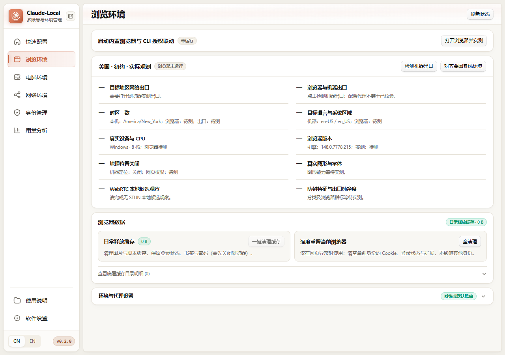
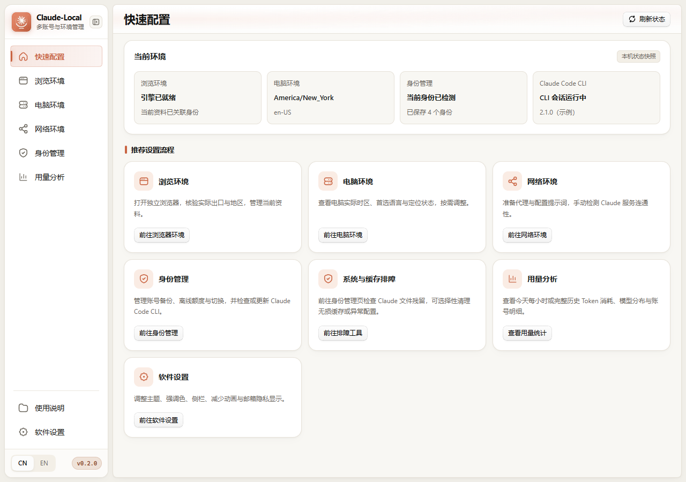
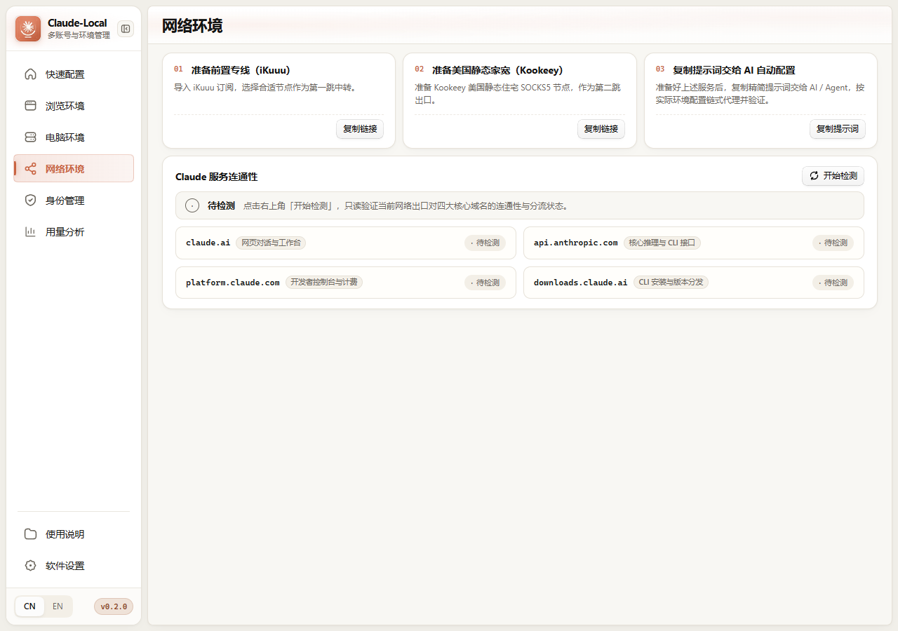
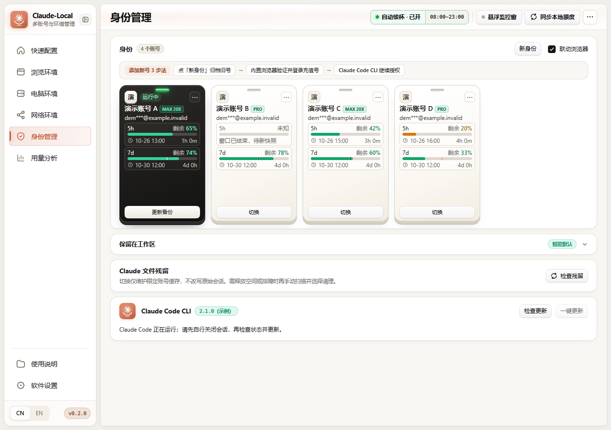
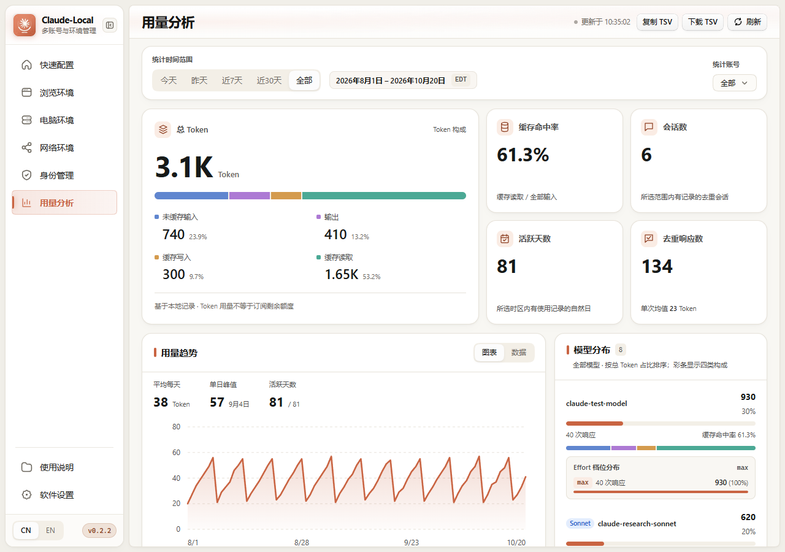

<!--
[INPUT]: Independent Windows x64 product, retained CCBaga/MIT attribution, 0.2.5 end-to-end anti-ban & Browser/System/Network/KYC hardening, persistent browser verification state, real Canvas FNV-1a fingerprinting, 4D cross-account sanitization, Free warming lifecycle protection, Smart Relay rotation, and HUD/Usage analytics polish.
[OUTPUT]: Bilingual-linked flagship project presentation foregrounding anti-ban engineering, isolated Fingerprint Chromium, KYC/WebRTC/DNS/IPv6 protection, zero-kill encrypted vault switching, and full-lifecycle warming cards.
[POS]: Primary repository introduction (Simplified Chinese default, linked to README_EN.md).
[PROTOCOL]: Keep private data, format compatibility and distribution boundaries in linked project documents.
-->

<div align="center">


# Claude-Local

**面向 Windows 10 / 11 x64 的 Claude 多账号全链路防关联工作台：硬件级指纹隔离伴生浏览器 · 跨域 KYC / WebRTC / DNS / IPv6 防泄露工程 · 零强杀四维消毒加密切号 · 全生命周期 Free 养号与智能接力**

基于开源项目 [CCBaga](https://github.com/liseami/CCBaga)（[@liseami](https://github.com/liseami)）二次开发并独立维护，保留原贡献者版权与 [MIT 许可](LICENSE) · 纯本地单机优先（Local-First） · 零云端凭据托管 · 绝不强杀运行中的 `claude.exe`

[](https://github.com/yq04/Claude-Local/releases/tag/v0.2.5)
[](https://github.com/yq04/Claude-Local/releases)
[](docs/DEVELOPMENT.md)
[](LICENSE)
[](docs/PROJECT_ORIGIN.md)

<p>
  <strong>🌐 语言 / Language：</strong>
  <strong>🇨🇳 简体中文（当前）</strong> · <a href="README_EN.md"><strong>🇺🇸 English</strong></a>
</p>

<p>
  <a href="https://github.com/yq04/Claude-Local/releases/download/v0.2.5/Claude-Local_0.2.5_x64-setup.exe"><strong>⬇️ 下载 v0.2.5 安装包 (Windows x64)</strong></a>
  ·
  <a href="https://github.com/yq04/Claude-Local/releases/tag/v0.2.5"><strong>✨ v0.2.5 Release 页面</strong></a>
  ·
  <a href="#-为什么选择-claude-local直击多账号风控四大痛点"><strong>🔥 四大防封壁垒</strong></a>
  ·
  <a href="#️-核心架构与界面全览"><strong>🖼️ 核心功能全览</strong></a>
  ·
  <a href="#-架构设计与数据安全边界"><strong>🛡️ 安全边界</strong></a>
</p>

</div>

---

## 📖 目录

- [🔥 为什么选择 Claude-Local？（直击多账号风控四大痛点）](#-为什么选择-claude-local直击多账号风控四大痛点)
- [✨ 八大核心能力矩阵](#-八大核心能力矩阵)
- [🖼️ 核心架构与界面全览](#️-核心架构与界面全览)
  - [1. 硬件级自洽的防关联伴生浏览器、20 项真机探针与断流急停（Kill-Switch）](#1-硬件级自洽的防关联伴生浏览器20-项真机探针与断流急停kill-switch)
  - [2. 跨域风控 / Persona KYC 核验、一键 Clash 防漏覆写与手机小火箭同源桥接](#2-跨域风控--persona-kyc-核验一键-clash-防漏覆写与手机小火箭同源桥接)
  - [3. 多身份加密保险库、跨账号四维消毒与全生命周期 Free 养号专区](#3-多身份加密保险库跨账号四维消毒与全生命周期-free-养号专区)
  - [4. 电脑/网络环境对齐、多账号智能接力与进程内 5h 自动续杯](#4-电脑网络环境对齐多账号智能接力与进程内-5h-自动续杯)
  - [5. 配套效率看板：桌面额度小窗（HUD）与本地用量价值分析](#5-配套效率看板桌面额度小窗hud与本地用量价值分析)
- [🧬 与 CCBaga 的来源关系与独立演进](#-与-ccbaga-的来源关系与独立演进)
- [📦 获取、安装与版本记录](#-获取安装与版本记录)
- [⚙️ 运行前置条件与源码构建](#️-运行前置条件与源码构建)
- [🛡️ 架构设计与数据安全边界](#️-架构设计与数据安全边界)
- [🔧 已知局限与常见问题排障](#-已知局限与常见问题排障)
- [🤝 参与贡献、开源许可与致谢](#-参与贡献开源许可与致谢)

---

## 🔥 为什么选择 Claude-Local？（直击多账号风控四大痛点）

在 Windows 桌面端同时维护多个 **Claude Code CLI** 与 **Claude Pro / Max / 待转正 Free** 账号时，绝大多数封号并非因为“额度用多了”，而是栽在 **跨域名出口分裂、底层网络泄露、劣质指纹伪装穿帮、以及切号本地残留污染** 四大隐蔽陷阱上。Claude-Local 从底层工程上逐一闭环解决：

| 真实风控痛点 | 传统做法为何频繁翻车 | Claude-Local 的系统级解决方案 |
| :--- | :--- | :--- |
| **1. 主站、Persona KYC、Stripe 绑卡与 Sentry 遥测出口分裂** | 代理规则只写了 `claude.ai`，结果触发 Persona 实名认证（`withpersona.com`）、Stripe 3DS 支付（`stripe.network`）或前端 Sentry 遥测（`sentry.io`）时走了直连或机场机房节点；或者拿手机用蜂窝流量/异地节点扫电脑上的 KYC 二维码，秒触发欺诈封号。 | **跨域同源核验 + 桌面/手机双端家宽桥接**：内置 `claude.ai` 与 `withpersona.com` 真实出口一致性实测；提供一键 **Clash/Mihomo 全局防漏覆写 YAML**（覆盖 Claude / Persona / Stripe / Sentry / WorkOS / Cloudflare 全域名同路锁死 + `ipv6: false` 防双栈旁路）；内置 **手机小火箭（Shadowrocket）同源家宽扫码桥接**，让手机与电脑 100% 共用同一静态住宅 IP 完成 KYC。 |
| **2. WebRTC STUN 穿透、Windows 双网卡明文 DNS 抢答与语言头穿帮** | 即使开了系统代理或普通 TUN，Windows 多宿主智能名称解析（SMHNR）仍会从物理网卡抢发明文 DNS；WebRTC 会探测物理网卡局域网/公网 IPv6；浏览器请求头残留 `en-US,zh-CN;q=0.9` 直接暴露真实区域。 | **内核三重强锁 + 严格路由体检 + 语言子标签净化**：伴生浏览器自动向每个资料写入 Google 官方 `WebRTC Network Limiter` 同款三重策略（禁非代理 UDP + 禁多路由枚举）与 `dns_prefetching.enabled = false`；规范注入 `--accept-lang=en-US,en` 杜绝中文子标签残留；自动审计本机 `tun.strict-route: true` 与远程加密 DoH。 |
| **3. 劣质防关联插件“假面具”硬件特征自相矛盾** | 普通反指纹插件强行把 UA 改成 macOS 或随机向 Canvas 涂抹噪点，但底层 `navigator.platform` 仍是 `Win32`、WebGL 仍暴露 `Direct3D11`、CPU 核数在 Worker 线程不一致，被 Cloudflare Turnstile 直接判定为高危脚本环境。 | **Fingerprint Chromium 硬件级自洽 + 按需防泄露断路器（Kill-Switch）**：每个身份/养号卡独占 `profile/` 目录与 32 位确定性种子；主线程、High-Entropy UA-CH、CPU 核数与真实 D3D11/WebGL 显卡渲染 100% 自洽；内置 **20 项真机探针（含 Canvas 2D FNV-1a 像素哈希与同 IP 机房分类）**；当检测到系统 TUN 掉线（5s）或出口国家漂移（60s）时，**Kill-Switch 自动保护性关闭浏览器**，阻断直连裸奔。 |
| **4. CLI 切号残留污染与强杀进程丢代码** | 直接替换 `.claude.json` 或用网关半途热换 Token，导致旧账号的设备 ID、缓存路径、组织 UUID 以及 `.jsonl` 会话中旧账号加密的 `thinking` 签名直接发给新账号，引发同人多号关联连坐。 | **零强杀进程锁 + 1,500+ 行跨账号四维消毒引擎**：切号前强制检查运行中的 `claude.exe`（绝不强杀终端会话），在加密 SQLite + `BAGAID01`（Zstd + AES-256-GCM）归档间执行原子切换，并自动对跨账号缓存、代理、仓库路径与历史会话签名执行四维消毒。 |

---

## ✨ 八大核心能力矩阵

| 核心支柱 | 工程实现与能力亮点 |
| :--- | :--- |
| **🌐 指纹隔离伴生浏览器与 20 项防封实测** | 每身份与养号卡独占 Chromium 资料目录与确定性种子；内置 **WebRTC 三重强锁、禁 DNS 预取、语言子标签净化、D3D11/WebGL/CPU/UA-CH 硬件自洽、Canvas 2D FNV-1a 像素哈希与 WebAudio 实测、同 IP 机房（Hosting）分类核验**；**`v0.2.5` 支持关闭浏览器或跨菜单切页后按 `(槽位, 配置)` 自动保留 10 项核验绿勾与机器出口结果**。 |
| **⚡ 伴生浏览器防泄露断路器（Kill-Switch）** | 按需激活（无受管浏览器运行时零开销）：后台以 **5s 周期监测系统 TUN 虚拟网卡掉线**、**60s 周期监测出口国家漂移**；一旦异常立即优雅关闭全部受管伴生浏览器并点亮托盘/横幅红色告警，恢复网络后一键重开，**全程绝不中断正在运行的 `claude.exe` 终端会话**。 |
| **🛡️ 跨域 KYC 核验、桌面 Clash 覆写与手机扫码桥接** | 第 1 步进页自动审计本机远程 DNS 锁、`strict-route` 与 KYC 分流配置，第 2 步实测比对 `claude.ai` 与 `withpersona.com` 真实出口 IP 及家宽属性；提供 **桌面端一键 Clash/Mihomo 防漏覆写 YAML（含 `ipv6: false`、封锁 STUN/QUIC/Fake-IP、`:7899` 独立监听与全域名同源规则）** 及 **手机小火箭（Shadowrocket / Clash Mi / Stash / sing-box）双栏扫码桥接**。 |
| **🔐 多身份加密保险库与跨账号四维消毒** | 100% 兼容 `BAGAID01` / `.baga`（Zstandard + AES-256-GCM）与 SQLite `user_version = 3`；切号前执行 `claude.exe` 进程锁保护，自动清理跨账号缓存、代理配置、项目路径与 `.jsonl` 历史签名残留；支持涵盖 **加密身份库 + 浏览器种子 + 养号卡片 + 手动订阅记录** 的全链路 `.clbackup` 口令加密备份与隔离救援恢复。 |
| **🌱 Free 养号卡片专区与全生命周期守护** | 独立于 CLI 正式身份库的 **Free 养号专区**（支持 `待注册 → 已过 KYC → Free 养号中 → Pro 待转正` 四阶段与自然日 `Day N` 追踪）；首次实测通过自动锁定常驻国家与 IANA 时区，后续打开前若检测到跨国或同国跨时区漂移自动弹窗拦截；内置阶段化防封 SOP 指南，升级 Pro 后一键零重绑无损转正为 CLI 身份。 |
| **🔀 多账号智能接力与轮换（Smart Relay）** | 借鉴 [magpie](https://github.com/yetone/magpie) 的顺位评估模型（默认关闭，按需开启）；支持 **智能（三级余量池 + 最快重置优先）/ 按顺序 / 轮流 / 余量优先 / 重置前用完** 五大策略、限流顺位保持或沉底、首选主力号滞回恢复提醒与一键安全切号接力。 |
| **⏱️ 进程内原生 5h 自动续杯调度** | 由 Rust 进程内唯一调度器驱动，支持自定义生效时段（如 `08:00–23:00`）、主力号阈值预热与逐账号阶梯退避；严格校验服务端 `new_5h_confirmed` 窗口锚点，不注册任何 Windows 后台服务或计划任务，退出软件即刻停止。 |
| **🖥️ 桌面额度小窗（HUD）与本地用量价值分析** | 配套提供三态桌面悬浮小窗（展开 / 紧凑 / 侧边磁吸自动隐藏胶囊，展示 5h/7d 剩余额度、耗尽预估 ETA、近 10 分钟 `tok/m` 速率与真实 5h 四类 Token 缓存命中率）及本地去重账本仪表盘（按官方 API 单价折算美元等效花费 `$`、缓存节省 `$` 与模型/Effort 分布）。 |

---

## 🖼️ 核心架构与界面全览

> **截图版本与隐私说明**：界面截图采集自隔离环境下的真实前端，账号、组织、用量与 CLI 版本均为**合成演示数据**；邮箱仅使用保留域名 `@example.invalid` 并启用隐私遮罩，不含任何真实凭据、代理地址或个人路径。最新 `v0.2.5` 增强详见上方能力表与 [0.2.5 发布说明](docs/RELEASE_NOTES_0.2.5.md)。

### 1. 硬件级自洽的防关联伴生浏览器、20 项真机探针与断流急停（Kill-Switch）



- **双上下文清晰归属与按需启动**：顶栏明确区分「当前 CLI 身份」与「已选浏览器资料（CLI 身份或养号卡）」，支持一键「重新打开实测页」、「正常退出浏览器」与「返回当前 CLI 浏览器并核验」；日常启动主程序绝不后台自启浏览器。
- **10 大类 / 20 项硬件与网络深度核验（`v0.2.5` 升级）**：
  - **网络与出口层**：核验目标地区网络出口、浏览器与机器出口 IP 一致性、同 IP 机房（Hosting）/ ISP 住宅属性分类（`api.ipquery.io` 词边界精准识别）、以及分阶段无 STUN WebRTC 本地候选观察。
  - **区域与时钟层**：核验网页 IANA 时区、出口时区与本机系统时区三方对齐，验证 `Intl` 时区偏移与本地时钟一致性，核验网页语言列表纯净度（`--accept-lang=en-US,en` 无次选中文残留）与地理位置权限关闭（`denied`）。
  - **硬件与反自动化层**：核验本机与网页上报的操作系统内核版本及 CPU 逻辑核数一致性、Chromium 引擎版本、`navigator.webdriver = false` 隐藏状态、真实 D3D11/ANGLE 硬件显卡渲染器（拦截 `SwiftShader` 等软件光栅化）、桌面端 UA-CH 与屏幕色深（`≥24-bit`），以及 **Canvas 2D FNV-1a 真实像素指纹哈希（`Canvas #xxxxxxxx`）与 `OfflineAudioContext` 音频节点图实测**。
- **跨菜单与关窗自动保留实测结果（`v0.2.5` 新增）**：实测通过后，即使关闭伴生浏览器、切换左侧菜单页面或执行日常图片/脚本缓存清理，10 项绿勾（`✓ 检测通过`）与机器出口结果依然按 `(槽位, 配置)` 完整保留，仅在修改指纹设置、深度重置资料或触发断路器时自动失效。
- **按需无阻断防泄露断路器（Kill-Switch）**：当受管浏览器运行期间检测到系统 TUN 虚拟网卡断开（连续 2 次 · 5s 周期）或机器出口国家偏离锁定国家（60s 周期）时，立即优雅关闭受管浏览器并弹出醒目告警横幅，**全程绝不中断正在运行的 `claude.exe` 会话**。

---

### 2. 跨域风控 / Persona KYC 核验、一键 Clash 防漏覆写与手机小火箭同源桥接

| 快速配置（四卡独立状态读取与工作区导流） | 网络环境（四大官方域名只读并发探针与链式家宽 AI 提示词） |
| :---: | :---: |
|  |  |

- **「风控验证」两步闭环体检**：
  - **第 1 步 · 本机静态防漏配置（进页自动检查）**：自动扫描浏览器远程 DNS 锁（`socks5h` / `--host-resolver-rules`）、Mihomo 运行期 `tun.strict-route: true` + 远程加密 DoH，以及 `claude.ai` / `withpersona.com` / `:7899` 独立监听规则（支持识别 `rules`、`prepend-rules` 与 `append-rules`）；若 `strict-route` 未开启，提供一键「修复 Strict-Route」分层向导与原位复核。
  - **第 2 步 · 跨域真实出口与家宽属性实测**：一键并发实测 `claude.ai` 主站链路与 `withpersona.com` KYC 链路的真实出口 IP、国家、ASN 及机房/住宅属性，确保登录、绑卡与实名认证 100% 走同一静态住宅 IP。
- **桌面端 Clash Verge / Mihomo 一键防漏覆写配置（`.yaml`，`v0.2.5` 增强）**：
  - 点击「查看一键覆写配置 (.yaml)」或「复制覆写配置 (.yaml)」，直接生成可粘贴至 Clash Verge 全局扩展覆写（Merge）的完整配置：
    1. **封死双栈 IPv6 旁路**：显式设置顶层 `ipv6: false` 与 `dns.ipv6: false`，防止校园网/双栈宽带下 IPv6 流量绕过纯 IPv4 静态家宽；
    2. **阻断 WebRTC STUN/TURN、QUIC 与 Fake-IP 泄露**：强制拦截 `UDP 443`、`UDP 3478/19302/5349`、`DOMAIN-KEYWORD,stun` 与 `198.18.0.0/15`；
    3. **全量关联域名同源锁死**：将 `claude.ai`、`claude.com`、`anthropic.com`、`withpersona.com`、`persona.org`、`stripe.com`、`stripe.network`、`sentry.io`、`workos.com`、`authkit.app`、`challenges.cloudflare.com`、`statsig.com`、`intercom.io` 及出口核验域统一绑定至同一静态家宽出口与 `:7899` 纯 TCP 监听端口。
- **手机端小火箭（Shadowrocket）同住宅出口双栏扫码桥接**：
  - 当网页弹出 Persona 扫码拍照认证时，支持「局域网同住宅桥接」与「独立直连前置代理链」两种模式；支持直接粘贴完整 SOCKS5 代理串自动拆解主机/端口/账号/密码，在内存中生成离线二维码，确保手机与电脑共用同一静态家宽 IP。
- **「电脑环境」与「网络环境」一键协同**：
  - **电脑环境**：一键将 Windows 系统时区、首选语言（`en-US`）、区域格式（`en_US`）及系统定位服务关闭状态对齐至目标出口地区，所有系统修改均保存快照并支持一键还原；内置 Claude Code CLI 版本检查与四维残留精细清理。
  - **网络环境**：对 `claude.ai`、`api.anthropic.com`、`console.anthropic.com` 与安装包域执行只读并发探测，并提供针对「机场节点 + Kookeey 静态家宽 `dialer-proxy` 链式代理」的一键 AI 自动配置提示词。

---

### 3. 多身份加密保险库、跨账号四维消毒与全生命周期 Free 养号专区



- **`180×286` 专属身份工牌与零强杀安全切换**：
  - 当前运行身份置顶并带呼吸绿光，`PRO` / `MAX` 徽章旁直观显示 `MM/DD` 自动续订或到期日；卡片菜单内置 **「进入 Claude.ai（独立浏览器）」**、**「打开官方用量页」** 与 **「返回 CLI 浏览器」**。
  - 点击「切换」或「新身份」时，强制检查 `claude.exe` 运行状态，自动完成旧身份加密归档（`.baga`）、跨账号四维残留消毒与目标身份凭据还原；若勾选「联动浏览器」，切号后自动调起对应槽位的隔离浏览器。
- **独立的「Free 养号卡片」全生命周期专区**：
  - 每张养号卡拥有独立浏览器槽位与确定性指纹种子，支持 `待注册 → 已过 KYC → Free 养号中 → Pro 待转正` 四阶段与自然日 `Day N` 追踪，养号操作绝不触碰当前 CLI 身份指针。
  - **常驻国家/时区自动锚定与漂移拦截（`v0.2.5` 增强）**：首次浏览器核验通过后自动锁定常驻国家与 IANA 时区；后续打开前若检测到跨国或同国跨州时区漂移（如 `US (America/Los_Angeles)` → `US (America/New_York)`），自动弹窗预警拦截。
  - **阶段防封 SOP 指南与无损转正 Pro**：内置待注册、刚过 KYC 72h 观察期、日常轻度使用与升级绑卡四阶段防封 SOP；网页升级 Pro 后一键「转正为 CLI 身份」，100% 继承原浏览器槽位、种子与登录 Cookie。

---

### 4. 电脑/网络环境对齐、多账号智能接力与进程内 5h 自动续杯

- **多账号智能接力与轮换（Smart Relay，默认关闭）**：
  - 在「身份管理」顶栏右侧胶囊 `[• 智能接力 | 策略]` 或「软件设置」中按需开启；平铺展示全部账号 `5h / 7d` 余量，提供 **智能 / 按顺序 / 轮流 / 余量优先 / 重置前用完** 5 种路由策略、限流顺位处理与 **首选账号（Preferred）冷却恢复滞回切回提醒**，点击一键接力仍走标准安全切号与四维消毒流程。
- **Rust 进程内原生 5h 自动续杯调度**：
  - 支持在顶栏 `[• 自动续杯 | 20:00–23:00]` 自定义生效时段；当账号 5h 窗口到期后，在生效时段内自动发送极简 ping 提前开启新一轮 5h 计时窗口，无需注册任何系统后台服务。

---

### 5. 配套效率看板：桌面额度小窗（HUD）与本地用量价值分析



- **桌面实时额度小窗（`v0.2.5` 界面与数据校准）**：
  - 顶栏开关统一为 **`额度小窗`**（左侧绿/灰圆点指示并支持直接点击切换）；支持展开、紧凑与贴边自动隐藏胶囊三态，置顶、位置锁定、18px 边缘磁吸与 50%–100% 透明度无级调节。
  - **紧凑身份头栏 + 真实 5h 缓存命中率 + 耗尽预估 ETA**：左侧紧凑排列 `[账号名 ✓ [Pro]]`，右侧显示实时会话状态；5h 进度条内置时间刻度与耗尽预估（`预计 Xh Ym 后耗尽` / `余量充裕`），并直接聚合 5h 窗口内真实四类 Token 计算缓存命中率，与「用量分析」页 100% 同口径。
- **「用量分析」黄金比例仪表盘（`v0.2.5` 重构）**：
  - 采用左大卡（总 Token + 四色构成 `2×2` 网格）+ 右侧等高 `2×2` 核心指标卡（**API 等效花费 `$`**、**缓存节省 `$`**、**缓存命中率 `%` + 复用倍数**、**日均/时均等效花费 `$`**），搭配用量趋势面积图、模型/Effort 分布双轨进度条、多账号对比与 TSV 导出。

---

## 🧬 与 CCBaga 的来源关系与独立演进

本项目**基于开源项目 [CCBaga](https://github.com/liseami/CCBaga)（由 [@liseami](https://github.com/liseami) 与社区贡献者开发）进行二次开发**。我们衷心感谢原作者在多账号归档格式与浏览器隔离工作流上的开创性设计。

Claude-Local 在完整保留上游数据格式兼容性的前提下，围绕 **Windows 10 / 11 x64 桌面工程可靠性、硬件级自洽伴生浏览器与 20 项防封实测、WebRTC 三重强锁与按需防泄露断路器（Kill-Switch）、跨域风控 / Persona KYC / 双栈 IPv6 防旁路与手机同源家宽桥接、Free 养号全生命周期、多账号智能接力、进程内 5h 自动续杯以及桌面额度小窗 / 美元花费分析** 进行了独立重构与扩展：

| 维度 | 继承自 CCBaga 的基线设计 | Claude-Local (`v0.2.5`) 的独立演进与增强 |
| :--- | :--- | :--- |
| **防关联浏览器与断路器** | 基础隔离浏览器资料与环境检测 | **Fingerprint Chromium 深度加固**：新增 Google 官方 `WebRTC Network Limiter` 三重 `Preferences` 强锁、`dns_prefetching.enabled = false`、`--accept-lang=en-US,en` 语言子标签防泄露、Canvas 2D FNV-1a 真实像素哈希与 WebAudio 节点图实测、同 IP 机房词边界分类、**关窗/跨页保留 `(槽位, 配置)` 实测结果**，以及 **按需无阻断防泄露断路器（Kill-Switch，5s TUN 掉线 / 60s 国家漂移急停，零 CLI 干扰）**。 |
| **风控 / KYC 与防泄露工程** | — | 全新 **「风控验证」工作台**：两步本机静态体检（含 `strict-route` 闭环向导）+ `claude.ai` 与 `withpersona.com` 跨域真实出口实测；内置 **桌面端一键 Clash/Mihomo 防漏覆写 YAML（含 `ipv6: false` 双栈防旁路、STUN/QUIC/Fake-IP 封锁、`:7899` 独立监听与 Claude/Persona/Stripe/Sentry/WorkOS 全域名同源锁死）** 及 **手机小火箭双栏扫码同源桥接**。 |
| **加密保险库与四维消毒** | `BAGAID01` 魔数、`.baga` 归档、SQLite `user_version = 3`、账号 HMAC 与浏览器种子域 | **100% 向下兼容已有身份库与浏览器种子**；新增 Zstandard 流式压缩、有界 tar 解包限额、`ScratchGuard` 暂存自清理、32 字节主密钥强校验、1,500+ 行跨账号缓存/代理/路径/会话签名四维消毒，以及覆盖 **加密身份库 + 养号卡片 + 手动订阅记录的全链路 `.clbackup` 口令加密备份与隔离恢复副本**。 |
| **Free 养号全生命周期与智能接力** | 单一身份列表 | 新增 **独立 Free 养号卡片专区**（四阶段进度、常驻国家/IANA 时区自动锚定与打开前跨国/跨州漂移拦截、阶段防封 SOP 指南、零重绑继承槽位/种子转正 Pro）；新增 **Magpie 风格多账号智能接力与轮换**（默认关闭，五大路由策略 + 首选号滞回恢复 + 一键安全切号）。 |
| **自动续杯、额度小窗与价值分析** | 基础身份状态管理 | 建立 **CLI 被动额度观察 + Python 单写者账本 + Rust 进程内唯一 5h 自动续杯调度器**（零 `.claude.json` 写入）；自研 **多模态桌面额度小窗（HUD，含 5h 真实四类 Token 缓存命中率与耗尽 ETA）** 与 **官方 API 美元等效花费（`$`）/ 缓存节省分析仪表盘**。 |

---

## 📦 获取、安装与版本记录

### 1. 下载最新安装包（`v0.2.5`）

| 发行资产 | 适用系统 | 文件大小 | SHA-256 校验和 |
| :--- | :--- | :--- | :--- |
| **[Claude-Local_0.2.5_x64-setup.exe](https://github.com/yq04/Claude-Local/releases/download/v0.2.5/Claude-Local_0.2.5_x64-setup.exe)** | Windows 10 / 11 (64-bit x64) | `140,847,905` 字节 (`134.32` MiB) | `16c9320d05a2100047c602331e22f9318dbba93a712100185b9bab4aca344e95` |

下载后在 PowerShell 中计算 SHA-256，并与 [v0.2.5 Release](https://github.com/yq04/Claude-Local/releases/tag/v0.2.5) 公布的校验值比对：

```powershell
Get-FileHash .\Claude-Local_0.2.5_x64-setup.exe -Algorithm SHA256
# 预期 SHA-256：16c9320d05a2100047c602331e22f9318dbba93a712100185b9bab4aca344e95
```

### 2. 安装与无损升级说明

1. **安装位置与标识**：采用当前用户模式 NSIS 安装程序，默认安装至 `%LOCALAPPDATA%\Programs\Claude-Local`；主程序为 `claude-local.exe`，应用包标识为 `ai.local.claude-local`，伴侣浏览器注册名为 `Claude-Local-Browser`。
2. **用户数据目录**：所有加密身份库、主密钥、额度/用量账本、外观壁纸配置与隔离浏览器个人资料均独立保存在 `%APPDATA%\ai.local.claude-local`。
3. **平滑升级**：从 `0.1.x` 或 `0.2.x` 升级至 `0.2.5` 保留已有身份库、密钥与浏览器登录状态，无需重建身份；升级过程不强制关闭正在运行的 `claude.exe` 会话。建议升级前在「软件设置 → 数据管理」中导出一份口令加密备份。

### 3. 发行版本演进记录

| 版本 | 发布日期 | 核心演进内容 | 详细文档 |
| :--- | :--- | :--- | :--- |
| **`v0.2.5`** *(Latest)* | 2026-11-01 | **全链路抗风控与防关联环境加固（`--accept-lang` 子标签防泄露、禁 DNS 预取、双栈 `ipv6: false` 防旁路、Claude/Persona/Stripe/Sentry/WorkOS 全域名同源分流）**、**伴生浏览器实测结果跨页/关窗自动保留与 Canvas 2D FNV-1a 真实像素哈希**、**桌面额度小窗真实 5h 缓存命中率校准与用量分析仪表盘重构** | [发布说明](docs/RELEASE_NOTES_0.2.5.md) |
| **`v0.2.4`** | 2026-10-31 | Magpie 风格多账号智能接力与轮换（默认关闭，五大路由策略 + 首选号恢复回切）、伴生浏览器 WebRTC Network Limiter 三重防漏强锁 + 桌面端 Clash/Mihomo 一键防漏覆写 YAML、官方 API 美元等效花费（`$`）与缓存节省分析回归、小火箭双栏扫码桥接与养号一键返回 CLI 浏览器 | [发布说明](docs/RELEASE_NOTES_0.2.4_SMART_RELAY.md) |
| **`v0.2.3`** | 2026-10-30 | 伴生浏览器按需无阻断防泄露断路器（Kill-Switch）、Mihomo `strict-route` 分层闭环修复向导、养号卡片国家/时区锁定与打开前防漂移核验、阶段防封 SOP 指南、高负荷速率提示与全链路加密备份扩展 | [发布说明](docs/RELEASE_NOTES_0.2.3_SECURITY.md) · [交付核验](docs/RELEASE_VERIFICATION_0.2.3_SECURITY.md) |
| **`v0.2.2`** | 2026-10-29 | 身份卡片 `PRO`/`MAX` 右侧 `MM/DD` 订阅到期显示与手动充值补录、「风控验证」跨域出口与手机同住宅出口 KYC 桥接、统计身份独立登记与受控续聊归属、四类 Token 构成与共享账本 HUD | [发布说明](docs/RELEASE_NOTES_0.2.2_USAGE.md) |
| **`v0.2.0`** | 2026-10-26 | Token Monitor 风格多模态悬浮监控小窗（置顶/锁定/磁吸/贴边隐藏/透明度/主题联动）、勾选联动浏览器切号自动弹出验证页、全工作区界面减负与导航栏美化 | [更新说明](docs/UI_MONITOR_0.2.0.md) · [发布说明](docs/RELEASE_NOTES_0.2.0.md) · [交付核验](docs/RELEASE_VERIFICATION_0.2.0.md) |
| **`v0.1.0` – `v0.1.5`** | 2026-10-26 | 多身份加密保险库基线、存储加固、网页额度与 CLI 授权分离、分阶段无 STUN WebRTC 本地候选观察、同 IP 机房 CSP 闭环与 20 项浏览器核验 | [首发说明](docs/RELEASE_NOTES_0.1.0.md) · [界面精简说明](docs/UI_POLISH_0.1.5.md) |

---

## ⚙️ 运行前置条件与源码构建

### 运行环境要求

1. **操作系统**：Windows 10 / 11 64-bit (x64)。
2. **Microsoft Edge WebView2 Runtime**：Windows 10（更新版）与 Windows 11 默认内置。
3. **Python 3.10+ 与 `cryptography` 库**（用于外部额度采集、在线查询与口令备份加解密；CI 使用 Python 3.13 验证）：
   ```powershell
   python -m pip install cryptography
   ```

### 从源码编译与验证

详细开发规范请参阅 [开发说明](docs/DEVELOPMENT.md)。在准备好 Bun、Rust（MSVC）、Python 3 与 Visual Studio C++ Build Tools 后：

```powershell
# 1. 安装前端与测试依赖
bun install --frozen-lockfile
python -m pip install -r scripts/requirements-ci.txt

# 2. 运行前后端与 Windows 合成测试套件（绝不触碰真实账号数据）
bun test
cargo test --locked --manifest-path src-tauri/Cargo.toml --bin claude-local
python scripts/test-windows.py

# 3. 编译本地 Release 宿主或部署到本机安装目录
bun run build:local
bun run deploy:local

# 4. 构建经隐私探针审计的完整 Windows NSIS 安装包（需先准备固定版本浏览器内核与 7z.exe）
python scripts/fetch-browser.py
bun run build:windows
```

---

## 🛡️ 架构设计与数据安全边界

- **纯本地单机存储（Local-First）**：所有身份档案、养号卡片、手动订阅元数据、主密钥、SQLite 数据库与浏览器资料均保存在本机 `%APPDATA%\ai.local.claude-local`，无任何云端同步或遥测上传。
- **被动读取与单写者账本**：默认额度同步仅被动读取 CLI 本地文件，绝不向 `.claude.json` 写入任何字段；外部额度账本 `quota_ledger.json` 由 Python 独占写入（跨进程文件锁 + 原子替换），Rust 端只读并在内存中按账号指纹合并。
- **严格账号隔离优于新鲜度**：每次在线查询或自动续杯均冻结目标账号 `quota_identity` 指纹并核验 OAuth Profile 与组织 UUID；任何指纹不匹配或未验证响应均被拒绝，绝不跨账号串写或降级直连。
- **按需防泄露断路器与运行会话保护**：伴生浏览器断路器（Kill-Switch）仅在受管浏览器运行且确认 TUN 掉线或出口国家漂移时执行单次急停与醒目提醒，用户恢复网络后点击即可重开；无论是断路器触发、养号网页操作、切号、清理残留还是更新 CLI，**均绝不停止、中断或强杀正在运行的 `claude.exe` 会话**。
- **自动续杯的透明边界**：自动续杯与手动唤醒本质上是向目标账号发送极简请求以触发服务端新 5h 窗口计时，会产生少量正常 Token 消耗；它属于本地调度辅助工具，不提供凭空增加额度或规避官方服务条款的承诺。

---

## 🔧 已知局限与常见问题排障

- **平台范围**：当前仅构建并验证 **Windows 10 / 11 x64** 平台，暂不分发 macOS 或 Linux 安装包。
- **单身份便携包（bagapack）**：单账号独立便携导出尚在规划中；当前已提供完整的**全链路 `.clbackup` 口令加密备份（覆盖加密身份库、浏览器种子、养号卡片与手动订阅记录）、完整性预检与隔离恢复副本**。
- **未签名安装包提示**：安装包由维护者独立构建且未附加商业代码签名证书，首次运行若遇 Windows SmartScreen 提示，请核对上方 SHA-256 校验和后选择「仍要运行」。
- **常见排障文档**：
  - 🌱 [Free 养号身份卡与生命周期说明](docs/FEATURE_NOTES_WARMING_CARDS.md)
  - 🔗 [网页额度与 CLI 授权恢复说明](docs/CONNECTION_RECOVERY.md)
  - 📊 [Token 用量统计与时区口径说明](docs/USAGE_STATISTICS.md)
  - 🧭 [与 CCBaga 的定位与取舍对比](docs/CCBAGA_COMPARISON.md)
  - 📜 [分发与第三方许可边界](docs/DISTRIBUTION.md)

---

## 🤝 参与贡献、开源许可与致谢

欢迎通过 [GitHub Issues](https://github.com/yq04/Claude-Local/issues/new/choose) 报告问题或提出改进建议，或参阅 [参与贡献指南](CONTRIBUTING.md) 提交 Pull Request（请务必使用合成测试数据并确保信息已脱敏）。

### 致谢与第三方归属

- **[CCBaga](https://github.com/liseami/CCBaga)**：感谢项目作者 [@liseami](https://github.com/liseami) 及贡献者，本项目继承了其 MIT 授权的核心架构与身份归档协议。
- **[magpie](https://github.com/yetone/magpie) 与 [agent-route](https://github.com/ryuu-restart/agent-route)**：为多账号智能接力与轮换策略、首选号滞回回切，以及桌面端 Clash/Mihomo 防 WebRTC STUN 与双栈泄露分流规则提供了重要设计参考。
- **[ccusage](https://github.com/ccusage/ccusage)、[Claude-Code-Usage-Monitor](https://github.com/Maciek-roboblog/Claude-Code-Usage-Monitor)、[CPA-Manager-Plus](https://github.com/seakee/CPA-Manager-Plus) 与 Token Monitor**：为本地 Token 账本聚合、官方 API 美元花费估算、用量分析界面排布与桌面悬浮监控小窗（HUD）提供了设计参考。
- **[Fingerprint Chromium](https://github.com/adryfish/fingerprint-chromium)**、**vendor/cromma-ui**、**[LobeHub lobe-icons](https://github.com/lobehub/lobe-icons)** 与 **[Unicode CLDR 48](https://github.com/unicode-org/cldr)**：各自遵循其原始许可证条款，完整声明请参阅 [LICENSE](LICENSE) 与 [NOTICE.md](NOTICE.md)。

> **免责声明**：Claude-Local 为独立开发的开源辅助工具，与 Anthropic 官方及 CCBaga 原作者均无商业合作、官方关联或背书关系。“Claude”、“Anthropic” 等名称与商标归其各自所有者所有。
