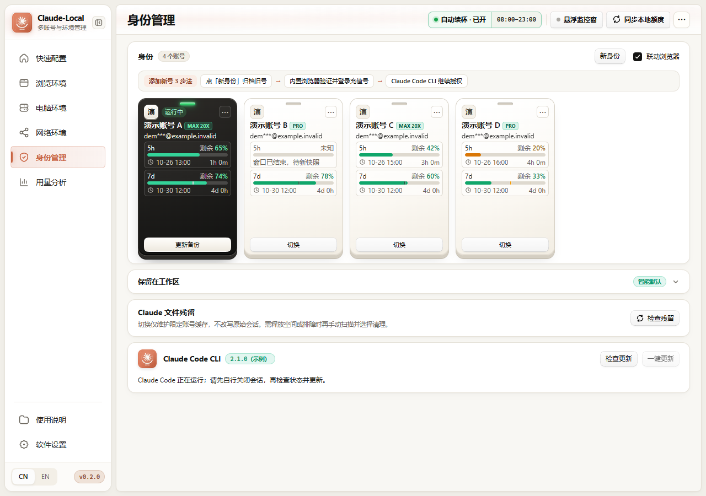
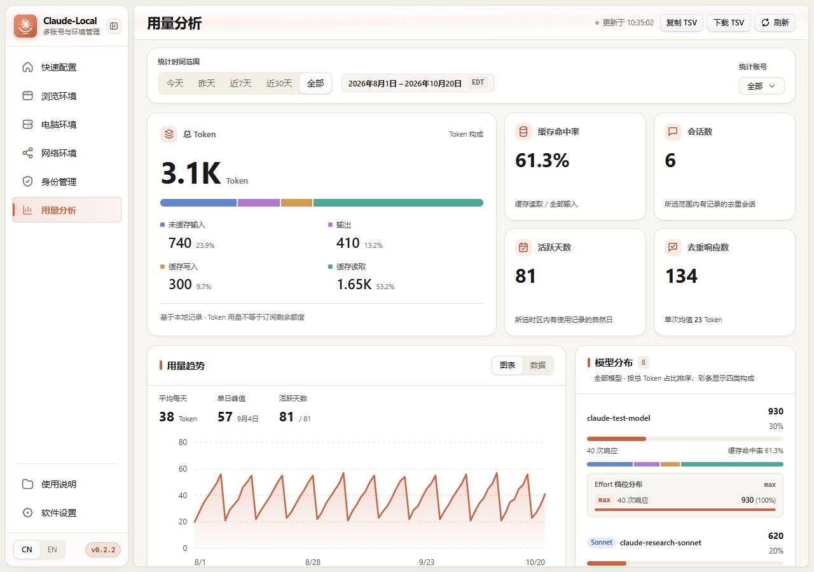
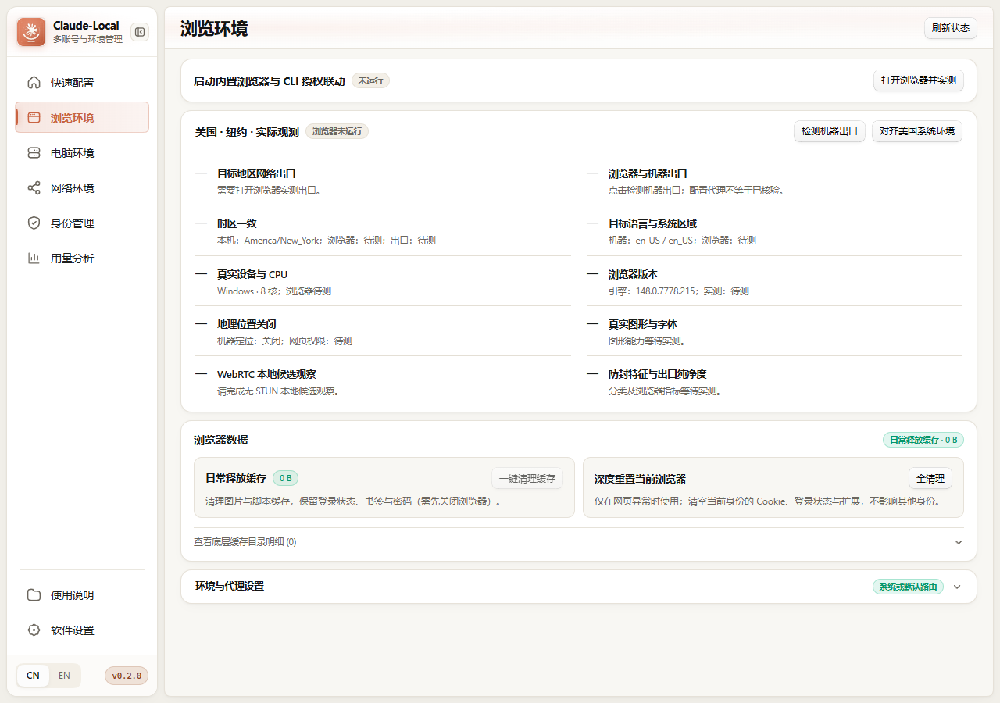
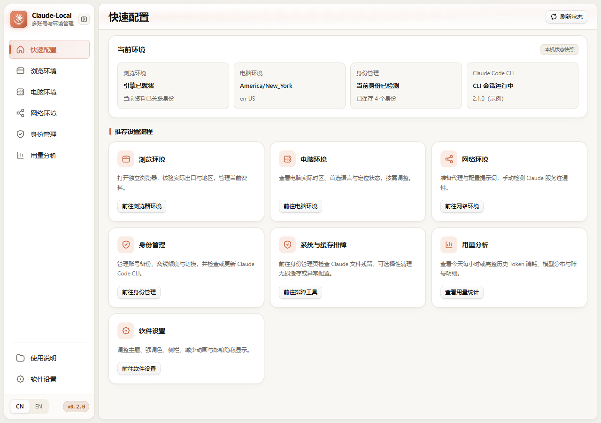
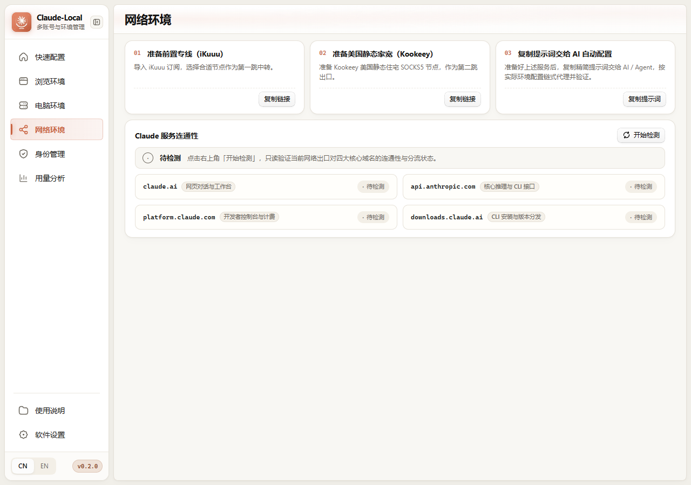

<!--
[INPUT]: Independent Windows x64 product, retained CCBaga/MIT attribution, 0.2.2 usage reliability and mixed-version synthetic-data previews.
[OUTPUT]: Bilingual-linked flagship project presentation, architectural lineage, feature matrix, visual tour, installation workflow and runtime boundaries.
[POS]: Primary repository introduction (Simplified Chinese default, linked to README_EN.md).
[PROTOCOL]: Keep private data, format compatibility and distribution boundaries in linked project documents.
-->

<div align="center">


# Claude-Local

**面向 Windows 10 / 11 x64 的 Claude 多账号加密工作台、Token 用量分析、5h 自动续杯调度与指纹隔离浏览器**

基于开源项目 [CCBaga](https://github.com/liseami/CCBaga)（[@liseami](https://github.com/liseami)）二次开发并独立维护，保留原贡献者版权与 [MIT 许可](LICENSE) · 纯本地单机优先（Local-First） · 零云端凭据托管 · 绝不强杀运行中的 `claude.exe`

[](https://github.com/yq04/Claude-Local/releases/tag/v0.2.2)
[](https://github.com/yq04/Claude-Local/releases)
[](docs/DEVELOPMENT.md)
[](LICENSE)
[](docs/PROJECT_ORIGIN.md)

<p>
  <strong>🌐 语言 / Language：</strong>
  <strong>🇨🇳 简体中文（当前）</strong> · <a href="README_EN.md"><strong>🇺🇸 English</strong></a>
</p>

<p>
  <a href="https://github.com/yq04/Claude-Local/releases/download/v0.2.2/Claude-Local_0.2.2_x64-setup.exe"><strong>⬇️ 下载 v0.2.2 安装包 (Windows x64)</strong></a>
  ·
  <a href="https://github.com/yq04/Claude-Local/releases/tag/v0.2.2"><strong>✨ v0.2.2 Release 页面</strong></a>
  ·
  <a href="#-界面与核心功能全览"><strong>🖼️ 界面预览</strong></a>
  ·
  <a href="#-与-ccbaga-的来源关系与独立演进"><strong>🧬 来源与演进</strong></a>
  ·
  <a href="#-架构设计与数据安全边界"><strong>🛡️ 安全边界</strong></a>
</p>

</div>

---

## 📖 目录

- [✨ 核心特色一览](#-核心特色一览)
- [🖼️ 界面与核心功能全览](#️-界面与核心功能全览)
  - [1. 身份管理工作台](#1-身份管理工作台identity-management)
  - [2. 用量分析与 Token 构成](#2-用量分析与-token-构成usage-analytics)
  - [3. 新一代 Token Monitor 风格桌面悬浮监控窗（HUD）](#3-新一代-token-monitor-风格桌面悬浮监控窗hud)
  - [4. 身份绑定的隔离浏览环境与防封实测](#4-身份绑定的隔离浏览环境与防封实测browser-environment)
  - [5. 快速配置与网络连通性诊断](#5-快速配置与网络连通性诊断quick-setup--network)
- [🧬 与 CCBaga 的来源关系与独立演进](#-与-ccbaga-的来源关系与独立演进)
- [📦 获取、安装与版本记录](#-获取安装与版本记录)
- [⚙️ 运行前置条件与源码构建](#️-运行前置条件与源码构建)
- [🛡️ 架构设计与数据安全边界](#️-架构设计与数据安全边界)
- [🔧 已知局限与常见问题排障](#-已知局限与常见问题排障)
- [🤝 参与贡献、开源许可与致谢](#-参与贡献开源许可与致谢)

---

## ✨ 核心特色一览

Claude-Local 专为在 Windows 桌面端高频使用 **Claude Code CLI** 与 **Claude Pro / Max** 多账号的开发者打造，将身份隔离、额度观测、Token 分析与环境核验整合为一套本地工作台：

| 核心模块 | 解决痛点与能力亮点 |
| :--- | :--- |
| **🔐 多身份加密保险库与安全切换** | 保留 `BAGAID01` / `.baga`（Zstandard + AES-256-GCM）加密归档与 SQLite `user_version = 3` 架构；切号前强制执行 `claude.exe` 进程锁检查（绝不暴力强杀终端会话），自动执行跨账号缓存/代理/仓库路径四维消毒与无损合并；支持 PBKDF2 口令整库加密备份与隔离救援副本恢复。 |
| **📊 Token 用量与账号分析** | 本地去重账本展示 **未缓存输入、输出、缓存写入、缓存读取** 四类 Token，以及缓存命中率、明确记录的会话数和活跃天数；新登录账号无需先保存归档即可登记统计身份。支持全部模型与已记录 Effort 档位分布、动态账号筛选、IANA/DST 时区与 TSV 导出。 |
| **🖥️ 桌面悬浮监控小窗（HUD）** | 使用与用量页相同的账本，按当前账号显示 **滚动近 5 小时 Token 构成、近 10 分钟平均速率、去重响应与缓存命中率**；支持展开、紧凑与侧边胶囊三态，以及置顶、位置锁定、边缘磁吸、贴边自动隐藏、50%–100% 透明度和主题/壁纸同步。 |
| **⏱️ 进程内原生 5h 自动续杯调度** | 由 Rust 进程内唯一调度器驱动，支持自定义生效时段（如 `08:00–23:00`）、主力号阈值联动与逐账号阶梯退避；严格校验新鲜 `new_5h_confirmed` 服务端窗口，无需注册 Windows 系统服务或计划任务，最小化到托盘保持工作、退出软件即刻停止。 |
| **🌐 隔离伴侣浏览器与切号自动联动** | 为每个身份绑定独立 Chromium 资料目录与确定性指纹种子；**勾选「联动浏览器」切号时，自动拉起新切入账号对应的内置浏览器环境检测与登录验证页**；内置 Chromium AppContainer 缓存 DACL 权限自愈、分阶段无 STUN WebRTC 检测与同 IP 机房/ISP 纯净度核验。 |
| **🧭 被动额度同步与连接修复队列** | 默认以只读方式被动监测 CLI `/usage` 缓存与 Python 单写者额度账本，**零后台 OAuth 轮询、零 `.claude.json` 写入**；可选手动在线批次核验，并将授权失效或路由异常的账号集中归入「连接修复队列」，引导在已绑定的隔离浏览器中安全恢复。 |

---

## 🖼️ 界面与核心功能全览

> **截图版本与隐私说明**：用量页截图为 `Claude-Local v0.2.2`；其他页面仍为明确标注的 `v0.2.0` 历史界面示例，当前功能以文字和 [0.2.2 发布说明](docs/RELEASE_NOTES_0.2.2_USAGE.md)为准。截图来自隔离环境下的真实前端，账号、组织、用量与 CLI 版本均为**合成演示数据**；邮箱仅使用保留域名 `@example.invalid` 并启用隐私遮罩，不含真实凭据、代理地址或个人路径。

### 1. 身份管理工作台（Identity Management）



- **一体化 `30px` 顶部胶囊工具栏**：右上角集成 `[• 自动续杯 · 已开 | 08:00–23:00]` 分段状态胶囊、`[• 悬浮监控窗]` 一键开关、`[↻ 同步本地额度]` 与 `[⋯]` 更多操作菜单（收纳在线额度批次查询、自动续杯参数配置与连接修复队列）。
- **精简「添加新号 3 步法」引导**：直观呈现 `点「新身份」归档旧号 → 内置浏览器验证并登录充值号 → Claude Code CLI 继续授权` 标准流程。
- **`180×286` 专属身份工牌**：当前激活身份固定置顶并带顶部呼吸绿光；独立展示 **5h / 7d 双窗口剩余额度百分比**、重置时刻与倒计时；当服务端旧窗口已过重置时间时，自动以 `reset_inferred` 状态清晰提示窗口已结束。
- **「联动浏览器」切号自动打开验证页**：勾选右上角「联动浏览器」后，点击任意备用身份的「切换」按钮，完成本地身份切换后会**自动启动或重开该账号专属的内置隔离浏览器并打开实测与登录验证页**。

---

### 2. 用量分析与 Token 构成（Usage Analytics）



- **同行时间范围与时区徽章**：在 `[今天 | 昨天 | 近7天 | 近30天 | 全部]` 右侧同行直接展示精确统计区间与简写时区（如 `2026年10月6日 – 2026年10月26日 EDT`），版面紧凑高效。
- **总 Token 与四类构成**：突出展示总量，以及未缓存输入、输出、缓存写入和缓存读取的数量与占比；推理 Token 已包含在输出中，不重复累加。
- **有记录的活动指标**：显示缓存命中率、明确会话标识去重后的会话数、所选时区内的活跃天数，以及去重响应数和单次均值。
- **完整模型分布与 Effort**：全部模型按总 Token 占比排序，展示各模型的四类构成、响应数、缓存命中率及已记录的 Effort 档位。
- **账号与时间筛选**：账号下拉仅提供「全部」和动态账号列表；保留趋势/数据视图、隐私遮罩和当前范围 TSV 导出。

---

### 3. 新一代 Token Monitor 风格桌面悬浮监控窗（HUD）

借鉴 **Token Monitor** 的卡片设计，支持展开、紧凑与侧边胶囊三态，并同步主窗口的主题、强调色与自定义壁纸。

- **与用量页共享的账号账本**：仅显示当前账号有证据的记录；账号无法确认或读取失败时显示未知，不借用其他账号的数据。
- **滚动窗口指标**：展示滚动近 5 小时总 Token 与四类构成、缓存命中率、最近有记录的模型和去重响应数；`tok/m` 表示近 10 分钟固定窗口的平均速率。
- **额度与统计分别呈现**：保留额度来源和重置倒计时；本地 Token 统计不代表订阅额度换算。
- **完备的桌面窗口交互能力**：
  - **置顶（Pin）与位置锁定（Lock）**：支持常驻桌面最顶层，锁定后禁用拖拽防止误触；
  - **18px 边缘磁吸（Magnetic Edge Snap）**：拖拽释放或移动停止时自动吸附当前显示器工作区四边；
  - **贴边自动隐藏（Edge Auto-Hide）**：吸附左/右屏幕边缘并开启自动隐藏后，鼠标移出约 420ms 自动收缩为侧边胶囊，鼠标移入或点击自动展开；
  - **50%–100% 无级透明度调节**：点击标题栏透明度图标可呼出滑块与五档快捷预设（50% / 65% / 80% / 95% / 100%），右键点击图标可快速循环切换透明度。

---

### 4. 身份绑定的隔离浏览环境与防封实测（Browser Environment）



- **极简顶部启动栏**：一键启动当前身份绑定的隔离浏览器并打开本地回环实测页，仅在用户主动点击或勾选「联动浏览器」切号时启动，日常打开主程序绝不后台自启浏览器。
- **10 大类 / 20 项防关联与环境一致性核验**：涵盖目标地区网络出口、浏览器与机器出口比对、IANA 时区一致性、系统语言与区域、真实硬件 CPU/内存、内核版本、地理位置关闭、WebGL/Canvas/字体指纹、**无 STUN 分阶段 WebRTC 本地候选观察**以及 **同 IP 机房（Hosting）/ ISP 宽带分类核验**。
- **安全缓存释放与深度重置分离**：支持保留登录 Cookie 的日常图片/脚本缓存清理，以及仅针对当前身份资料目录的深度重置（绝不波及其他身份资料）。

---

### 5. 快速配置与网络连通性诊断（Quick Setup & Network）

| 快速配置（四卡独立状态读取与工作区导流） | 网络环境（四大官方域名只读并发探针） |
| :---: | :---: |
|  |  |

- **快速配置**：按需独立读取当前身份、隔离浏览器、电脑环境与 Claude Code CLI 状态，提供六大工作区快捷入口与系统/缓存排障导流。
- **网络环境**：用户手动点击「开始检测」后，对 `claude.ai`、`api.anthropic.com`、`console.anthropic.com` 与官方安装包下载域执行只读并发连通性探测（8 秒超时、不携带凭据、不自动外跳）；内置链式代理配置提示词一键复制。

---

## 🧬 与 CCBaga 的来源关系与独立演进

本项目**基于开源项目 [CCBaga](https://github.com/liseami/CCBaga)（由 [@liseami](https://github.com/liseami) 与社区贡献者开发）进行二次开发**。我们衷心感谢原作者在多账号归档格式与浏览器隔离工作流上的开创性设计。

Claude-Local 在完整保留上游数据格式兼容性的前提下，围绕 **Windows 10 / 11 x64 桌面工程可靠性、被动额度与 Token 分析、进程内自动续杯以及桌面 HUD 监控** 进行了独立重构与扩展：

| 维度 | 继承自 CCBaga 的基线设计 | Claude-Local (`v0.2.2`) 的独立演进与增强 |
| :--- | :--- | :--- |
| **存储与归档协议** | `BAGAID01` 魔数、`.baga` 归档、SQLite `user_version = 3`、账号 HMAC 与确定性浏览器种子域 | **100% 向下兼容已有身份库与浏览器种子**；新增 Zstandard 流式压缩兼容、有界 tar 解包防炸弹限额、`ScratchGuard` 暂存自清理、32 字节主密钥强校验及 PBKDF2 + AES-GCM 口令整库加密备份与隔离恢复副本。 |
| **额度监测与续杯** | 基础身份状态管理 | 建立 **CLI 被动额度观察 + Python 单写者账本 + `quota_core` 逐窗单调合并** 架构（零 `.claude.json` 写入）；新增 `reset_inferred` 到期推定、**Rust 进程内唯一 5h 自动续杯调度器**、在线批次查询与集中连接修复队列。 |
| **Token 用量分析** | — | 原生 SQLite 去重账本与 **CPAMP / ccusage 风格分析工作台**：统计身份独立登记、受控登录后续聊归属、四类 Token 构成、明确会话与活跃天数、全部模型及 Effort 分布、IANA/DST 时区与 TSV 导出。 |
| **桌面悬浮监控（HUD）** | — | 全新自研 **Token Monitor 风格多模态桌面悬浮小窗**：支持展开/紧凑/侧边胶囊三态、置顶、位置锁定、18px 边缘磁吸、贴边自动隐藏、50%–100% 透明度调节，以及主题/强调色/自定义壁纸实时联动。 |
| **Windows 平台与防关联** | 跨平台通用实现 | 专为 **Windows x64** 深度加固：Chromium AppContainer 缓存 DACL 权限继承自愈、Win32/MSIX `claude.exe` 进程树精确识别、跨账号 `tool_use/tool_result` 孤儿修复与 `tengu_exit` 遥测拆弹、系统设置修改前后快照审计与冲突保护回滚。 |

### 维护与边界声明

- **独立演进与独立发行**：Claude-Local 在本仓库独立维护，发行版本号从 **`0.1.0`** 起算（当前最新版为 **`0.2.2`**）。本项目未配置针对上游仓库的自动代码同步，不接入任何外部自动更新端点，亦不依赖上游发行流水线。
- **开源许可边界**：完整保留原 CCBaga 贡献者版权与 MIT 声明（见 [LICENSE](LICENSE)）；其他第三方组件与图标资产按各自许可证条款管理（详见 [NOTICE.md](NOTICE.md) 与 [分发说明](docs/DISTRIBUTION.md)）。
- **非官方声明**：本项目为独立开源辅助工具，非 Anthropic 或 CCBaga 官方产品，不代表任何官方背书或商业支持承诺。

---

## 📦 获取、安装与版本记录

### 1. 下载最新安装包（`v0.2.2`）

| 发行资产 | 适用系统 | 文件大小 | SHA-256 校验和 |
| :--- | :--- | :--- | :--- |
| **[Claude-Local_0.2.2_x64-setup.exe](https://github.com/yq04/Claude-Local/releases/download/v0.2.2/Claude-Local_0.2.2_x64-setup.exe)** | Windows 10 / 11 (64-bit x64) | `140,550,954` 字节 (134.04 MiB) | `1a121cb4c1c6f1fc19b5825375dfd741de85bb81f6848aea05586d51852d0e51` |

下载后在 PowerShell 中计算 SHA-256，并与 [v0.2.2 Release](https://github.com/yq04/Claude-Local/releases/tag/v0.2.2) 公布的校验值比对：

```powershell
Get-FileHash .\Claude-Local_0.2.2_x64-setup.exe -Algorithm SHA256
# 预期 SHA-256：1a121cb4c1c6f1fc19b5825375dfd741de85bb81f6848aea05586d51852d0e51
```

### 2. 安装与无损升级说明

1. **安装位置与标识**：采用当前用户模式 NSIS 安装程序，默认安装至 `%LOCALAPPDATA%\Programs\Claude-Local`；主程序为 `claude-local.exe`，应用包标识为 `ai.local.claude-local`，伴侣浏览器注册名为 `Claude-Local-Browser`。
2. **用户数据目录**：所有加密身份库、主密钥、额度/用量账本、外观壁纸配置与隔离浏览器个人资料均独立保存在 `%APPDATA%\ai.local.claude-local`。
3. **平滑升级**：从 `0.1.x` 或 `0.2.0` 升级至 `0.2.2` 保留已有身份库、密钥与浏览器登录状态，无需重建身份；升级过程不强制关闭正在运行的 `claude.exe` 会话。建议升级前在「软件设置 → 数据管理」中导出一份口令加密备份。

### 3. 发行版本演进记录

| 版本 | 发布日期 | 核心演进内容 | 详细文档 |
| :--- | :--- | :--- | :--- |
| **`v0.2.2`** *(Latest)* | 2026-10-29 | 统计身份独立登记与受控续聊归属、四类 Token 构成、会话与活跃天数、全部模型分布、简洁动态账号筛选，以及共享账号账本的滚动窗口 HUD | [发布说明](docs/RELEASE_NOTES_0.2.2_USAGE.md) |
| **`v0.2.0`** | 2026-10-26 | **Token Monitor 风格多模态悬浮监控小窗（置顶/锁定/磁吸/贴边隐藏/透明度/主题联动）**、**官方 API 美元等效花费与缓存节省分析（历史功能）**、**勾选联动浏览器切号自动弹出验证页**、全工作区界面减负与导航栏美化 | [更新说明](docs/UI_MONITOR_0.2.0.md) · [发布说明](docs/RELEASE_NOTES_0.2.0.md) · [交付核验](docs/RELEASE_VERIFICATION_0.2.0.md) |
| **`v0.1.5`** | 2026-10-26 | 五大核心页面冗余说明精简、身份与用量工具栏分组重构、隔离演示数据预览重拍与已安装生产包 20 项浏览器核验 | [界面精简说明](docs/UI_POLISH_0.1.5.md) · [交付核验](docs/RELEASE_VERIFICATION_0.1.5_UI.md) |
| **`v0.1.4`** | 2026-10-26 | 伴侣浏览器同 IP 机房分类查询生产环境 CSP（`api.ipquery.io`）完整闭环与回归验证 | [浏览器 CSP 修复](docs/BROWSER_CSP_0.1.4.md) · [交付核验](docs/RELEASE_VERIFICATION_0.1.4_BROWSER.md) |
| **`v0.1.3`** | 2026-10-26 | 分阶段无 STUN WebRTC 本地候选计时修复与同 IP 机房/ISP 补充分类接入 | [浏览器核验说明](docs/BROWSER_VERIFICATION_0.1.3.md) |
| **`v0.1.2`** | 2026-10-26 | 加密存储与备份兼容加固（`ScratchGuard` 暂存清理、解包资源限额、32 字节主密钥严格核验） | [存储加固说明](docs/CRYPTO_HARDENING_0.1.2.md) · [交付核验](docs/RELEASE_VERIFICATION_0.1.2_CRYPTO.md) |
| **`v0.1.1`** | 2026-10-26 | 网页额度恢复与 CLI 授权状态分离、自动续杯本地就绪度同步与连接修复队列优化 | [登录同步说明](docs/AUTH_SYNC_0.1.1.md) · [交付核验](docs/RELEASE_VERIFICATION_0.1.1_SYNC.md) |
| **`v0.1.0`** | 2026-10-26 | Claude-Local 首个公开基准版本：多身份归档切换、被动额度观察、Effort 用量统计、原生自动续杯与伴侣浏览器 | [首发说明](docs/RELEASE_NOTES_0.1.0.md) · [交付核验](docs/RELEASE_VERIFICATION_0.1.0.md) |

---

## ⚙️ 运行前置条件与源码构建

### 运行环境要求

1. **操作系统**：Windows 10 / 11 64-bit (x64)。
2. **Microsoft Edge WebView2 Runtime**：Windows 10（更新版）与 Windows 11 默认内置。
3. **Python 3.10+ 与 `cryptography` 库**（用于外部额度采集、在线查询与口令备份加解密；CI 使用 Python 3.13 验证）：
   ```powershell
   python -m pip install cryptography
   ```

### 从源码编译与验证

详细开发规范请参阅 [开发说明](docs/DEVELOPMENT.md)。在准备好 Bun、Rust（MSVC）、Python 3 与 Visual Studio C++ Build Tools 后：

```powershell
# 1. 安装前端与测试依赖
bun install --frozen-lockfile
python -m pip install -r scripts/requirements-ci.txt

# 2. 运行前后端与 Windows 合成测试套件（绝不触碰真实账号数据）
bun test
cargo test --locked --manifest-path src-tauri/Cargo.toml --bin claude-local
python scripts/test-windows.py

# 3. 编译本地 Release 宿主或部署到本机安装目录
bun run build:local
bun run deploy:local

# 4. 构建经 13 项隐私探针审计的完整 Windows NSIS 安装包（需先准备固定版本浏览器内核与 7z.exe）
python scripts/fetch-browser.py
bun run build:windows
```

---

## 🛡️ 架构设计与数据安全边界

- **纯本地单机存储（Local-First）**：所有身份档案、主密钥、SQLite 数据库与浏览器资料均保存在本机 `%APPDATA%\ai.local.claude-local`，无任何云端同步或遥测上传。
- **被动读取与单写者账本**：默认额度同步仅被动读取 CLI 本地文件，绝不向 `.claude.json` 写入任何字段；外部额度账本 `quota_ledger.json` 由 Python 独占写入（跨进程文件锁 + 原子替换），Rust 端只读并在内存中按账号指纹合并。
- **严格账号隔离优于新鲜度**：每次在线查询或自动续杯均冻结目标账号 `quota_identity` 指纹并核验 OAuth Profile 与组织 UUID；任何指纹不匹配或未验证响应均被拒绝，绝不跨账号串写或降级直连。
- **自动续杯的透明边界**：自动续杯与手动唤醒本质上是向目标账号发送极简请求以触发服务端新 5h 窗口计时，会产生少量正常 Token 消耗；它属于本地调度辅助工具，不提供凭空增加额度或规避官方服务条款的承诺。
- **运行会话保护**：切号、清理残留或更新 CLI 前均优先检查 `claude.exe` 运行状态，拒绝在会话运行中执行破坏性覆盖，不将强制杀死终端进程作为切号手段。

---

## 🔧 已知局限与常见问题排障

- **平台范围**：当前仅构建并验证 **Windows 10 / 11 x64** 平台，暂不分发 macOS 或 Linux 安装包。
- **单身份便携包（bagapack）**：单账号独立便携导出尚在规划中；当前已提供完整的**全库口令加密备份（`.clbackup`）、完整性预检与隔离恢复副本**。
- **未签名安装包提示**：安装包由维护者独立构建且未附加商业代码签名证书，首次运行若遇 Windows SmartScreen 提示，请核对上方 SHA-256 校验和后选择「仍要运行」。
- **常见排障文档**：
  - 🔗 [网页额度与 CLI 授权恢复说明](docs/CONNECTION_RECOVERY.md)
  - 📊 [Token 用量统计与时区口径说明](docs/USAGE_STATISTICS.md)
  - 🧭 [与 CCBaga 的定位与取舍对比](docs/CCBAGA_COMPARISON.md)
  - 📜 [分发与第三方许可边界](docs/DISTRIBUTION.md)

---

## 🤝 参与贡献、开源许可与致谢

欢迎通过 [GitHub Issues](https://github.com/yq04/Claude-Local/issues/new/choose) 报告问题或提出改进建议，或参阅 [参与贡献指南](CONTRIBUTING.md) 提交 Pull Request（请务必使用合成测试数据并确保信息已脱敏）。

### 致谢与第三方归属

- **[CCBaga](https://github.com/liseami/CCBaga)**：感谢项目作者 [@liseami](https://github.com/liseami) 及贡献者，本项目继承了其 MIT 授权的核心架构与身份归档协议。
- **[ccusage](https://github.com/ccusage/ccusage)、[Claude-Code-Usage-Monitor](https://github.com/Maciek-roboblog/Claude-Code-Usage-Monitor)、[CPA-Manager-Plus](https://github.com/seakee/CPA-Manager-Plus) 与 Token Monitor**：为本地 Token 账本聚合、用量分析界面排布与桌面悬浮监控小窗（HUD）提供了设计参考。
- **[Fingerprint Chromium](https://github.com/adryfish/fingerprint-chromium)**、**vendor/cromma-ui**、**[LobeHub lobe-icons](https://github.com/lobehub/lobe-icons)** 与 **[Unicode CLDR 48](https://github.com/unicode-org/cldr)**：各自遵循其原始许可证条款，完整声明请参阅 [LICENSE](LICENSE) 与 [NOTICE.md](NOTICE.md)。

> **免责声明**：Claude-Local 为独立开发的开源辅助工具，与 Anthropic 官方及 CCBaga 原作者均无商业合作、官方关联或背书关系。“Claude”、“Anthropic” 等名称与商标归其各自所有者所有。
