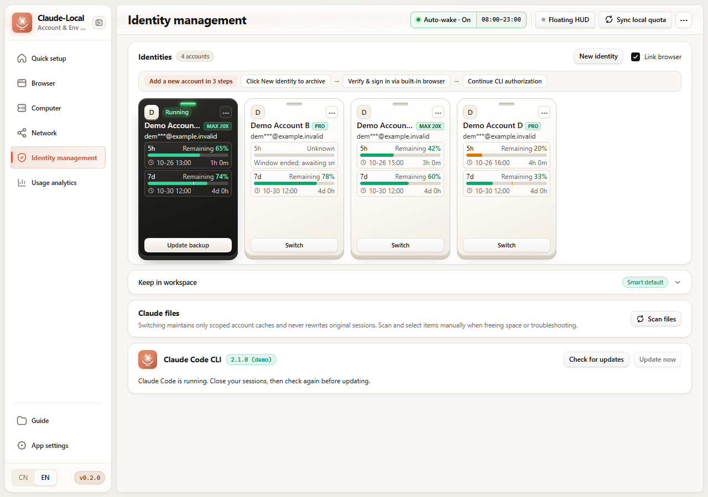
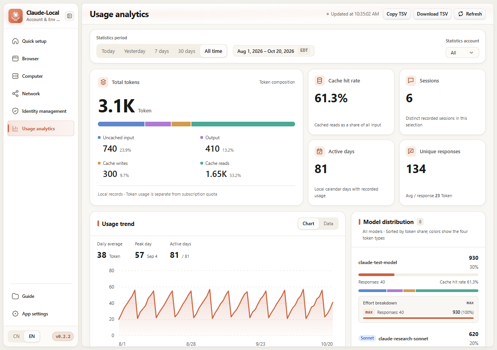
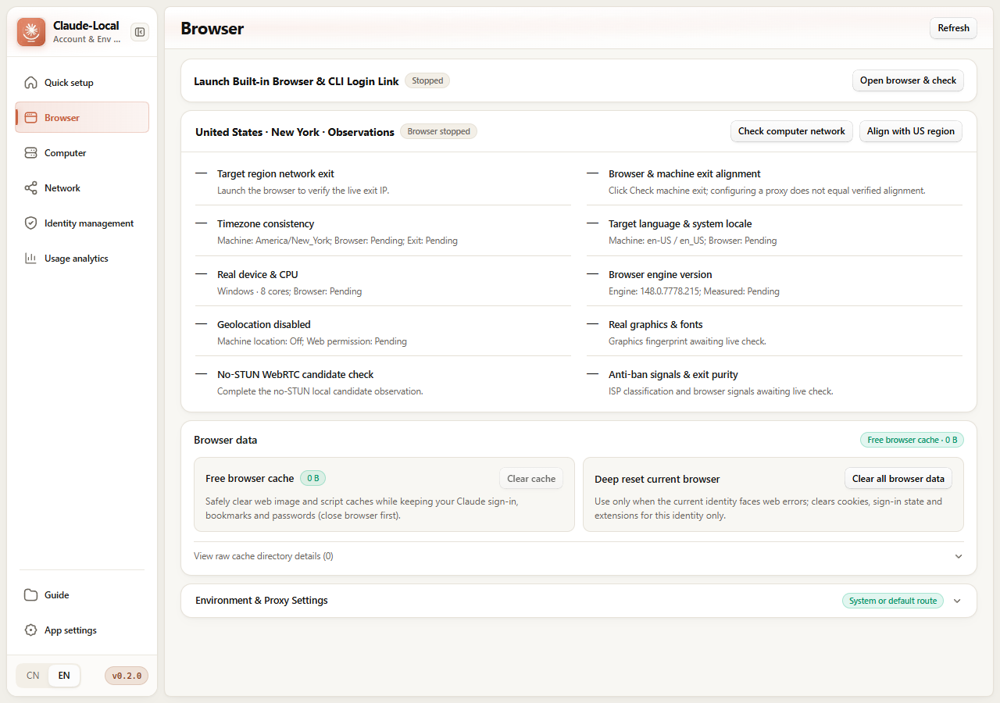
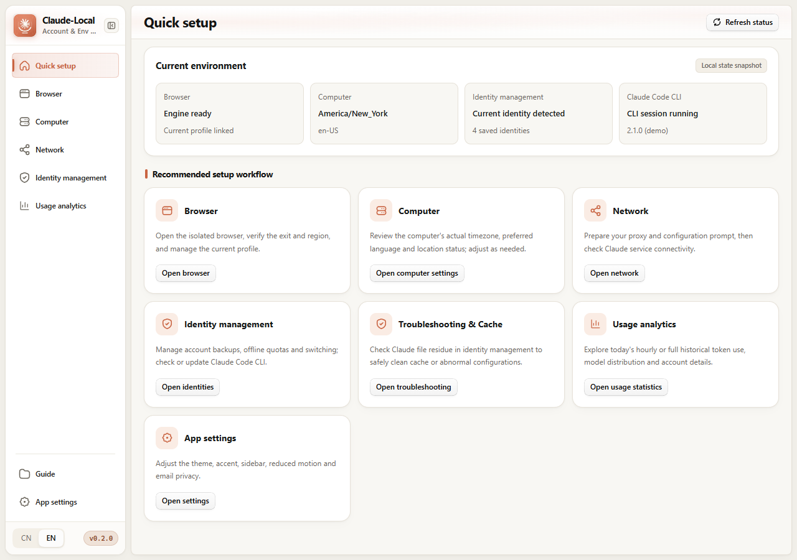
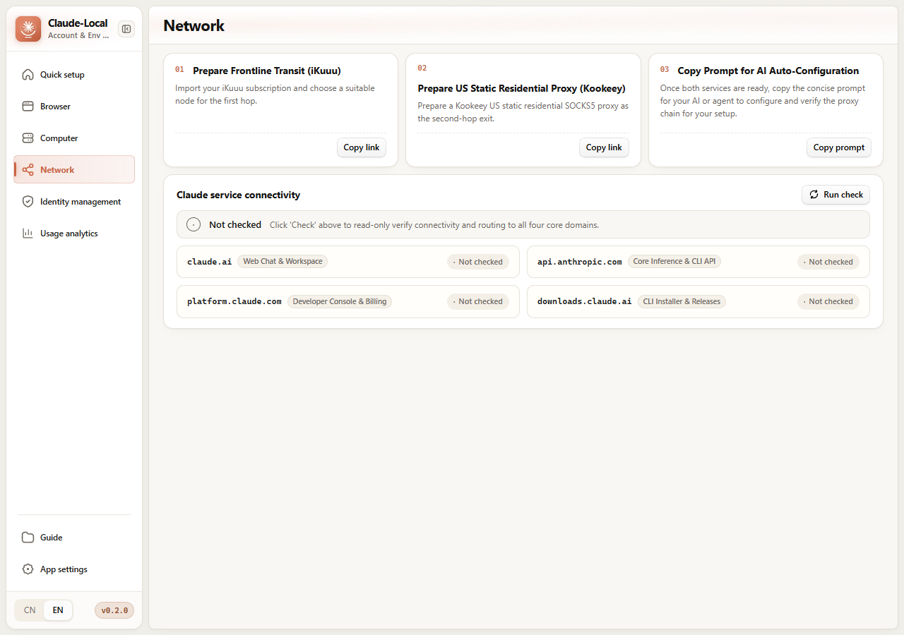

<!--
[INPUT]: Independent Windows x64 product, retained CCBaga/MIT attribution, 0.2.2 usage reliability and mixed-version English synthetic-data previews.
[OUTPUT]: Full English flagship project presentation, architectural lineage, feature matrix, visual tour, installation workflow and runtime boundaries.
[POS]: English repository introduction linked bidirectionally with README.md.
[PROTOCOL]: Keep private data, format compatibility and distribution boundaries in linked project documents.
-->

<div align="center">


# Claude-Local

**A Local-First Windows 10 / 11 x64 Multi-Identity Encrypted Vault, Token Usage Analyzer, 5h Auto-Wake Scheduler, and Isolated Browser for Claude**

Derived from [CCBaga](https://github.com/liseami/CCBaga) ([@liseami](https://github.com/liseami)) and independently maintained, retaining the original contributors' copyright and [MIT license](LICENSE) · Local-First · Zero Cloud Credential Hosting · Never Force-Kills Running `claude.exe` Sessions

[](https://github.com/yq04/Claude-Local/releases/tag/v0.2.2)
[](https://github.com/yq04/Claude-Local/releases)
[](docs/DEVELOPMENT.md)
[](LICENSE)
[](docs/PROJECT_ORIGIN.md)

<p>
  <strong>🌐 Language / 语言：</strong>
  <a href="README.md"><strong>🇨🇳 简体中文</strong></a> · <strong>🇺🇸 English (Current)</strong>
</p>

<p>
  <a href="https://github.com/yq04/Claude-Local/releases/download/v0.2.2/Claude-Local_0.2.2_x64-setup.exe"><strong>⬇️ Download v0.2.2 Installer (Windows x64)</strong></a>
  ·
  <a href="https://github.com/yq04/Claude-Local/releases/tag/v0.2.2"><strong>✨ v0.2.2 Release Page</strong></a>
  ·
  <a href="#-visual-tour--core-capabilities"><strong>🖼️ Visual Tour</strong></a>
  ·
  <a href="#-origin--evolution-from-ccbaga"><strong>🧬 Origin & Lineage</strong></a>
  ·
  <a href="#-architecture--data-safety-boundaries"><strong>🛡️ Safety Boundaries</strong></a>
</p>

</div>

---

## 📖 Table of Contents

- [✨ Why Claude-Local?](#-why-claude-local)
- [🖼️ Visual Tour & Core Capabilities](#️-visual-tour--core-capabilities)
  - [1. Identity Management Workbench](#1-identity-management-workbench)
  - [2. Usage Analytics & Token Composition](#2-usage-analytics--token-composition)
  - [3. Next-Gen Token Monitor-Style Floating HUD](#3-next-gen-token-monitor-style-floating-hud)
  - [4. Identity-Bound Isolated Browser & Anti-Ban Verification](#4-identity-bound-isolated-browser--anti-ban-verification)
  - [5. Quick Setup & Read-Only Network Diagnostics](#5-quick-setup--read-only-network-diagnostics)
- [🧬 Origin & Evolution from CCBaga](#-origin--evolution-from-ccbaga)
- [📦 Download, Installation & Release History](#-download-installation--release-history)
- [⚙️ Prerequisites & Building from Source](#️-prerequisites--building-from-source)
- [🛡️ Architecture & Data Safety Boundaries](#️-architecture--data-safety-boundaries)
- [🔧 Known Limitations & Troubleshooting](#-known-limitations--troubleshooting)
- [🤝 Contributing, License & Acknowledgements](#-contributing-license--acknowledgements)

---

## ✨ Why Claude-Local?

Built for developers on Windows who rely heavily on **Claude Code CLI** and manage multiple **Claude Pro / Max** subscriptions, Claude-Local unifies encrypted identity switching, passive quota tracking, token analytics, and browser profile isolation into a single desktop workbench:

| Core Pillar | Key Capabilities & Engineering Highlights |
| :--- | :--- |
| **🔐 Multi-Identity Encrypted Vault & Safe Switching** | Preserves `BAGAID01` / `.baga` (Zstandard + AES-256-GCM) archives and SQLite `user_version = 3`; enforces live `claude.exe` process locks before switching (never force-killing active CLI sessions), performs 4-dimensional cross-account residue sanitization, and supports PBKDF2 password-encrypted full-vault backups with isolated recovery copies. |
| **📊 Token Usage & Account Analytics** | A local deduplicated ledger shows **uncached input, output, cache writes, and cache reads**, cache hit rate, explicitly recorded sessions, and active days. Newly signed-in accounts can register for statistics before an archive is saved. Includes all-model and recorded Effort breakdowns, dynamic account filters, IANA/DST timezones, and TSV export. |
| **🖥️ Multi-Mode Floating HUD** | Shares the analytics ledger and filters by the current account to show **rolling 5h token composition, a 10-minute average rate, unique responses, and cache hit rate**. Supports Expanded, Compact, and Edge-Collapsed Capsule modes, Pin, Lock, magnetic edge snap, auto-hide, 50%–100% opacity, and theme/wallpaper synchronization. |
| **⏱️ In-Process Native 5h Auto-Wake Scheduler** | Driven by a single Rust in-process scheduler with configurable active time windows (e.g. `08:00–23:00`), primary-account threshold pre-warming, and staggered per-account backoff; strictly requires a fresh `new_5h_confirmed` server reset anchor, registers zero Windows services or scheduled tasks, and stops immediately when the app exits. |
| **🌐 Identity-Bound Isolated Browser & Auto-Launch** | Binds each identity to a dedicated Chromium user-data directory and deterministic fingerprint seed; **checking "Link browser" automatically launches or re-opens the newly switched account's isolated browser verification page upon account switch**; includes Windows AppContainer DACL self-healing, phased no-STUN WebRTC checks, and same-IP hosting/ISP classification. |
| **🧭 Passive Quota Sync & Connection Recovery Queue** | Passively observes CLI `/usage` caches and the Python single-writer quota ledger by default (**zero background OAuth polling, zero writes to `.claude.json`**); offers optional on-demand batch verification and groups accounts needing re-authentication or route fixes into a centralized Connection Recovery Queue. |

---

## 🖼️ Visual Tour & Core Capabilities

> **Screenshot Versions & Privacy Notice**: The usage screenshot shows `Claude-Local v0.2.2`; other pages remain labeled historical `v0.2.0` examples. See the current descriptions and [0.2.2 release notes](docs/RELEASE_NOTES_0.2.2_USAGE.md). The real frontend was captured in an isolated environment using **synthetic demonstration data**. Account names, organizations, token counts, and CLI versions are fictional; emails use the reserved `@example.invalid` domain with privacy masking enabled.

### 1. Identity Management Workbench



- **Unified `30px` Segmented Header Toolbar**: Combines `[• Auto-wake · On | 08:00–23:00]`, `[• Floating HUD]`, `[↻ Sync local quota]`, and the `[⋯]` overflow menu (housing online batch queries, auto-wake configuration, and the connection recovery queue) into a cohesive toolbar.
- **Streamlined 3-Step Onboarding Guide**: Clearly walks through `Click New identity to archive → Verify & sign in via built-in browser → Continue CLI authorization`.
- **`180×286` Identity Badges**: Pinned active identity card at the front with top green status glow; displays independent **5h / 7d remaining quota bars**, reset timestamps, countdowns, and `reset_inferred` post-expiry indicators.
- **Auto-Launch Linked Browser on Switch**: When **Link browser** is checked, switching to another identity automatically launches that identity's dedicated Chromium profile and opens its environment verification & sign-in page.

---

### 2. Usage Analytics & Token Composition



- **Inline Date Range & Timezone Badge**: Displays the active date interval and timezone abbreviation (`Oct 6, 2026 – Oct 26, 2026 EDT`) directly alongside `[Today | Yesterday | 7 days | 30 days | All time]`.
- **Total Tokens & Four-Part Composition**: Shows amounts and shares for uncached input, output, cache writes, and cache reads. Reasoning tokens are already included in output and are not added again.
- **Recorded Activity**: Shows cache hit rate, deduplicated explicit session identifiers, active calendar days in the selected timezone, unique responses, and tokens per response.
- **All Models & Effort**: Lists all models by total token share with four-part composition, responses, cache hit rate, and recorded reasoning Effort tiers.
- **Account & Time Filters**: The account dropdown offers only All accounts and the dynamic account list; retains chart/data views, privacy masking, and scoped TSV export.

---

### 3. Next-Gen Token Monitor-Style Floating HUD

Inspired by **Token Monitor**, the HUD supports Expanded, Compact, and Edge-Collapsed Capsule modes and synchronizes with the app's theme, accent color, and custom wallpaper.

- **Shared Account Ledger**: Displays only records supported by the current account's evidence. An unverified account or read failure shows unknown values without borrowing another account's data.
- **Rolling Window Metrics**: Shows rolling 5h tokens and their four-part composition, cache hit rate, the most recently recorded model, and unique responses. `tok/m` is the average over a fixed 10-minute window.
- **Separate Quota & Token Measures**: Keeps quota sources and reset countdowns; local token totals are not a conversion of subscription quota.
- **Desktop Window Controls**:
  - **Always-on-Top Pin & Position Lock**: Keep the HUD above all windows and lock coordinates to prevent accidental dragging;
  - **18px Magnetic Edge Snap**: Automatically snaps to the nearest monitor work-area edge within 18px;
  - **Edge Auto-Hide**: When docked to the left or right screen edge with Auto-Hide enabled, folds into a compact `52×138` side capsule ~420ms after mouse leave and expands on hover or click;
  - **50%–100% Continuous Opacity Control**: Interactive slider + 5 preset pills (50% / 65% / 80% / 95% / 100%) + right-click quick cycling.

---

### 4. Identity-Bound Isolated Browser & Anti-Ban Verification



- **Clean Launch Bar**: One-click launch for the bound isolated browser and loopback verification page; never auto-starts at ordinary app launch.
- **10 Categories / 20 Anti-Correlation Checks**: Verifies target region exit IP, browser-vs-machine exit alignment, IANA timezone consistency, system locale, hardware CPU/memory, engine version, geolocation off, WebGL/Canvas/font fingerprints, **phased no-STUN WebRTC local candidate observation**, and **same-IP hosting/ISP classification**.
- **Safe Cache Release vs. Scoped Deep Reset**: Clear everyday image/script caches while keeping login cookies intact, or deep-reset only the active identity's browser profile without affecting other accounts.

---

### 5. Quick Setup & Read-Only Network Diagnostics

| Quick Setup (4 Independent Status Cards & Guided Shortcuts) | Network Environment (4-Domain Read-Only Concurrent Probes) |
| :---: | :---: |
|  |  |

---

## 🧬 Origin & Evolution from CCBaga

Claude-Local is **derived from the open-source project [CCBaga](https://github.com/liseami/CCBaga) (created by [@liseami](https://github.com/liseami) and contributors)**. We gratefully acknowledge the original authors for their foundational work on multi-identity archive encoding and browser profile isolation.

While preserving compatibility with existing vaults and browser profiles, Claude-Local is independently engineered for **Windows 10 / 11 x64 desktop reliability, passive quota & token analytics, in-process 5h auto-wake scheduling, and desktop HUD monitoring**:

| Dimension | Inherited CCBaga Baseline | Claude-Local (`v0.2.2`) Independent Engineering & Enhancements |
| :--- | :--- | :--- |
| **Vault & Archive Protocol** | `BAGAID01` magic header, `.baga` archives, SQLite `user_version = 3`, account HMACs, and deterministic browser seed domain | **Full backward compatibility**; added Zstandard streaming compression support, bounded tar extraction limits, `ScratchGuard` staging cleanup, strict 32-byte master key validation, and PBKDF2 + AES-GCM password-encrypted vault backups with isolated recovery copies. |
| **Quota Tracking & Auto-Wake** | Basic identity state management | Built **passive CLI quota observation + Python single-writer ledger + `quota_core` per-window monotonic merge** (zero writes to `.claude.json`); added `reset_inferred` post-expiry recovery, **in-process Rust 5h auto-wake scheduler**, online batch queries, and the Connection Recovery Queue. |
| **Token Usage Analytics** | — | Native deduplicated SQLite ledger + **CPAMP / ccusage-inspired analytics workbench** with independent statistics identities, controlled sign-in attribution for resumed sessions, four-part composition, explicit sessions and active days, all-model/Effort breakdowns, IANA/DST timezones, and TSV export. |
| **Floating HUD Monitor** | — | **Token Monitor-inspired multi-mode desktop HUD** supporting Expanded/Compact/Capsule geometries, Pin, Lock, 18px Magnetic Edge Snap, Edge Auto-Hide, 50%–100% Opacity slider, and live theme/accent/wallpaper synchronization. |
| **Windows x64 & Anti-Ban Hardening** | Cross-platform baseline | Purpose-built for **Windows x64**: Chromium AppContainer cache DACL self-healing, Win32/MSIX `claude.exe` process tree detection, cross-account `tool_use/tool_result` orphan repair & `tengu_exit` telemetry sanitization, and before/after system setting snapshots with conflict-checked rollback. |

---

## 📦 Download, Installation & Release History

### 1. Latest Windows x64 Installer (`v0.2.2`)

| Asset | Platform | File Size | SHA-256 Checksum |
| :--- | :--- | :--- | :--- |
| **[Claude-Local_0.2.2_x64-setup.exe](https://github.com/yq04/Claude-Local/releases/download/v0.2.2/Claude-Local_0.2.2_x64-setup.exe)** | Windows 10 / 11 (64-bit x64) | `140,550,954` bytes (134.04 MiB) | `1a121cb4c1c6f1fc19b5825375dfd741de85bb81f6848aea05586d51852d0e51` |

Compute the installer SHA-256 in PowerShell and compare it with the checksum published in the [v0.2.2 Release](https://github.com/yq04/Claude-Local/releases/tag/v0.2.2):

```powershell
Get-FileHash .\Claude-Local_0.2.2_x64-setup.exe -Algorithm SHA256
# Expected SHA-256: 1a121cb4c1c6f1fc19b5825375dfd741de85bb81f6848aea05586d51852d0e51
```

### 2. Installation & Non-Disruptive Upgrade Notes

1. **Install Location & Identifiers**: Per-user NSIS installer defaulting to `%LOCALAPPDATA%\Programs\Claude-Local`; main executable `claude-local.exe`, bundle identifier `ai.local.claude-local`, companion browser registration `Claude-Local-Browser`.
2. **User Data Root**: All encrypted vaults, master keys, quota/usage ledgers, appearance settings, and browser profiles live under `%APPDATA%\ai.local.claude-local`.
3. **Seamless Upgrades**: Upgrading from `0.1.x` or `0.2.0` to `0.2.2` preserves existing vaults, keys, and browser profiles without re-creating identities or interrupting running `claude.exe` sessions. Export a password-encrypted backup from `App settings → Data management` before upgrading.

### 3. Public Release Series (`0.1.0` – `0.2.2`)

| Version | Date | Highlights | Documentation |
| :--- | :--- | :--- | :--- |
| **`v0.2.2`** *(Latest)* | 2026-10-29 | Independent statistics identities and controlled resumed-session attribution, four-part token composition, sessions and active days, all-model distribution, simple dynamic account filters, and a shared account-ledger HUD with rolling windows | [Release Notes](docs/RELEASE_NOTES_0.2.2_USAGE.md) |
| **`v0.2.0`** | 2026-10-26 | **Token Monitor-style multi-mode Floating HUD (Pin/Lock/Snap/Auto-Hide/Opacity/Theme Sync)**, **official API USD cost & cache savings analytics (historical feature)**, **auto-launch linked browser on account switch**, and global UI/sidebar polish | [UI & HUD Note](docs/UI_MONITOR_0.2.0.md) · [Release Notes](docs/RELEASE_NOTES_0.2.0.md) · [Verification](docs/RELEASE_VERIFICATION_0.2.0.md) |
| **`v0.1.5`** | 2026-10-26 | Five-page copy & toolbar refinement, synthetic preview refresh, and 20-check isolated production browser verification | [UI Polish Note](docs/UI_POLISH_0.1.5.md) · [Verification](docs/RELEASE_VERIFICATION_0.1.5_UI.md) |
| **`v0.1.4`** | 2026-10-26 | Production CSP (`api.ipquery.io`) completion for same-IP hosting classification in the companion browser | [Browser CSP Note](docs/BROWSER_CSP_0.1.4.md) · [Verification](docs/RELEASE_VERIFICATION_0.1.4_BROWSER.md) |
| **`v0.1.3`** | 2026-10-26 | Phased no-STUN WebRTC candidate timing fix and same-IP hosting/ISP supplementary classification | [Browser Verification](docs/BROWSER_VERIFICATION_0.1.3.md) |
| **`v0.1.2`** | 2026-10-26 | Encrypted storage & backup hardening (`ScratchGuard` cleanup, tar extraction bounds, strict 32-byte key check) | [Crypto Hardening](docs/CRYPTO_HARDENING_0.1.2.md) · [Verification](docs/RELEASE_VERIFICATION_0.1.2_CRYPTO.md) |
| **`v0.1.1`** | 2026-10-26 | Separation of web quota recovery vs. CLI authorization state, local wakeup readiness sync, and recovery queue | [Auth Sync Note](docs/AUTH_SYNC_0.1.1.md) · [Verification](docs/RELEASE_VERIFICATION_0.1.1_SYNC.md) |
| **`v0.1.0`** | 2026-10-26 | Initial public baseline release: multi-identity vault, passive quota tracking, Effort usage analytics, native wakeup & companion browser | [Release Notes](docs/RELEASE_NOTES_0.1.0.md) · [Verification](docs/RELEASE_VERIFICATION_0.1.0.md) |

---

## ⚙️ Prerequisites & Building from Source

### Runtime Prerequisites

1. **OS**: Windows 10 / 11 64-bit (x64).
2. **Microsoft Edge WebView2 Runtime**: Pre-installed on modern Windows 10 and Windows 11.
3. **Python 3.10+ with `cryptography`** (required for external quota collection, online queries, and password backup encryption; verified with Python 3.13 in CI):
   ```powershell
   python -m pip install cryptography
   ```

### Build & Test from Source

See [Development Guide](docs/DEVELOPMENT.md) for details. With Bun, Rust (MSVC), Python 3, and VS C++ Build Tools installed:

```powershell
# 1. Install dependencies
bun install --frozen-lockfile
python -m pip install -r scripts/requirements-ci.txt

# 2. Run synthetic test suites (never touches live accounts or running CLI sessions)
bun test
cargo test --locked --manifest-path src-tauri/Cargo.toml --bin claude-local
python scripts/test-windows.py

# 3. Build local release binary or deploy to local installation
bun run build:local
bun run deploy:local

# 4. Build audited Windows NSIS installer in a neutral staging directory
python scripts/fetch-browser.py
bun run build:windows
```

---

## 🛡️ Architecture & Data Safety Boundaries

- **100% Local-First Storage**: All identity vaults, master keys, SQLite databases, and browser profiles stay under `%APPDATA%\ai.local.claude-local`. No credentials are ever uploaded to external cloud servers.
- **Passive Observation & Single-Writer Ledger**: Default quota sync passively reads local CLI files and never writes to `.claude.json`. Python is the sole writer for `quota_ledger.json` (protected by a cross-process file lock and atomic replace), while Rust merges newer same-account anchors in memory.
- **Account Isolation Over Freshness**: Every online query or wakeup freezes the target account's `quota_identity` fingerprint and verifies its OAuth profile and organization UUID before committing.
- **Active CLI Session Protection**: Switching identities, cleaning residue, or updating the CLI always checks for running `claude.exe` processes first and refuses destructive overwrites while a session is active.

---

## 🔧 Known Limitations & Troubleshooting

- **Platform Scope**: Currently built and verified exclusively for **Windows 10 / 11 x64**.
- **Single-Identity Portable Pack (`bagapack`)**: Not yet implemented; use **Full-Vault Password-Encrypted Backup & Isolated Recovery** under `App settings → Data management`.
- **Unsigned Installer Notice**: The NSIS installer is independently built without a commercial code-signing certificate; verify the SHA-256 checksum above if Windows SmartScreen prompts on first run.
- **Troubleshooting Guides**:
  - 🔗 [Web Quota vs. CLI Authorization Recovery](docs/CONNECTION_RECOVERY.md)
  - 📊 [Usage Statistics & Timezone Methodology](docs/USAGE_STATISTICS.md)
  - 🧭 [Comparison & Trade-offs vs. CCBaga](docs/CCBAGA_COMPARISON.md)
  - 📜 [Distribution & Third-Party License Boundaries](docs/DISTRIBUTION.md)

---

## 🤝 Contributing, License & Acknowledgements

Issues and Pull Requests are welcome via [GitHub Issues](https://github.com/yq04/Claude-Local/issues/new/choose). Please read [CONTRIBUTING.md](CONTRIBUTING.md) before submitting changes.

### Acknowledgements

- **[CCBaga](https://github.com/liseami/CCBaga)**: Created by [@liseami](https://github.com/liseami) and contributors; Claude-Local inherits its MIT-licensed core vault architecture and `.baga` archive specification.
- **[ccusage](https://github.com/ccusage/ccusage), [Claude-Code-Usage-Monitor](https://github.com/Maciek-roboblog/Claude-Code-Usage-Monitor), [CPA-Manager-Plus](https://github.com/seakee/CPA-Manager-Plus) & Token Monitor**: Design inspiration for local token ledger aggregation, usage analytics layout, and the desktop Floating HUD monitor.
- **[Fingerprint Chromium](https://github.com/adryfish/fingerprint-chromium)**, **vendor/cromma-ui**, **[LobeHub lobe-icons](https://github.com/lobehub/lobe-icons)** & **[Unicode CLDR 48](https://github.com/unicode-org/cldr)**: Governed by their respective licenses; see [LICENSE](LICENSE) and [NOTICE.md](NOTICE.md).

> **Disclaimer**: Claude-Local is an independent open-source utility and is not affiliated with, endorsed by, or sponsored by Anthropic or the upstream CCBaga project.
