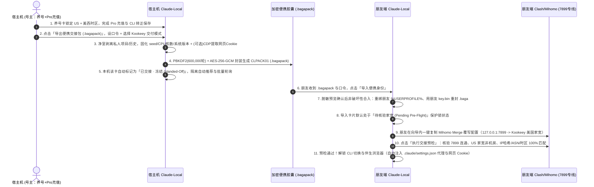

<!--
[INPUT]: Open-source benchmarking (CCBaga, cc-switch, claudia, age, Playwright/Puppeteer CDP storageState, HackBrowserData Windows DPAPI transcoding, Fingerprint Chromium deterministic CLI flags, Mihomo listener + dialer-proxy chaining) and source-level audit of Claude-Local v0.2.5 (src-tauri/src/identities/archive.rs, backup.rs, codec.rs, catalog.rs, database.rs, warming.rs, subscription.rs, cleaner_identity.rs, browser/config.rs, browser/network.rs, risk_check.rs).
[OUTPUT]: Historical research and unimplemented four-phase proposal for single-account portability; cancelled by the owner on 2026-11-02 in favor of manual network setup and normal sign-in on the recipient machine.
[POS]: docs/ archived research, not an active implementation specification. Original feasibility assumptions remain for history and are not verified product guarantees.
[PROTOCOL]: Update this header and check CLAUDE.md when modifying this document.
-->

# Claude-Local 单账号跨机可移植与朋友交接：深度调研分析报告及实施计划方案（`.bagapack` + Kookeey 美国家宽绑定）

> **状态：已取消，不实施（2026-11-02 用户决定）。** 不开发单身份 `.bagapack` 导入/导出或跨机登录态搬运。号主人工提供 Kookeey 信息，朋友独立配置 iKuuu + Kookeey 并正常登录同一账号；本机资料由用户按现有确认流程处理。现有 `.clbackup` 整库备份不在取消范围。下文保留历史草案，其中“零风控”“100% 恒定”等表述未经双机及服务端验证，不是现行能力或承诺；四阶段路线图不再是待办。

> **编制时间**：2026-11-02
> **基准版本**：`v0.2.5`（含 P0–P7 开源对标优化、166px 紧凑卡片与顶部横条拖拽排序、未登录工作区防空白卡根治）
> **核心业务目标**：支持号主在宿主机（Host PC）使用 Kookeey 美国静态住宅 IP 完成 Claude 账号养号、KYC 验证与 Pro 充值后，将该**单张卡片（含 Claude Code CLI OAuth 凭据、伴生浏览器确定性指纹、网页端登录态、手动订阅周期及 Kookeey 美国家宽代理配置）**导出为口令认证加密的独立便携胶囊（`.bagapack`），安全移交给朋友在另一台 Windows 电脑（Friend PC）非破坏性导入，并强制绑定同一 Kookeey 美国家宽出口实现零风控使用。

---

## 第一部分：深度调研分析报告

### 一、 开源项目调研与技术借鉴矩阵

围绕「单账号加密胶囊移交」、「破解 Windows Chromium DPAPI 跨机 Cookie 失效」、「跨物理机器硬件指纹 100% 恒定」以及「静态住宅代理专线交付与 Fail-Closed 启动门禁」四大核心难题，我们系统调研了 GitHub 相关高星开源项目与反检测浏览器工程标准：

| 技术维度 | 代表性开源项目 / 标准 | 核心技术原理与开源实现剖析 | 对 Claude-Local 的架构启发与方案选型 |
| :--- | :--- | :--- | :--- |
| **1. CLI 与多账号单卡加密胶囊** | • `liseami/CCBaga`<br>• `farion1231/cc-switch`<br>• `getAsterisk/claudia`<br>• `FiloSottile/age` | 1. **主密钥解耦（Vault Key Decoupling）**：本地保险库使用随机生成的机器主密钥（`key.bin`）加密各身份归档；跨机导出单卡时，先用宿主机 `key.bin` 解密，剥离机器私有路径，再用口令经 `PBKDF2-HMAC-SHA256`（600,000 轮）或 `Argon2id` 派生的传输密钥封装为独立胶囊；目标机导入时用目标机自己的 `key.bin` 重新加密入库。<br>2. **净室抽提（Clean-Room Extraction）**：仅打包身份认证核心字段，剔除宿主机本地工程目录（`projects`）、历史对话（`history.jsonl`）和第三方 MCP 密钥。 | 设计 **`CLPACK01`（`.bagapack`）单卡便携包引擎**（复用本仓库 `codec.rs` 与 `backup.rs` 已审计的 `PBKDF2` + `AES-256-GCM` + `zstd/tar`），支持宿主机净室导出与朋友端非破坏性合并（绝不覆盖朋友既有身份库与 `key.bin`）。 |
| **2. 破解 Windows Chromium DPAPI 跨机 Cookie 失效** | • `microsoft/playwright` (`storageState`)<br>• `puppeteer/puppeteer` (CDP `Storage.getCookies`)<br>• `moonD4rk/HackBrowserData` | 1. **Windows DPAPI 硬件绑定壁垒**：Chromium 在 Windows 下将 `Default/Network/Cookies` 的 `encrypted_value` 用 `Local State` 中的 `os_crypt.encrypted_key`（AES-256-GCM）加密，而该密钥经 Windows `CryptProtectData`（DPAPI）绑定在**宿主机当前 Windows 用户的 SID 与登录凭据**上；直接复制 `User Data` 目录到朋友电脑必触发 `0x80090005 (SEC_E_INVALID_DATA)`，导致 Cookie 被静默清空、网页退出登录。<br>2. **三种开源解法对比**：<br>  - **方案 A（Playwright CDP 动态转储与回放 · 推荐）**：导出时通过本地回环 CDP `Storage.getCookies` 提取已由宿主机 DPAPI 解密的明文 Cookie JSON 封入胶囊；朋友端首次启动时通过 CDP `Storage.setCookies` 注入，由朋友本机 Chromium 自动用朋友的 DPAPI 落盘。<br>  - **方案 B（HackBrowserData 离线 DPAPI 转码）**：直接调 Windows `CryptUnprotectData` 解密 SQLite 再在目标机用 `CryptProtectData` 重建，但强耦合 Chromium 内部 SQLite 表版本。<br>  - **方案 C（重编译 Chromium 引擎）**：修改 `os_crypt_win.cc`，工程维护成本过高。 | 选用 **方案 A（基于本地 Loopback CDP 的便携网页会话快照 `web_session.json`）**：完全不触碰 `quota-bridge` 扩展（严守该扩展零 Cookie 权限红线），零 C++ 编译改动，100% 兼容现有内置 Fingerprint Chromium。同时明确：**CLI 的 `.claude/.credentials.json` 本身是纯 JSON，不经过 DPAPI，重绑路径后跨机天然可用**。 |
| **3. 反检测浏览器跨机器物理硬件指纹锁定** | • `adryfish/fingerprint-chromium`<br>• `daijro/camoufox`<br>• `apify/fingerprint-suite` | 1. **跨机硬件泄漏点**：`fingerprint-chromium` 虽然接收 `--fingerprint=<seed>` 生成确定性噪声，但默认仍会将宿主操作系统的真实 CPU 线程数、Windows 版本号、系统时区/语言或原生 GPU 渲染暴露给网页，除非通过命令行参数显式覆盖。<br>2. **固化策略（Hardware Pinning）**：导出 Profile 时必须将创建该账号时的 `hardwareConcurrency`、`platformVersion`、`timezone`、`lang` 写入 Profile 元数据并在目标机启动时强制注入，同时关闭 `native_graphics`（开启 Canvas/WebGL/Audio 伪装）。 | 在 [browser/config.rs](../src-tauri/src/browser/config.rs:40) 新增 `pinned_cores` 与 `pinned_platform_version`，导出时强制固化宿主机硬件参数并置 `follow_machine: false`、`native_graphics: false`，确保朋友电脑上的 **20 项防关联实测与 FNV-1a Canvas 哈希 100% 不变**。 |
| **4. 静态住宅代理专线交付与 Fail-Closed 门禁** | • `MetaCubeX/mihomo` (`listeners` + `dialer-proxy`)<br>• `clash-verge-rev`<br>• 商业防关联浏览器团队分享门禁 | 1. **Chromium 无账密 SOCKS5 限制**：Chromium `--proxy-server=socks5://...` 原生不支持内联 `username:password`，而 Kookeey 静态住宅 IP 必带账密，且国内直连 Kookeey 往往需挂在机场前置节点后（链式代理 `dialer-proxy`）。<br>2. **Mihomo 独立 Listener 专线模式**：在朋友的 Clash/Mihomo 中声明独立本地监听 `127.0.0.1:7899`（`type: mixed, udp: false`），绑定 `Kookeey-US-Static` 节点；CLI 与伴生浏览器专走 `7899`，朋友主端口（7890/7897）随便切香港/日本节点都互不干扰。<br>3. **Fail-Closed 启动门禁**：激活前强制核验出口 IP 哈希、ASN、国家与时区，任一不符立即阻断启动。 | 设计 **「Kookeey 朋友端 Mihomo 7899 专线一键覆写生成器」** + **「五维交接预检门禁（`identities_portable_preflight`）」**，从根源上杜绝朋友误操作裸连或挂错节点导致封号。 |

---

### 二、 本仓库源码级现状审计：阻断跨机交接的 5 个硬性技术壁垒

通过对 `Claude-Local v0.2.5` 核心源码的逐行核查，我们梳理出当前架构中阻断「号主养号充值后移交朋友异机使用」的 **5 处具体代码级壁垒**：

#### 壁垒 1：`.baga` 归档硬编码宿主机 `%USERPROFILE%` 绝对路径，异机解包直接报错拦截
- **源码位置**：[src-tauri/src/identities/archive.rs](../src-tauri/src/identities/archive.rs:19) 与 [archive.rs:126](../src-tauri/src/identities/archive.rs:126)。
- **代码事实**：
  - `archive::Manifest` 结构体直接持久化了宿主机的 `pub(super) home: PathBuf`（例如 `C:\Users\Alice`），且 `sources: Vec<Source>` 中每个归档成员的 `Source.path` 都是带宿主机用户名的绝对路径（例如 `C:\Users\Alice\.claude.json`、`C:\Users\Alice\.claude\.credentials.json`）。
  - 在 `Store::load_with_limits`（第 126 行）解包时，硬编码了严格路径校验：
    ```rust
    if manifest.version != VERSION
        || manifest.home != self.home
        || manifest.sources.len() > limits.sources
        || !manifest.sources.iter().all(|s| identity::allowed(&self.home, s))
    {
        return Err("身份不属于当前电脑或归档版本无效。".into());
    }
    ```
- **后果**：只要朋友电脑的 Windows 用户名或主目录路径（如 `C:\Users\Bob`）与你的电脑不同，原生的 `.baga` 归档在朋友电脑上会被直接拒绝解包。

#### 壁垒 2：整库备份 `CLBKUP01` 强耦合宿主机主密钥 `key.bin`，不支持单卡非破坏性合入
- **源码位置**：[src-tauri/src/identities/backup.rs](../src-tauri/src/identities/backup.rs:406)、[codec.rs:32](../src-tauri/src/identities/codec.rs:32)、[catalog.rs:13](../src-tauri/src/identities/catalog.rs:13)。
- **代码事实**：
  - 现有的 `.clbackup`（魔数 `CLBKUP01`）打包的是整个 `identity-vault` 目录（含 `identities.sqlite`、宿主机 32 字节随机主密钥 `key.bin` 及全部 `.baga`），且恢复函数 `identities_backup_restore_new` 只能创建全新隔离保险库副本，既不能只导出你充好值的那 1 张卡（会把你自己留用的其他 4 张 Pro 卡一并暴露），也不能合并进朋友已有的保险库。
  - 更关键的是，数据库中的账号去重标识 `account_key` 是用本机 `key.bin` 计算的 HMAC：
    ```rust
    // src-tauri/src/identities/catalog.rs:13
    hmac::Key::new(hmac::HMAC_SHA256, master_key)
    ```
- **后果与解法**：单卡跨机导入时，必须在朋友电脑上脱离宿主机 `key.bin`，使用朋友本机的 `vault/key.bin` 重新计算 `account_key` 并重新调用 `codec::Seal::new` 生成新的 `.baga` 归档。与此同时，用于本地额度账本（`quota_ledger.json`）和浏览器插件对账的 `quota_identity` 是无盐 `SHA-256([accountUuid, email, orgUuid])`（见 [background.js:68](../browser-runtime/quota-bridge/background.js:68)），跨机天然保持不变。

#### 壁垒 3：伴生浏览器跨机器存在 3 处物理硬件指纹漂移漏口
- **源码位置**：[src-tauri/src/browser/config.rs](../src-tauri/src/browser/config.rs:48) 与 [config.rs:150](../src-tauri/src/browser/config.rs:150)。
- **代码事实**：
  - `Config::default()` 默认设置 `follow_machine: true` 且 `native_graphics: true`。
  - 在 `Config::arguments(&self, seed: u32, machine: &Machine)`（第 150 行）构造 Fingerprint Chromium 启动参数时：
    ```rust
    let mut args = vec![
        format!("--fingerprint={seed}"),
        "--fingerprint-platform=windows".into(),
        format!("--fingerprint-platform-version={}", machine.version),
        format!("--fingerprint-hardware-concurrency={}", machine.cores),
        format!("--timezone={timezone}"),
        format!("--lang={language}"),
        format!("--accept-lang={accept}"),
    ];
    if self.native_graphics {
        args.push("--disable-spoofing=font,audio,gpu,canvas,clientrects".into());
    }
    ```
- **后果与解法**：
  1. `machine.version` 与 `machine.cores` 直接取自运行机器的 Windows 版本与 CPU 逻辑核心数（例如你的电脑是 16 核 Win11 23H2，朋友电脑是 8 核 Win10 22H2）；
  2. 若 `native_graphics == true`，会附加 `--disable-spoofing=font,audio,gpu,canvas,clientrects`，导致 Canvas / WebGL / Audio 直接反映朋友电脑的真实物理显卡，使 FNV-1a Canvas 像素哈希发生跳变；
  3. 若 `follow_machine == true`，朋友的中文 Windows（`zh-CN` / `Asia/Shanghai`）会直接覆盖浏览器的语言和时区。
  - **修复方案**：在 `browser::config::Config` 中新增可选字段 `pinned_cores: Option<u32>` 与 `pinned_platform_version: Option<String>`，导出便携包时自动填入宿主机的核数与平台版本，并强制设 `follow_machine: false`、`native_graphics: false`、`language: "en-US"`、`timezone: locked_timezone`。

#### 壁垒 4：Claude Code CLI 与伴生浏览器在 Windows 下的凭据可移植性差异
- **源码位置**：[src-tauri/src/cleaner_targets.rs](../src-tauri/src/cleaner_targets.rs:230)、[cleaner_identity.rs:152](../src-tauri/src/cleaner_identity.rs:152)、[credentials.rs](../src-tauri/src/identities/credentials.rs:1)。
- **代码事实**：
  - **CLI 凭据（天然可跨机重绑）**：Claude Code CLI 在 Windows 下将 OAuth 凭据保存在 `%USERPROFILE%\.claude\.credentials.json`（内含 `claudeAiOauth: { accessToken, refreshToken, expiresAt, subscriptionType }` 与 `trustedDeviceToken`），将账号归属保存在 `%USERPROFILE%\.claude.json`（`oauthAccount`、`userID`）。这两个文件均已收纳在 `.baga` 归档内，不依赖 Windows DPAPI。只要剥离宿主机 `projects` 路径并重绑至朋友的 `%USERPROFILE%`，朋友切换身份后 CLI 即可直接无缝使用。
  - **设备客户端 ID 边界**：`cleaner_identity.rs:152` 的 `preserved_client_path` 在切号时保留了每台电脑自己的 `.claude/.machine-id` 与 `.claude/.user-id`。便携包导出时同样**绝不打包**宿主机的 `.machine-id` / `.user-id`，让朋友电脑保留其自身的客户端标识，配合合法的 `trustedDeviceToken` 与相同的 Kookeey 美国家宽 IP 平滑过渡。
  - **浏览器网页登录态（受 DPAPI 限制）**：如前文所述，Chromium `Default/Network/Cookies` 无法直接跨机器文件拷贝，需通过本地回环 CDP 快照提取/恢复 `sessionKey`、`cf_clearance` 与 `lastActiveOrg`。

#### 壁垒 5：缺少「宿主机交接后防双开冻结」与「朋友端 Kookeey 7899 专线强门禁」
- **源码位置**：[src/identities.tsx](../src/identities.tsx:1)、[src/warming-cards.tsx](../src/warming-cards.tsx:167)、[src-tauri/src/browser/config.rs:101](../src-tauri/src/browser/config.rs:101)。
- **代码事实**：
  - `browser/config.rs:101` 的 `proxy()` 明确拒绝含用户名和密码的代理 URL（`!url.username().is_empty() || url.password().is_some()`），因此 Kookeey 静态住宅 SOCKS5 节点必须通过朋友本机的 Clash Verge Rev / Mihomo 独立本地监听端口（`127.0.0.1:7899`）中转。
  - 若宿主机导出卡片后未做冻结标记，宿主机的「智能接力推荐（`recommendSaved`）」或「批量在线额度查询（`Batch Quota Sync`）」仍可能读取或刷新该账号的 OAuth Token，与朋友电脑形成双机并发冲突。

---

## 第二部分：端到端架构与后续实施计划方案

### 三、 全生命周期交接工作流（Host 养号充值 $\rightarrow$ 朋友端共享 Kookeey 家宽）



#### 1. Stage A：宿主机（Host PC）—— 净室打包、Kookeey 随包策略与本机防碰撞冻结
- **净室白名单抽提（零个人隐私外泄）**：
  - 从目标身份的 `.baga` 中仅提取：`.claude.json` 的 `config::ACCOUNT_KEYS`（`oauthAccount`、`userID`，**彻底剔除** `projects`、`githubRepoPaths`、`mcpServers`）；`.claude/.credentials.json` 的 `claudeAiOauth` 与 `trustedDeviceToken`（**彻底剔除** `mcpOAuth`）；并自动生成将 `HTTPS_PROXY` / `HTTP_PROXY` / `ALL_PROXY` 指向 `127.0.0.1:7899` 的干净 `.claude/settings.json`。
  - **彻底排除**：`.claude/projects/*`、`.claude/history.jsonl`、`.claude/.machine-id`、`.claude/.user-id`。
- **硬件与语言时区完全固化**：
  - 将该卡的 `seed`、`pinned_cores = Some(host_cores)`、`pinned_platform_version = Some(host_win_ver)`、`follow_machine = false`、`native_graphics = false`、`language = "en-US"`、`timezone = locked_timezone`、`proxy = "socks5://127.0.0.1:7899"` 写入便携包。
- **Kookeey 美国家宽随包交付二选一**：
  - **模式 1（加密内嵌 Kookeey 节点凭证 · 推荐给信任的朋友）**：在导出弹窗填入 Kookeey SOCKS5 的 `server:port:username:password`（及可选前置代理组名，默认 `Proxy`），连同宿主机实测的出口校验锁（`expected_country: "US"`、`expected_timezone`、`expected_asn`、单向加盐哈希 `expected_ip_hash = SHA256("cl-ip-v1:" + ip)`）一起封入 AES-256-GCM 密文包。朋友导入后可一键复制含完整账密的 Mihomo 覆写 YAML。
  - **模式 2（脱敏校验锁模式）**：仅内嵌 `127.0.0.1:7899` 端口约定与出口校验锁（`expected_country`、`expected_timezone`、`expected_asn`、`expected_ip_hash`），朋友端生成带占位符的 YAML 模板，由号主私聊发送节点参数。
- **宿主机「已交接 · 冻结 (`handed_off`)」与 15 分钟冷却提示**：
  - 导出完成后宿主机默认将该卡置为 `handoff_status: "handed_off"`（显示琥珀色 **`已交接 · 冻结`** 徽章），自动从智能接力推荐与批量额度查询中剔除，误点切换时弹出防双开警告；回执弹窗提醒号主静置 **10–15 分钟**后再由朋友在异机激活。

#### 2. Stage B：朋友端（Friend PC）—— 脱敏预览与非破坏性合并导入
- **口令验证与预览（`identities_portable_inspect`）**：在 `ScratchGuard` 独占临时目录解密并校验全部成员 SHA-256，展示卡片名、遮罩邮箱、套餐（`Pro`）、订阅到期日、锁定环境（`US · America/Los_Angeles · Seed #xxxx`）及冲突状态。
- **非破坏性合入（`identities_portable_import`）**：
  - 保持朋友原有的 `key.bin` 与所有现有卡片完好无损；
  - 将相对路径槽位重绑为朋友本机的 `%USERPROFILE%`，用朋友的 `key.bin` 重算 `account_key` 并重封生成新 `.baga`，随即调用 `Store::load` 执行真实解包验收；
  - 将原 `seed` 与固化后的 `Config` 写入朋友的 `browser_bindings` 与 `browser/contexts/{slot}/config.json`，合入 `manual_subscriptions.json`，并将该卡设为 **`preflight_status: "pending"`（待核验家宽）**。

#### 3. Stage C：朋友端 `127.0.0.1:7899` 专线桥接与五维 Fail-Closed 门禁
- **一键复制朋友端 Clash Verge Rev / Mihomo 扩展覆写 YAML**：
  - 在朋友本机建立 `127.0.0.1:7899` 独立 `mixed` 监听（`udp: false` 物理阻断 QUIC/WebRTC），通过 `dialer-proxy` 串联朋友自己的机场前置节点与你的 `Kookeey-US-Static` 节点。朋友主端口（7890/7897）日常切换任何地区节点或开关 TUN 模式，都绝不影响 `7899` 端口专走你的 Kookeey 美国家宽。
- **五维启动前强制预检门禁（`identities_portable_preflight`）**：
  - 朋友首次点击该卡的「切换身份（CLI）」或「打开浏览器」时，强制通过 `socks5://127.0.0.1:7899` 校验以下 5 项，任一失败即硬阻断启动：
    1. **本地 7899 专线握手可达**（3s 内连通）；
    2. **出口国家匹配**（`exit.country == "US"`）；
    3. **住宅属性非机房**（`!network::is_hosting_exit(&exit)`）；
    4. **Kookeey 静态 IP 哈希 / ASN 匹配**（`SHA256("cl-ip-v1:" + exit.ip) == expected_ip_hash` 或同 ASN）；
    5. **双站点同源与时区一致**（`claude.ai` 与 `withpersona.com` Trace 同出口，且 `exit.timezone == locked_timezone`）。

---

### 四、 `.bagapack`（`CLPACK01`）容器格式、数据结构与 Tauri IPC 契约

#### 1. 外层二进制信封（`CLPACK01`）
复用 `src-tauri/src/identities/codec.rs` 与 `backup.rs` 的加密流结构，零外部新依赖：

```text
+-------------------------------------------------------------------------------------------------------+
| Magic (8 Bytes)   | KDF Rounds (4 B)   | Salt (16 Bytes)    | Sealed Stream (BAGAID01 AES-256-GCM)    |
| b"CLPACK01"       | 600,000 (u32 BE)   | CSPRNG Random      | 64KiB Authenticated Chunks (Zstd + Tar) |
+-------------------------------------------------------------------------------------------------------+
```

#### 2. 内层 `tar` 归档结构
- `portable_manifest.json`：协议版本、卡片类型（`cli_pro` | `warming_only`）、脱敏摘要、浏览器 `(id, slot, seed, Config)`、Kookeey 预检锁与可选节点参数、手动订阅记录、养号记录，以及所有内部文件的字节长度与 SHA-256 校验和。
- `payload/claude_account.json`：净室抽提的 `.claude.json` 账号核心字段。
- `payload/claude_credentials.json`：净室抽提的 `.claude/.credentials.json` OAuth 凭据（`cli_pro` 模式）。
- `payload/claude_settings.json`：预置 `127.0.0.1:7899` 代理环境变量的 `.claude/settings.json`。
- `payload/web_session.json`（可选）：经本地回环 CDP 解密导出的 `.claude.ai` Cookie 与 `localStorage` 快照。

#### 3. 新增 Tauri IPC 命令签名（`src-tauri/src/identities/portable.rs`）
```rust
#[tauri::command]
pub async fn identities_portable_export(
    app: tauri::AppHandle,
    request: PortableExportRequest, // id, kind, path, passphrase, include_web_session, kookeey_endpoint, freeze_local
) -> Result<PortableExportReceipt, String>;

#[tauri::command]
pub async fn identities_portable_inspect(
    app: tauri::AppHandle,
    path: String,
    passphrase: String,
) -> Result<PortablePackagePreview, String>;

#[tauri::command]
pub async fn identities_portable_import(
    app: tauri::AppHandle,
    path: String,
    passphrase: String,
    target_id_override: Option<String>,
) -> Result<PortableImportReceipt, String>;

#[tauri::command]
pub async fn identities_portable_set_handoff_freeze(
    app: tauri::AppHandle,
    id: String,
    frozen: bool,
) -> Result<PortableCardState, String>;

#[tauri::command]
pub async fn identities_portable_preflight(
    app: tauri::AppHandle,
    id: String,
) -> Result<PortablePreflightReport, String>;
```

---

### 五、 分阶段实施路线图（Phase 1 → Phase 4）

#### Phase 1：底层便携胶囊引擎、硬件指纹固化与跨机合入核心（Rust 后端）
1. **修改 [src-tauri/src/browser/config.rs](../src-tauri/src/browser/config.rs)**：
   - 在 `Config` 结构体中新增向后兼容字段：
     ```rust
     #[serde(default, skip_serializing_if = "Option::is_none")]
     pub pinned_cores: Option<u32>,
     #[serde(default, skip_serializing_if = "Option::is_none")]
     pub pinned_platform_version: Option<String>,
     ```
   - 在 `Config::arguments()` 中优先使用 `self.pinned_cores.unwrap_or(machine.cores)` 与 `self.pinned_platform_version.as_deref().unwrap_or(&machine.version)`。
2. **新增 `src-tauri/src/identities/portable.rs` 与 `src-tauri/src/identities/portable_tests.rs`**：
   - 实现 `CLPACK01` 信封加密/解密与 `ScratchGuard` 独占暂存清理；
   - 实现宿主机单卡净室抽提（支持已保存的正式身份卡与养号卡）；
   - 实现朋友端预览（`identities_portable_inspect`）与非破坏性合并导入（`identities_portable_import`）：路径重绑至朋友 `self.home`、用朋友 `key.bin` 重算 `account_key` 并重封 `.baga`、调用 `Store::load` 验收、原样保留 `seed` 写入 `browser_bindings`、合入 `manual_subscriptions.json`；
   - 实现 `identity-vault/portable_state.json` 持久化读写（维护每张卡的宿主机 `handoff_status: "active" | "handed_off"` 与朋友端 `preflight_status: "not_required" | "pending" | "verified"` 及 `expected_ip_hash` / `expected_asn`）。
3. **修改 [src-tauri/src/identities/mod.rs](../src-tauri/src/identities/mod.rs) 与 [src-tauri/src/main.rs](../src-tauri/src/main.rs)**：挂载模块并注册上述 5 个 Tauri 命令。

#### Phase 2：Kookeey 7899 专线 Mihomo 覆写生成与五维预检门禁（Rust + TS）
1. **修改 [src/risk-model.ts](../src/risk-model.ts) 与 [src/risk-model.test.ts](../src/risk-model.test.ts)**：
   - 新增纯函数 `buildKookeeyFriendHandoffMihomoYaml(options)`，一键生成包含 `Kookeey-US-Static`（含 `dialer-proxy` 前置代理串联）、`127.0.0.1:7899` 独立 `mixed` 监听（`udp: false`）与防漏规则的 Clash Verge Rev Merge 覆写 YAML。
2. **完善 `identities_portable_preflight`（`src-tauri/src/identities/portable.rs`）**：
   - 复用 `browser::network::probe` 与 `risk_check` 探针，针对 `socks5://127.0.0.1:7899` 执行五维校验（端口可达、`US` 国家、非机房住宅、`expected_ip_hash` / `expected_asn` 匹配、`claude.ai` vs `withpersona.com` 同出口且时区一致），全部通过后将该卡的 `preflight_status` 更新为 `"verified"`。

#### Phase 3：跨 Windows DPAPI 便携网页会话快照（可选 CDP Cookie 提取与恢复）
1. **新增 `src-tauri/src/browser/session_portable.rs`（或集成于 `src-tauri/src/browser/lifecycle.rs`）**：
   - 宿主机导出勾选“附带网页登录态”时，以本地回环调试端口（`--remote-debugging-port=0` + 读取 `DevToolsActivePort`）瞬态调用 CDP `Storage.getCookies` 提取 `.claude.ai` 域名的明文 Cookie 列表封入 `.bagapack`；
   - 朋友端导入后首次启动通过预检的伴生浏览器时，自动通过 CDP `Storage.setCookies` 注入 Cookie（由朋友本机 Chromium 使用朋友的 Windows DPAPI 加密落盘），注入成功后立即安全擦除暂存快照。

#### Phase 4：前端交互向导、防双开冻结徽章与双语词条（UI & i18n）
1. **修改 [src/identities.tsx](../src/identities.tsx) 与 [src/warming-cards.tsx](../src/warming-cards.tsx)**：
   - **严守 `166×286` 卡片尺寸红线**：不在卡片表面增加新高度行，所有导出/导入/预检均通过卡片顶部状态徽章、`⋯` 下拉菜单与 `<AppDialog>` 弹窗承载；
   - **宿主机端**：在卡片 `⋯` 菜单增加「导出便携交接包（`.bagapack`）」弹窗；对 `handed_off` 卡片展示琥珀色 **`已交接 · 冻结`** 徽章，在智能接力推荐（`recommendSaved`）与批量额度查询中自动跳过，误点切换时弹出防双开警告；
   - **朋友端**：在身份管理页顶栏增加「导入便携身份（`.bagapack`）」按钮与预览合入弹窗；对 `preflight_status === "pending"` 的卡片展示 **`待核验家宽`** 徽章，点击激活时弹出「Kookeey 美国家宽一键配置与五维预检向导」，预检通过后即刻解锁 CLI 切换与伴生浏览器。
2. **修改 [src/locales/zh.yaml](../src/locales/zh.yaml) 与 [src/locales/en.yaml](../src/locales/en.yaml)**：补齐完整中英双语词条。

---

### 六、 验证与测试矩阵（Proportional Testing）

1. **Rust 合成双机往返集成测试（`src-tauri/src/identities/portable_tests.rs`）**：
   - 在隔离临时目录构建模拟宿主机 `HostMachine`（`home_a`、`key_a.bin`、含已登录 Pro 卡与养号卡）与模拟朋友机 `FriendMachine`（`home_b`、不同的 `key_b.bin`、含朋友既有的身份卡 `friend_card_1`）：
     - **测试 1（净室剥离验证）**：导出 `.bagapack` 后检查内部载荷，断言宿主机 `.claude.json` 中的 `projects`、`mcpServers` 与宿主机路径 `home_a` 100% 被剥离；
     - **测试 2（口令与防篡改验证）**：验证错误口令、篡改密文块或篡改成员 SHA-256 时均拒绝导入且不污染 `FriendMachine`；
     - **测试 3（跨机非破坏性合入与路径重绑验证）**：导入 `FriendMachine` 后，断言 `friend_card_1` 与 `key_b.bin` 完好无损；新导入卡可通过 `Store::load` 与 `Store::switch`，且落地到 `home_b` 的 `.claude.json`、`.claude/.credentials.json`、`.claude/settings.json`（含 `7899` 代理环境变量）完整可用；
     - **测试 4（确定性指纹与硬件参数固化验证）**：断言朋友端 `browser_bindings` 中的 `seed` 与宿主机 100% 相同，且 `Config` 的 `follow_machine == false`、`native_graphics == false`、`pinned_cores`、`pinned_platform_version` 生成的 Chromium 启动参数在异机硬件下完全恒定；
     - **测试 5（防碰撞冻结与预检门禁状态机验证）**：断言宿主机导出后状态置为 `handed_off`，朋友端导入后状态置为 `pending`，通过合成预检后置为 `verified`。
2. **前端与模型单测（`bun x tsc --noEmit && bun test`）**：
   - 新增 `buildKookeeyFriendHandoffMihomoYaml` 与预检状态机单测，验证内嵌节点与脱敏模板两种 YAML 输出、双语目录对齐及 `166×286` 卡片几何断言（`scripts/test-identities-ui.ts` 等）零回归。
