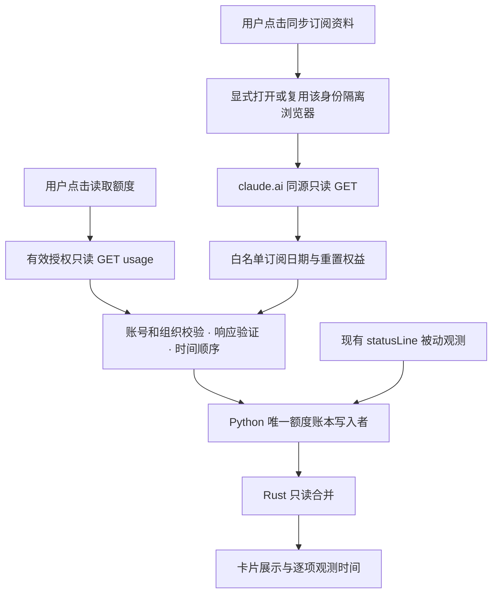

<!--
[INPUT]: Claude-Local 0.1.7 source, the owner's card screenshot and manual-reset clarification, official Claude support material, and pinned public source snapshots.
[OUTPUT]: Source-anchored quota-card findings, retrieval feasibility, card presentation and a staged implementation proposal.
[POS]: Research/design record. No product implementation, real-account query, deployment or permission-policy change is performed by this document.
[PROTOCOL]: Separate observed code, community reports, proposed behavior and unverified account-specific availability. Never include credentials, account identifiers or raw authenticated responses.
-->
# 额度卡片与在线数据来源调研

调研日期：2026-10-22。产品基线为 0.1.7（代码提交 `765148f3e3c4b0d67f4f7e3e6cf6a2370d0ffaa5`；当前文档 HEAD 为 `5b0959f`）。用户明确说明，“剩余重置次数”指平台提供的手动重置权益余额，不是订阅结束前可经历的自动窗口数。

## 结论与建议

卡片应把空间交给套餐、5h/7d 额度、订阅日期和手动重置余额。Pro/Max 移到账号别名附近；“凭证有效”“待自动续期”“推荐切换”退出卡片常驻区。凭证异常仍可在用户点击刷新或操作时给出具体说明。登录凭证有效期与订阅有效期没有可替代关系。

常规额度可以通过已有有效授权主动读取，不必每次切换 Claude Code 账号再执行 `/usage`。公开实现使用 `GET https://api.anthropic.com/api/oauth/usage`，返回 `five_hour`、`seven_day` 的 `utilization` 和 `resets_at`。这仍然需要有效授权，不等于完全免登录，也不保证被暂存的旧凭证一直有效。[claude-meter OAuth 实现](https://github.com/m13v/claude-meter/blob/acef1aa48f39fdb0f8567313f6df8d0dd2fdf8aa/src/oauth.rs#L136)

订阅日期与手动重置余额需要独立的数据通路。浏览器认证的 `subscription_details` 有公开实现先例，但已证实字段是 `next_charge_date`，不能一律标成“订阅到期”。手动重置的公开实现从浏览器同源 usage 响应中的 `cedar_ember.grants` 读取；不能保证现有 Claude Code OAuth 对所有网页赠送权益都有权限。[历史订阅读取实现](https://github.com/m13v/claude-meter/blob/7b99d5a64acca3b3a714a9f7c1c8d62f9eddb5ea/src/api.rs#L45)；[Clawmeter 读取实现](https://github.com/tnunamak/clawmeter/blob/17edf27e68d194724b9a6741b1c1dd3b10ca119c/extension/resets.js#L45)

建议分开提供“读取额度”和“同步订阅资料”的用户动作；前者可用有效 OAuth，后者优先使用产品已有的隔离浏览器登录上下文。首次登录或授权无法消除；目标是复用已有授权，并免去每次切换 CLI 账号与运行 `/usage` 的步骤。

## 三类信息必须区分

### 订阅与凭证日期

`OAuth expiresAt` 表示登录凭证需要续期的时间；它不是 Pro/Max 订阅到期。`next_charge_date` 表示下次扣款日期；自动续费开启时应显示“下次续费”。只有服务端明确提供已取消订阅的权益结束日期时，才显示“订阅有效至”。苹果/Google 应用商店订阅的账单入口不同，不能用网站字段缺失推断没有订阅。

官方说明，取消订阅在当前付费周期结束时生效，取消后可继续使用到该时点。因此，“停止续费”与“立即失去权益”也不能混用。[取消订阅说明](https://support.claude.com/en/articles/8325617-cancel-your-pro-or-max-subscription)；[账单 FAQ](https://support.claude.com/en/articles/8325618-paid-plan-billing-faqs)

### 自动窗口重置

5h/7d 的 `resets_at` 是对应额度窗口的边界，与手动重置券不是同一资源。本项目已有 `reset_inferred` 表示可信历史边界已过后的本地预计恢复。这个状态应继续标明“预计”，不得被在线读取失败改写成服务端刚刚确认的 100%。

### 手动重置权益

官方已确认限时赠送的 limit reset 存在，可以针对五小时或周额度，可能有有效期；使用后不可撤销，也不改变额外用量余额或正常周重置日。官方入口为网页或 Desktop 的 Settings > Usage；终端/IDE 上未提供相同按钮。[What is a limit reset?](https://support.claude.com/en/articles/17007452-what-is-a-limit-reset)

Clawmeter 的固定提交读取：

```text
GET https://claude.ai/api/organizations/{organization}/usage?at_wall=1&skip_spend=1
cedar_ember.grants[]:
  resets_left   剩余次数
  starts_at     开始可用时间
  ends_at       权益失效时间
  paused        是否暂停
```

可用余额应为：已经生效、尚未过期、没有暂停的 grants 的 `resets_left` 之和。不要简单计算 grants 数组长度。按权益分别保留失效时间，卡片显示合计，详情显示最早失效与可清除的窗口范围；没有可信 scope 字段时保持“适用范围待确认”。[浏览器解析](https://github.com/tnunamak/clawmeter/blob/17edf27e68d194724b9a6741b1c1dd3b10ca119c/extension/resets.js#L55)；[原生验证](https://github.com/tnunamak/clawmeter/blob/17edf27e68d194724b9a6741b1c1dd3b10ca119c/internal/claudeweb/resets.go#L111)

空值不代表余额为零。公开 issue 显示，基础 OAuth 响应的 `cedar_ember:null` / `juniper_tide:null` 会令旧解析器提前判空；独立 probe 可能返回 `ineligible_reason:"surface"`，即网页可见的权益在 OAuth 通路不可见。已合并补丁修复的是空值判断，不能解除服务器的通路限制。[社区复现 #12883](https://github.com/can1357/oh-my-pi/issues/12883)；[已合并修复 #12886](https://github.com/can1357/oh-my-pi/pull/12886)

## 当前产品为何不能直接得到这些信息

前端 `src/identities.tsx` 的 `read()` 调用 `identities_read`；额度详情的刷新按钮调用 `read(false)`，该路径读取本地状态，没有接入在线 usage 请求。`src-tauri/src/identities/profile.rs` 组合本地配置、缓存、Python 额度锚点及会话估算。手动执行 `/usage` 或收到 statusLine 的真实 rate-limit 输入能补充服务端观测，而反复点本地刷新无法凭空产生新的服务端数据。

`subscription_expires_at` 已存在于摘要契约，但 `profile.rs:1474` 初始化为 `None`，本轮源码检查没有发现可信订阅日期赋值路径；该文件的合成测试也明确断言没有把凭证到期转为订阅日期。`identities.tsx:704` 的重置次数仍固定显示“未提供”，不是尚未刷新出来的真实余额。

`profile.rs:1382` 附近依据 access credential 的有效期与是否存在 refresh credential，产生 `valid`、`refresh_needed` 等状态；`identities.tsx:31` 把后者呈现为“待自动续期”。这能说明登录凭证状态，但没有实际订阅续费含义。卡片 `identities.tsx:581` 与 `:614` 常驻这些标签，确实占用了本可展示业务权益的位置。

## 用户指定的四个项目

以下按本轮定位到的公开仓库记录。同名项目可能存在；尤其 Claude Switcher 在这里指 `YOURSJEYO/claude-switcher`，同时检查了轻量的 `Symbioose/claude-account-switcher` 作为名称消歧参考。所有结论限定于固定提交及已检查模块，不用“支持 Claude”推导它支持每个账户字段。

### Claude Swap：常规额度查询与请求治理的首要参考

仓库 `realiti4/claude-swap`，固定提交 `c896cdd64829ae3a4e674cc520238dce13c0c847`，MIT。`src/claude_swap/oauth.py:399` 的 `request_usage_data` 使用 OAuth Bearer、`anthropic-beta: oauth-2025-04-20` 和明确的应用 User-Agent，对 usage 发起超时五秒的 GET。`build_usage_result` 解析五小时、周窗口及附加用量。[请求与解析](https://github.com/realiti4/claude-swap/blob/c896cdd64829ae3a4e674cc520238dce13c0c847/src/claude_swap/oauth.py#L399)

值得借鉴的是 `usage_store.py` 将最后有效测量 `lastGood` 与请求失败/退避状态分开，并以有界租约协调多收集者：申领时持锁，网络请求在锁外，提交时重新持锁并校验租约，拒绝已经过时的写入。这与本项目唯一写入者、原子替换和新观测优先的方向一致。[存储设计说明](https://github.com/realiti4/claude-swap/blob/c896cdd64829ae3a4e674cc520238dce13c0c847/src/claude_swap/usage_store.py#L1)；[租约提交](https://github.com/realiti4/claude-swap/blob/c896cdd64829ae3a4e674cc520238dce13c0c847/src/claude_swap/usage_store.py#L1084)

`poll_policy.py` 的三分钟缓存下限、AIMD 退避及 `Retry-After` 额外保护来自该项目作者在特定账号/时间的测量。它关于约 28–30 次/小时的记录不是 Anthropic 发布的统一限额；附加 900 秒也不是应直接照搬的产品常量。应借鉴共享冷却、去重和服务端反馈优先的机制，不复制其高频调度或未经本项目验证的经验阈值。[限制及误差说明](https://github.com/realiti4/claude-swap/blob/c896cdd64829ae3a4e674cc520238dce13c0c847/src/claude_swap/poll_policy.py#L1)

源码还区分活跃/非活跃账号的凭据刷新。Claude-Local 不应直接移植其自动轮换策略：身份归档、活跃 CLI 和其他进程可能共享授权血缘；必须先明确凭据所有权与安全持久化协议。该项目已检查的额度模型不能直接提供本需求的订阅日期或网页赠送手动重置余额。

### Cockpit Tools：Claude OAuth 与网页通路的双实现

仓库 `jlcodes99/cockpit-tools`，固定提交 `76fbea02ba8ab5a071205a0bfa59ef4db5cc64b4`。根 README 声明默认许可为 CC BY-NC-SA 4.0；本轮克隆的根目录没有独立 LICENSE 文件。[许可声明](https://github.com/jlcodes99/cockpit-tools/blob/76fbea02ba8ab5a071205a0bfa59ef4db5cc64b4/README.md#L498)

它的 Claude 模块确实向 `api.anthropic.com/api/oauth/usage` 发起 Bearer GET，使用十五秒超时；同时有网页会话通路读取组织 usage、`subscription_details` 和 `overage_spend_limit`。这证明“无需切换 CLI 后执行 /usage”已有工程先例。[OAuth 请求](https://github.com/jlcodes99/cockpit-tools/blob/76fbea02ba8ab5a071205a0bfa59ef4db5cc64b4/src-tauri/src/modules/claude_account_desktop_auth.rs#L3460)；[网页请求](https://github.com/jlcodes99/cockpit-tools/blob/76fbea02ba8ab5a071205a0bfa59ef4db5cc64b4/src-tauri/src/modules/claude_account_desktop_profile.rs#L1242)

可借鉴其账号级 `ClaudeQuotaRefreshGuard` 及相关并发测试。它请求订阅详情，但本轮检查的映射主要提取套餐字段；没有证据证明已实现本需求的真实订阅结束日和 Claude 手动重置余额。它的 Codex `rate-limit-reset-credits` 属于 ChatGPT 通路，不能移用于 Claude。[账号级刷新互斥](https://github.com/jlcodes99/cockpit-tools/blob/76fbea02ba8ab5a071205a0bfa59ef4db5cc64b4/src-tauri/src/modules/claude_account_oauth_updates.rs#L67)；[并发测试](https://github.com/jlcodes99/cockpit-tools/blob/76fbea02ba8ab5a071205a0bfa59ef4db5cc64b4/src-tauri/src/modules/claude_account_cli_sync_tests.rs#L205)

其直接提取 Chromium Cookie 的方式不作为本项目采纳方案；优先研究隔离浏览器内同源读取、只回传白名单资料的桥接。

### Antigravity Tools：借鉴请求隔离，不套用 Google 配额模型

对应仓库 `lbjlaq/Antigravity-Manager`，固定提交 `9f8e4f24d61b33fa80b8078d104c942752a5fa0b`，根 LICENSE 为 CC BY-NC-SA 4.0。[许可](https://github.com/lbjlaq/Antigravity-Manager/blob/9f8e4f24d61b33fa80b8078d104c942752a5fa0b/LICENSE)

本轮检查的 `src-tauri/src/modules/quota.rs` 调用 Google Cloud Code 的 `loadCodeAssist`、`retrieveUserQuotaSummary` 和 `fetchAvailableModels`；这里的 Claude 模型配额来自 Google 托管服务，不能据此推断 Claude Pro 账户的订阅或重置券数据结构。模块单独维护 `QUOTA_ENDPOINT_HEALTH`，可借鉴额度读取与主业务请求健康状态分离的做法。[配额端点与独立健康状态](https://github.com/lbjlaq/Antigravity-Manager/blob/9f8e4f24d61b33fa80b8078d104c942752a5fa0b/src-tauri/src/modules/quota.rs#L11)

检索到的 `quotaResetDelay` 用于上游 429 的等待/退避，不是“剩余手动重置次数”。本报告不对该项目所有网关功能是否可能连接其他服务作全局判断。

### Claude Switcher：主要解决环境和客户端快照隔离

对应仓库 `YOURSJEYO/claude-switcher`，固定提交 `abfb2d718368f0cbbe4849d112e98afa457c1cab`，MIT。已检查 README 与切换模块的主要职责是启动前环境检查、Desktop 快照隔离和进程守护；没有找到可直接迁移的五小时/周额度、订阅日期或手动重置余额解析器。[项目定位](https://github.com/YOURSJEYO/claude-switcher/blob/abfb2d718368f0cbbe4849d112e98afa457c1cab/README.md#L3)

它的进程急停与客户端目录替换流程不属于本需求，也不符合本项目开发期间保护运行中 `claude.exe` 的规则，因此不纳入此次改造。名称相近的其他项目也不能仅凭名字认定为同一实现。

上述调研优先借鉴设计和协议事实，独立实现符合本产品边界的代码。Antigravity/Cockpit 的非商业及相同方式共享许可不应被当作可直接并入本仓库 MIT 代码的许可；本轮没有复制第三方产品代码。

## 补充项目的直接证据

### Clawmeter：手动重置权益的主要参考

仓库 `tnunamak/clawmeter`，本轮固定提交 `17edf27e68d194724b9a6741b1c1dd3b10ca119c`，MIT。其星数较少，不能据此称成熟生产方案；但有针对本问题的实现、解析测试及 JS→Go 合同测试，证据比泛泛的账号切换功能更直接。本轮只读检查源码和测试，没有运行第三方代码或对用户账号验证。

可借鉴点是：在已经登录的 claude.ai 标签页内发起同源只读请求，不向桌面端导出 Cookie；仅向配对的本地接收端发送白名单字段；按账号来源绑定摘要；旧观测不能覆盖新观测；余额为零与无数据分开处理。[浏览器执行](https://github.com/tnunamak/clawmeter/blob/17edf27e68d194724b9a6741b1c1dd3b10ca119c/extension/background.js#L62)；[接收与匹配](https://github.com/tnunamak/clawmeter/blob/17edf27e68d194724b9a6741b1c1dd3b10ca119c/internal/claudeweb/extension.go#L147)；[摘要绑定](https://github.com/tnunamak/clawmeter/blob/17edf27e68d194724b9a6741b1c1dd3b10ca119c/internal/claudeweb/store.go#L15)；[合同测试](https://github.com/tnunamak/clawmeter/blob/17edf27e68d194724b9a6741b1c1dd3b10ca119c/internal/claudeweb/contract_test.go#L11)

本项目不应照搬其一分钟轮询，也不能只以组织 UUID 匹配账号：Team 组织可含多个成员，必须同时核对账号与组织身份。本地起始页已经具备回环会话回报能力，但该页面不能直接跨源读取 claude.ai；仍需独立的站点范围浏览器桥接实现和验证。

### claude-meter：常规额度与订阅资料的权限差异

仓库 `m13v/claude-meter`，当前固定提交 `acef1aa48f39fdb0f8567313f6df8d0dd2fdf8aa`，MIT。当前实现用 CLI 已有 OAuth 读取 usage/profile，并明确把 `subscription` 留空，因为网页账单信息没有通过相同 OAuth scopes 暴露。它不主动轮换 CLI 凭据，而是让 CLI 自行维护。[当前源码](https://github.com/m13v/claude-meter/blob/acef1aa48f39fdb0f8567313f6df8d0dd2fdf8aa/src/oauth.rs#L136)；[当前 README 限制](https://github.com/m13v/claude-meter/blob/acef1aa48f39fdb0f8567313f6df8d0dd2fdf8aa/README.md#L67)

其历史版本 v0.1.1（提交 `7b99d5a64acca3b3a714a9f7c1c8d62f9eddb5ea`）确实通过浏览器认证读取 `/subscription_details`，模型字段为 `next_charge_date`。搜索结果中部分博客描述的是这个旧版本，不代表当前 main 仍提供该能力。旧版提取日常浏览器 Cookie 的方式不适合本项目；可借鉴字段语义与请求分层。[历史请求](https://github.com/m13v/claude-meter/blob/7b99d5a64acca3b3a714a9f7c1c8d62f9eddb5ea/src/api.rs#L45)；[当前保留模型](https://github.com/m13v/claude-meter/blob/acef1aa48f39fdb0f8567313f6df8d0dd2fdf8aa/src/models.rs#L51)

## 建议的数据与交互设计



这是待实施设计：OAuth usage 的用户触发在线读取会扩展现有“纯被动采集”边界；不引入后台 OAuth 轮询。界面原有“刷新本地状态”与新的“读取在线额度”应明确区分，避免点刷新后仍只展示旧锚点。

任何新额度来源继续交给 Python 在跨进程锁内原子写入；Rust 不直接改写 `quota_ledger`。订阅与权益应有独立、按账号绑定的扩展元数据，不混进 Token 计费账本，也不为了增加显示字段就修改 SQLite `user_version=3` 或归档格式。兼容旧摘要，缺失新字段时保持未知。

建议最小模型包含 `billing_date_kind`（next_renewal / access_until / unknown）、`billing_date`、`reset_grants`、每种来源各自的 `observed_at`、`status` 和账号/组织绑定。它比复用一个 `subscription_expires_at` 更能正确表达真实语义。

刷新采用按账号串行、同请求合并、手动冷却和服务端 `Retry-After` 退避。401/403 分别表达授权失效/权限或通路不可用，429 保留上次有效观测并说明重试时间，网络失败不把旧数据清成零。对未知响应结构只报告“数据格式变化”。保存账号只读解密自身授权，不把账号写入活跃 CLI 配置，不切号、不启动推理请求、不自动刷新可能轮换的共享 refresh credential。

卡片保持 180×286，信息顺序为：账号名与 Pro/Max、按隐私偏好展示的邮箱、两条额度窗口、订阅日期、手动重置余额、读取动作。重置失效日期与来源时间可进入详情，卡片仅在临近失效或观测过旧时提示。浏览器未启动时，应明确需要显式打开并复用对应身份；不能为自动刷新违背“普通启动不拉起浏览器”。

“手动重置”只展示余额，本轮需求不增加消耗按钮。权益未知、确认 0 次、观测过旧、无权限必须是不同状态；不能把请求失败显示成 0 次。

## 实施与验证顺序

1. 先完成卡片信息重排及双语文案，移除重复状态标签，保留必要错误入口。
2. 增加用户触发的常规额度只读服务与 Python 写入入口，覆盖有效授权、失效授权、账号隔离、429 与新旧观测顺序。
3. 为隔离浏览器增加站点范围的订阅/手动权益同步桥，先验证白名单和账号匹配，再验证真实字段兼容；不读取日常浏览器资料库，不导出 session cookie。
4. 用合成响应和假 IPC 验证卡片布局、隐私模式、双语、缺失日期、自然重置/手动余额区别及旧观测保留。针对性验证通过即止，正式打包仍走既有远程 CI。

## 本轮范围与遗留

本轮仅开展公开源码、官方资料和本地代码研究，并提供可审阅方案。没有读取真实凭据、调用用户账户接口、切换身份、运行 `/usage`、消耗手动重置、修改安装软件或触发构建。

仍需后续在明确开展实现时，以脱敏的真实服务端响应确认：用户各账号是否具有手动重置权益、订阅字段在网页/商店购买场景下的实际形状、隔离 Chromium 对站点桥接的支持。公开源码能证明通路与字段有实现先例，不能证明本机每个账号现在都能读取。

参考 `REA_Study` 的证据纪律，本报告区分“代码已观测”“社区运行报告”“拟议设计”和“账户级未知”。本次目标已有公开源码，无需对用户正在运行的 Claude 二进制做动态插桩、抓包或逆向；也没有注册 REA MCP 或更改共享工具配置。

## 来源与复核范围

官方资料：本报告引用的 [limit reset 说明](https://support.claude.com/en/articles/17007452-what-is-a-limit-reset)、[取消订阅说明](https://support.claude.com/en/articles/8325617-cancel-your-pro-or-max-subscription)、[付费账单 FAQ](https://support.claude.com/en/articles/8325618-paid-plan-billing-faqs)。

固定源码：正文分别链接 Claude Swap、Cockpit Tools、Antigravity Tools、Claude Switcher、Clawmeter 与 claude-meter 的固定提交；社区运行证据来自 oh-my-pi issue #12883 和已合并 PR #12886。以上均是软件接口与产品行为材料，本问题不依赖学术论文证据。

本地源码：`src/identities.tsx`、`src/identity-model.ts`、`src/identity-quota.ts`、`src-tauri/src/identities/profile.rs`、`src-tauri/src/identities/mod.rs`、`scripts/claude_quota.py` 及相关目录说明。网络检索原始输出和第三方源码副本保存在工作区外的本轮临时调研目录；不随产品打包。
