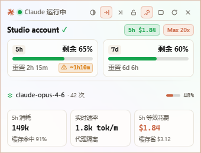
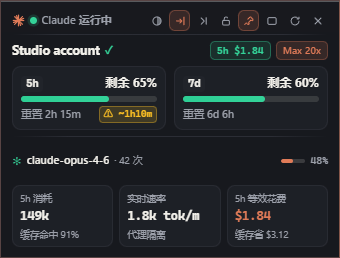
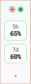
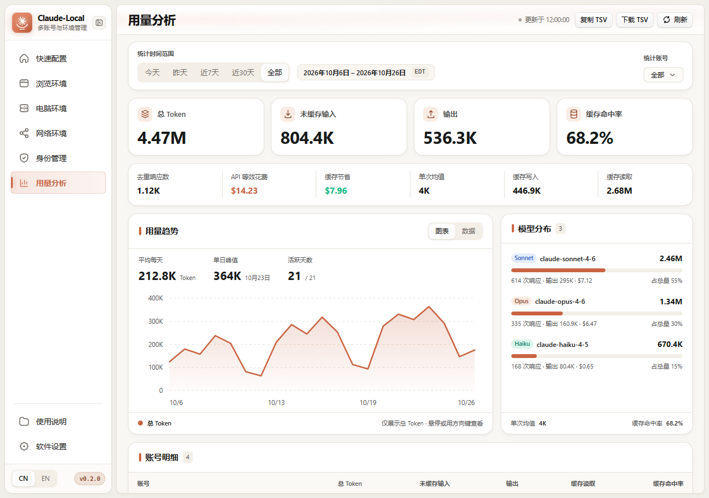

<!--
[INPUT]: Version 0.2.0 UI/UX refinement, Token Monitor-inspired HUD window, API USD cost calculation, linked browser switch auto-launch, and verified synthetic test suites.
[OUTPUT]: Bilingual public release notes for Claude-Local v0.2.0.
[POS]: Versioned release description used for GitHub Release v0.2.0 and repository documentation.
[PROTOCOL]: Preserve private distribution boundaries, existing user vaults, and explicit verification bounds.
-->
# Claude-Local 0.2.0 Release Notes

> **🇨🇳 简体中文** · **[🇺🇸 English Summary Below](#-english-release-summary)**

`Claude-Local 0.2.0` 面向 Windows 10 / 11 x64 带来全新的 **Token Monitor 风格多模态桌面悬浮监控窗（HUD）**、**基于 Anthropic 官方 Claude API 定价的美元等效花费（USD）与缓存节省分析**、**勾选「联动浏览器」切号自动打开新账号浏览器验证页**，以及覆盖全工作区的界面减负与导航栏美化。

---

## ✨ 核心更新亮点

### 1. 🖥️ 新一代 Token Monitor 风格桌面悬浮监控小窗（HUD）

| 浅色展开模式（`340×258`） | 深色极光模式（随主题/壁纸同步） | 贴边自动隐藏胶囊（`52×138`） |
| :---: | :---: | :---: |
|  |  |  |

- **三态几何自适应**：支持 **展开模式（`340×258`）**、**紧凑模式（`340×152`）** 与 **侧边胶囊模式（`52×138`）**，完整呈现 `重置 2h 15m` 与 `⚠ ~1h10m` 耗尽预警，彻底解决窄窗文字截断。
- **Token Monitor 三栏实时遥测**：底部集成 **5h 消耗（含缓存命中率）**、**实时速率（`tok/m` + 路由隔离状态）** 与 **5h 等效花费（`$X.XX` + 缓存节省 `$X.XX`）**，并在账号行展示当前主力模型调用次数及占比。
- **置顶 / 位置锁定 / 18px 边缘磁吸 / 贴边自动隐藏 / 50%–100% 透明度**：
  - 一键切换常驻 **置顶（Pin）** 与 **锁定位置（Lock）**；
  - 拖拽靠近显示器工作区四边 18px 内自动 **磁吸对齐（Magnetic Edge Snap）**；
  - 开启 **贴边自动隐藏（Edge Auto-Hide）** 后，停靠在屏幕左右边缘的小窗在鼠标移出后自动收缩为 `52px` 侧边胶囊，鼠标移入或点击即刻展开；
  - 内置 **50%–100% 无级透明度滑块与五档快捷预设**（支持右键快速循环切换），并实时同步主软件的浅/深色主题、6 套强调色與自定义壁纸。

### 2. 📊 用量分析：API 等效美元花费（USD）与同行时间范围

- **同行时间范围与时区徽章**：将当前筛选日期区间与时区标识（如 `2026年10月6日 – 2026年10月26日 EDT`）移至 `[今天 | 昨天 | 近7天 | 近30天 | 全部]` 右侧同行空白处。
- **单行 6 项次级遥测横条**：在四大 KPI 卡片下方提供 `去重响应数 | API 等效花费 ($USD) | 缓存节省 ($USD) | 单次均值 | 缓存写入 | 缓存读取` 六维统计，按 Anthropic 官方 Claude API 模型单价自动计算美元花费与缓存节省金额。
- **按模型成本分布**：右侧「模型分布」同步显示每个模型家族的调用响应次数、输出 Token 与等效美元花费（如 `614 次响应 · 输出 295K · $7.12`）。

### 3. 🔐 身份管理与内置浏览器切号自动联动

- **顶部工具栏一体化**：右上角 `[• 自动续杯 | 08:00–23:00] | [• 悬浮监控窗] [↻ 同步本地额度] [⋯]` 采用统一 `30px` 高度胶囊与按钮组设计。
- **三步法引导栏精简**：移除「添加新号 3 步法」右侧冗余的「打开内置浏览器」按钮。
- **切号自动打开联动浏览器**：勾选「联动浏览器」后切换身份时，无论内置浏览器此前是否开启，均自动拉起新切入账号对应的隔离浏览器并打开环境检测与登录验证页。

### 4. 🧭 全局界面减负与导航栏美化

- **左侧导航栏升级**：移除底部冗余搜索栏（保留 `Ctrl+K` 快捷键呼出命令中心），新增当前页左侧 `3px` 强调色指示条与渐变激活态，底部 `[CN | EN]` 与 `v0.2.0` 版本徽章合并为单行。
- **浏览环境、电脑环境与使用说明精简**：移除浏览环境顶部多余的 `绑定身份`、`Chromium` 标签及 `正常退出浏览器`、`设为默认浏览器` 按钮；移除电脑环境右上角低频按钮；移除使用说明底部的「任务交接模板」。

---

## 🇺🇸 English Release Summary

**Claude-Local `v0.2.0`** (Windows 10 / 11 x64) introduces a redesigned **Token Monitor-inspired Multi-Mode Floating HUD**, **official Anthropic API USD cost & prompt cache savings analytics**, **automatic linked-browser launch on identity switch**, and a cleaner workspace UI:

1. **Multi-Mode Floating HUD (`?window=monitor`)**: Supports Expanded (`340×258`), Compact (`340×152`), and Edge-Collapsed Capsule (`52×138`) modes with **Always-on-Top Pin**, **Position Lock**, **18px Magnetic Edge Snap**, **Edge Auto-Hide** (collapses to side capsule on mouse leave, expands on hover/click), **50%–100% Continuous Opacity Slider**, live **5h USD Cost / Cache Savings / `tok/m` Velocity tiles**, and real-time theme/accent/wallpaper synchronization.
2. **Official USD API Cost & Cache Savings in Usage Analytics**: Inline date-range & timezone badge beside period tabs, a 6-column secondary telemetry bar (`Unique responses | Est. API cost | Cache savings | Avg / response | Cache writes | Cache reads`), and per-model USD cost breakdown.
3. **Identity Toolbar & Linked Browser Auto-Open**: Unified `30px` segmented header toolbar, cleaner 3-step onboarding bar, and automatic launch of the newly switched account's isolated browser verification page when **Link browser** is checked.
4. **Sidebar & Workspace Streamlining**: Refined left navigation bar with a `3px` accent indicator and single-row `[CN | EN] + v0.2.0` footer; removed redundant controls across Browser, Computer, and Guide pages.
