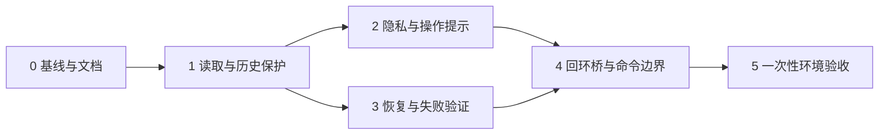

<!--
[INPUT]: Approved-scope choices in README.md, evidence S01-S12 in FINDINGS.md and current repository APIs/test fixtures.
[OUTPUT]: Self-contained implementation phases, exact integration points, proportional verification and rollback criteria.
[POS]: Pending plan; phase descriptions are future work and are not execution receipts.
[PROTOCOL]: Begin only after user approval; preserve data formats and existing user changes, and stop when required checks pass.
-->
# 分阶段实施计划

版本：提案 v1，2026-10-21。状态：待用户确认。执行前重新核对基线与工作区，不能假定其他会话没有改动。

## 目标、范围与执行约定

默认执行范围为入口文件中的推荐 A：原始历史优先、读取与维护分离、隐私一致、操作透明、恢复可验证。阶段 0–5 分开提交审阅材料，不把所有问题合成一次大重构；本文件不授权提交推送、部署或发布。

每阶段开始前读相关目录 `CLAUDE.md` 与 source header；编辑后更新 INPUT/OUTPUT/POS、目录地图和双语文案。复用已有 Cromma/Radix/Motion、Rust/Win32 及合成夹具，不新增前端依赖。不修改他人的 AGENTS/HANDOFF、未跟踪工具资料或个人运行文件。

工作量以 S/M/L 表示相对复杂度，不给未验证的工时承诺。依赖顺序如下：

## 阶段 0 · 文档发现与基线固定 · S

### 实施内容

本轮已完成首轮发现；未来实施时先复核 `git status`、当前提交、相关文件是否变化及用户批准的 A/B 取舍。工作区有其他会话改动时按文件范围协调，不 stash、不 reset、不清场。

阅读 [DEVELOPMENT](../../../docs/DEVELOPMENT.md)、[SECURITY](../../../src-tauri/SECURITY.md)、[目录说明](../../../src-tauri/src/identities/CLAUDE.md)、[前端地图](../../../src/CLAUDE.md)、[测试地图](../../../tests/CLAUDE.md)，并从本报告链接找到相应夹具。官方事实按 [FINDINGS](FINDINGS.md) 的 O1–O4 复核；若页面或 CLI 行为变化，更新证据再实施，不能从旧结论猜新 API。

### 允许复用的现有接口

- `Database::open(root: &Path) -> Result<Self, String>`；`pending/complete` 用于既有恢复状态。参考 `database.rs:31、266`，不改 SQLite `user_version=3`。
- `Store::switch(&mut self, target: &str, name: &str, policy: &Policy, reporter: &Reporter)`、`recover`、`delete`，参考 `store.rs:408、521、708`。
- `Store::save_checkpoint(&self, name: &str, policy: &Policy, reporter: &Reporter)`，参考 `archive.rs:201`；不要误当作无条件覆盖当前槽位的 `save`。
- `private::safe/directory/create/write`，参考 `private.rs:57、145、176、220`。复用现有私有落盘和原子替换，不能另用普通文件写入绕过权限层。
- `Reporter::channel/log` 与 `AppDialog`，参考 `progress.rs:29`、`dialog.tsx:14`。真实事件驱动进度，默认取消和既有焦点规则继续生效。
- `maskEmailAddress`、`usePreferences`、Cromma `Button/Checkbox/Disclosure/Tabs`，参考 `settings-model.ts:133` 及 `vendor/cromma-ui/src/index.ts`。
- `server::nonce/current_session/resource`，参考 `browser/server.rs:55、63、99`。保留随机令牌与受限资源解析。

下文的只读状态模型、隐私桥、结构化结果和 OS 锁都是拟新增设计，不是已经存在的 API。实施时先确定最小签名和调用者，不能直接调用虚构接口。

### 完成条件

记录可执行基线、确认范围、已有变动和每阶段文件清单；首轮不运行全库测试。基线若已变更，定向更新相关证据，保留其他会话成果。

## 阶段 1 · 读取不改历史，备份保留原件 · L

对应 S01/S02，是原生层的首个实施批次。

### 实施内容与复用位置

1. 从 `identities/mod.rs::state`、`Store::open`、`archive.rs::save_inner` 梳理调用链。拆开本应用索引维护与默认 Claude 工作区修改；移除读取、摘要补齐和单纯保存时隐式运行 sanitizer 的路径。
2. 保留必需的本应用索引创建、合法旧索引迁移和摘要更新；它们只能写本产品私有目录。临时区回收也不能误删另一个正在进行的操作，先纳入已有事务门和恢复状态判断。
3. 按推荐 A，停止切换/恢复中的自动会话内容转换。纳入归档的会话/历史文件先按原始字节进入已有认证归档；配置仍按既有键白名单提取，不扩大备份范围。恢复和共享历史的既有路径限制继续保留，不批量改变旧归档。不能把 `save_checkpoint` 不经分析地套在所有动作上，造成无界归档或意外回收原件。
4. 原账号历史与跨账号留在工作区的历史分别说明。现有 `Policy` 布尔语义保持兼容，已有用户选项不静默重置；若提供“工作接力/按账号带走”预设，只映射现有策略，并在执行前展示具体影响。
5. 用户保留旧会话但在另一账号续接不兼容时，提供新建会话建议；不通过改写组织、签名或遥测来假称已解决。历史转换若仍被要求，回到 B 的独立设计，不偷偷回退旧自动行为。
6. 原有 `let _ = ...` 吞掉维护错误的位置逐一分类：不再需要的自动修复直接撤出；必要操作的失败进入现有真实进度/错误状态，不把部分失败报告成安全处理完成。

### 验证

复用 `optimization_tests.rs` 的虚构跨账号历史和 `tests.rs` 的临时保险库。定向覆盖：

- 含旧摘要、异账号标记、损坏行、thinking/工具块的合成文件，在页面读取和单纯备份前后，字节 SHA-256 一致；无会话或配置源路径新增删除。
- 新保存归档解包后的会话/历史文件与纳入归档的对应输入字节一致；配置仍符合键白名单。旧 gzip/Zstd、BAGAID01 认证、HMAC、ID、种子仍兼容。
- 开启/关闭历史保留策略分别验证文件去向；恢复和失败回滚保留原件；进程仍运行时继续拒绝修改。
- 原有会话转换测试调整为新契约：证明不发生无感改写及兼容性限制可见；不能仅删除失败断言。

只运行新测试对应过滤项和原有直接相关兼容项。需要隔离系统路径的原生测试交一次性 CI；本机不跑完整 `cargo test`。

### 风险与回退

主要行为差异是跨账号旧会话续接可能不再自动修复。先交代码与合成结果供审阅；若未满足数据完整性条件，不进入真实使用验证。回退只撤销本次代码块，保留全部数据和新归档，不用旧归档覆盖用户最新工作区。

## 阶段 2 · 隐私一致与操作提示 · M

对应 S03–S07；依赖阶段 1 的读取边界。

### 实施内容与复用位置

1. 修正 `settings-model.ts::maskEmailAddress` 的短邮箱分支。主卡片、切换/恢复确认、用量列表、title/aria 和邮箱充当名称的回退路径统一使用同一规则，避免双重打码。
2. 主程序与独立浏览器增加一个仅承载隐私布尔值的原生偏好桥。参考 `ui_language.rs` 的白名单、原子持久化与成功后更新模式；新文件若需要，只放应用资料根下的有界 UI 偏好，不含账号、路径或凭据，不写身份数据库版本。
3. 首次同步显式接纳旧 `privacyMask` 设置；持久化后原生是该布尔值的权威来源，前端仅保留兼容缓存。独立起始页不读主 WebView 的 localStorage；未知或失败时先遮罩。伴生显示 DTO 在原生层按偏好裁剪，关闭打码只在读取到明确的 false 后生效。
4. 浏览环境如需显示当前本地资料归属，在 Rust `Snapshot` 增加有界展示摘要；复用 `BrowserIdentity` 的允许字段，不读取网站 Cookie，不把绑定状态写成网页已登录同一账号。
5. 直接删除当前身份复用保存/切换弹窗的进程明细。恢复弹窗展示 `state.recovery` 对应原身份和“执行时先保存当前残存状态”的说明；执行前不能使用“检查点已创建”的过去时。空身份或名称不可用时有明确回退。
6. 在额度卡片标注周期推算；未知采集时间不伪造。浏览器报告显示上次测量时间，超过拟议 10 分钟提示较旧，网络变化提示手动重测；不增加出口/OAuth 自动请求。
7. 修订帮助、浏览文案和统计说明中的历史残留；保持双语键与插槽一致。不扩展成新的营销页、设置大重排或新图表库。

### 验证

- 现有 `settings-model`/本地化测试中补一组短邮箱与普通邮箱；这些测试验证隐私契约而不是镜像实现。
- 复用假 IPC GUI 夹具，覆盖隐私开关、确认框、独立 context、偏好失败时无闪现；正文、title、aria、序列化伴生 DTO 都不包含原邮箱。使用 `a@example.test` 等虚构值。
- 用合成 `sessions/recovery` 检查删除进程明细和原身份显示；绝不启动或终止真实 Claude 会话。
- 用受控时钟检查额度推算与报告时效，断言只改变本地显示、不增加原生命令或出口请求。
- 运行 TypeScript/Vite 构建与本次相关 GUI 子检查；保持工牌 180×286、双语、主题和现有窄窗无溢出。没有新改动时不反复全套回归。

### 风险与回退

隐私桥迁移失败保持遮罩并显示可恢复错误，不回退为明文。新字段保持前后端兼容，旧 context 缺隐私状态按未知处理。回退前端改动时保留新偏好文件，不重写用户其他设置。

## 阶段 3 · 恢复与部分失败验证 · M

对应 S04/S09，依赖阶段 1；这阶段主要补证和修复由本次改动暴露的确定问题。

### 实施内容

从 `interrupted_switch_can_recover_and_preserves_pre_recovery_state`、`operation_progress_tracks_completed_sources_and_explicit_rollback` 复制临时夹具和 Reporter 模式。检查已有故障点后，只补清理前、部分恢复、凭据阶段边界、提交前最关键的缺口，避免每一行都加故障注入。

故障注入只放测试编译范围；不得增加可由产品环境变量或 IPC 打开的绕过开关。重新打开 Store 验证持久恢复状态，而非只在同一对象上重试。需要进程退出模型时，使用 CI 中专用合成 helper 自行退出，不能以正在运行的 `claude.exe` 做样本。

直接删除仍无隐式新增备份。若需要结构化结果，只增加完成阶段、部分完成/需刷新等有界字段，不把文件正文、凭据或任意路径放入错误。失败后保留原始事件和明确的下一步，不自动再次执行删除。

### 验证与完成条件

- 失败前未修改的路径保持不变；发生修改后恢复标记不会被误清除。
- 重开后拒绝冲突动作，保留恢复前检查点，恢复到明确的原身份。
- 直接删除失败准确呈现部分完成，成功删除不扩大保留策略范围。
- 无凭据正文进入 UI、日志或回执；原有坏归档拒绝测试保持通过。

针对性过滤测试通过即结束本阶段。不因测试失败清空工作区，也不把尚未验证的恢复路径写成已通过。

## 阶段 4 · 回环桥、命令与并发边界 · M

对应 S08/S09/S11；在前述行为稳定后实施，避免同时改锁、恢复和页面状态。

### 回环桥

在 `browser/server.rs::handle/answer` 复用当前请求预算、token 复核和资源解析。新增 Host 与实际监听地址/端口匹配、存在 Origin 时同源校验、报告 POST 的 Content-Type/来源检查；拒绝重复或歧义的关键请求头。明确实际 Chromium 可能产生的请求格式，再收紧规则。

补 `Referrer-Policy: no-referrer` 和 CSP `frame-ancestors 'none'`；不放宽 CORS，不移除 token。`start.url` 写入复用私有层并保留旧 token 失效和退出清理。响应或诊断不输出完整会话 URL/token。

复用 `server.rs` 的合成 HTTP 样本，覆盖正确同源、错误 Host/Origin、过期 token、畸形长度、超时和图片资源；使用隔离 Chromium 检查起始页加载与回报成功，不访问真实网站身份。

### 命令暴露面

依据 `main.rs` 和 `src` 调用点建立清单，特别核对 `browser_rotate` 等无界面入口的注册。确认没有兼容消费者才撤下注册；不为证明安全新增隐藏按钮。若采用应用命令清单，按 Tauri O3 的 `AppManifest::commands` 官方模式配置并先核对锁定版本签名，不能把 `core:default` 当作自定义命令白名单。

验收为所有生产调用有明确消费者和原生参数/路径检查，远程内容不能进入具备 IPC 的主 WebView。它不能保证被攻破的主窗口只能做用户愿意的操作，因此保留 Rust 的进程、快照和事务验证。

### 条件性跨进程锁与 ACL 检查

先在临时保险库运行两个合作进程的争用实验。若全操作区间可交错，增加 RAII OS 锁，覆盖保存、切换、恢复、删除以及会修改保险库/绑定的维护路径；状态读取避免绕过该锁发起维护。若现有保护已满足所需场景，记录证据，不为形式额外叠锁。

Windows 候选使用现有 `windows-sys` 的命名 mutex；API 以 [Microsoft CreateMutexW](https://learn.microsoft.com/en-us/windows/win32/api/synchapi/nf-synchapi-createmutexw) 为入口，连同 wait/release/close 的官方契约核验后再编码。名字绑定用户与规范保险库位置，权限限当前用户；锁在同一 blocking worker 线程获取与释放，明确 abandonment 后先检查恢复状态。采用非阻塞或有界获取，写明 Cleaner、Browser gate 和 OS 锁的顺序，防止死锁。

保留数据库初始化短锁。新锁只约束合作的新版本，不能宣称阻止外部程序或不配合的旧版本。双进程与异常退出验收放 CI；不对用户真实进程试验。

既有归档 DACL 可先加只读检查和结果提示；未经明确需要，不自动改权限。若发现本次修改造成权限回归，只修本产品明确目标，不递归更改用户目录或其他应用。

## 阶段 5 · 一次性环境与交付验收 · M

对应 S10；环境不可用时保留“尚未执行”，不在本机替代测试。

在一次性 Windows runner/VM，以版本固定、哈希核对过的 0.1.2 和待验新版安装包验证真实升级。全部资料由夹具生成：首次安装、升级确认与拒绝、取消、文件占用、旧卸载器失败、新向导准入、资料哈希/身份数量、浏览器注册与默认关联状态。

不携带真实账号、身份归档或浏览器资料。占用测试使用专用合成程序；记录它的 PID 与归属，不能使用真实 Claude 会话。系统修改只发生于一次性环境。

最终按实际改动组合一次必要验证：相关 Bun/GUI、Rust 过滤测试、合成 Python；安装器代码没改则只补执行证据，不重复改写已发布资产。完整原生测试只在隔离 HOME/APPDATA 的 CI 跑；测试绿色后停止扩张检查。

产出无个人信息的检查报告、版本/哈希、已通过项与未完成项；计划状态分别标明“已实现”“已合成验证”“已安装器实测”。安装、构建、更新本机和发布是不同交付状态，不能合并宣称完成。

本阶段不发布、不推送标签、不覆盖 0.1.3 附件、不部署本机。若用户之后明确要求交付版本，再按现有快照、同提交 CI、审计和回滚流程准备可审阅产物。

## 独立候选项：CLI 配置目录隔离试点

S12 不包含在默认实施范围。若单独批准，只在新建临时目录验证 `CLAUDE_CONFIG_DIR` 对配置、会话、登录和统计的影响，并记录 Console 例外。未验证前不复制真实凭据、不改用户环境变量、不自动迁移保险库或浏览器资料。

试点交付应包括与当前模式的差异、数据去向、旧归档兼容、默认工作区退出机制和单独实施计划。DPAPI、用户主密码、KDF 或新归档版本同样需要另案，不在这份计划中夹带。

## 最终停止条件与回退纪律

用户确认前止于方案文件。本次交付不代表已经实施任一阶段。

实施时出现数据哈希变化超出确认范围、恢复标记丢失、身份错绑、隐私明文泄漏或无法解释的测试失败，停止该阶段并定位原因，不绕过保护、弱化断言或用 Git 清场。必要回退采用本次改动的局部逆向补丁；已有文件整体替换/删除需先备份并按用户规则确认。

始终保留 BAGAID01、`.baga`、账号 HMAC、稳定 ID、浏览器种子域和 SQLite v3；不重生密钥、不清理源迁移资料、不增加 OAuth 轮询、不写 Python 额度账本。开发和部署永不自动中断用户的 Claude 会话。
