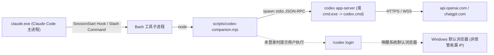

<!--
[INPUT]: Claude Code 官方网络配置文档、openai/codex-plugin-cc 源码、anthropic-experimental/sandbox-runtime 源码、Koushik890/jev-firewall 源码、disler/claude-code-hooks-mastery 源码、anthropics/claude-code Issues (#71177/#11660/#15212/#39862)、Claude-Local v0.2.6 源码审计。
[OUTPUT]: 浏览器调用向量（B1–B4）、子进程与网络漏流向量（N1–N5）、“Claude 调 Codex 封号”三层归因、开源参考实现对比、Claude-Local v0.2.6 真实缺口（G1–G6）。
[POS]: 调研发现与技术证据文档；支撑 02-OPTIMIZATION-PLAN.md。
[PROTOCOL]: 严格基于源码证据与官方文档，区分已验证事实、工程机制与社区传言。
-->
# 调研发现：Claude Code CLI 浏览器调用、子进程派生（含 Codex）与 IP 泄露全链路分析

## 一、 Claude Code CLI 日常使用中调用浏览器的 4 条真实路径（Vectors B1–B4）

在日常使用 `claude.exe`（Claude Code CLI）时，**普通的问答、文件读写（`Read`/`Edit`/`Write`/`Grep`/`Glob`）不会主动打开浏览器**。但在以下 4 类场景中，Claude Code 或其派生的工具会直接拉起浏览器进程：

### 1. Vector B1：OAuth 登录、重授权与订阅升级（`/login`、`/upgrade`、Token 失效重定向）
- **触发机制**：
  - 当用户执行 `claude login`、会话内输入 `/login`、`/upgrade`，或本地 `~/.claude/.credentials.json` 中的 OAuth `refresh_token` 失效需要重新授权时，Claude Code 会在本地开启 `127.0.0.1:<random_port>/callback` 回调监听，并调用系统 URL 处理器（Windows 下为 `cmd /c start "" "<url>"` 或 `rundll32 url.dll,FileProtocolHandler`）打开授权链接。
  - 根据 Claude Code 官方网络文档（`https://code.claude.com/docs/en/network-config`），登录与授权涉及的入口域名包括：
    - `claude.com`（初始登录跳转入口）
    - `claude.ai`（`https://claude.ai/oauth/authorize` 个人 Pro/Max 授权页）
    - `sso.claude.com`（SSO 重定向）
    - `platform.claude.com` / `console.anthropic.com`（Console / API 授权与账单页）
- **IP 与环境泄露风险**：
  1. **系统默认浏览器分流/WebRTC 泄露**：大多数用户不会把指纹伴侣浏览器（`Claude-Local-Browser`）设为 Windows 全局默认浏览器（否则日常微信/邮件点链接全会进隔离开槽）。此时若未设置 `BROWSER` 环境变量，Windows 会直接用日常 Edge/Chrome 打开 `claude.com` / `claude.ai`。日常浏览器往往没挂 `--proxy-server=socks5://127.0.0.1:7899`，也未锁死 WebRTC（`default_public_and_private_interfaces`），瞬间把本地局域网/公网 IP 或日常机场节点暴露给 Anthropic 认证页。
  2. **伴侣浏览器 OAuth 路由守卫过窄导致“串槽”风险**：即便用户把 `Claude-Local-Browser` 设为系统默认浏览器，当前 `src-tauri/src/browser/oauth_route.rs` 第 28–35 行的 `is_claude_oauth_authorize_url()` **仅匹配 `host == "claude.ai"` 且 `path == "/oauth/authorize"`**。如果 CLI 先打开的是 `https://claude.com/...` 重定向入口或 `https://platform.claude.com/...`，`resolve_browser_launch()` 会将其判定为普通网页，直接投递到 `cfg.active`（当前最后激活的槽位）——如果用户此时正打开着一张 **Free 养号卡槽位**，CLI 的主账号授权就会落进养号卡的指纹与 Cookie 容器中，造成严重的双号同容器关联！

### 2. Vector B2：`Claude in Chrome` 浏览器桥接（`--chrome` / `/chrome`）
- **触发机制**：
  - Claude Code 内置了连接桌面 Chrome 扩展的功能（启动参数 `--chrome` 或命令 `/chrome`），通过 WebSocket 连接官方中继 `bridge.claudeusercontent.com` 控制浏览器标签页。
- **IP 与环境泄露风险**：
  - 官方网络配置文档明确警告：*“Allowlist `bridge.claudeusercontent.com` if you enforce IP-based restrictions, because traffic routes through this bridge service.”*
  - 如果 `claude.exe` 在终端走静态住宅 IP（如美国 ISP），而受控的日常 Chrome 走的是直连或香港/日本普通节点，Anthropic 服务端在 `bridge.claudeusercontent.com` 两端同时看到同一个账号会话挂着两个不同国家/ASN 的 IP，属于典型的高危异地并发特征。

### 3. Vector B3：浏览器自动化 MCP Server（Playwright / Puppeteer / Chrome DevTools MCP）
- **触发机制**：
  - 用户在 `~/.claude.json` 或项目 `.mcp.json` 中配置了 `@playwright/mcp`、`@modelcontextprotocol/server-puppeteer` 或 `chrome-devtools-mcp`。当 Claude Code 遇到需要验证前端 UI 或查网页的任务时，会自动通过 MCP 派生独立的 Chromium/Chrome 实例。
- **IP 与环境泄露风险**：
  - 这类由 `npx` / `node.exe` 拉起的無头或有头浏览器**完全脱离 `Claude-Local-Browser` 的管理**，不带 `--fingerprint={seed}`，默认不带 `--proxy-server=socks5://127.0.0.1:7899`，且默认开启 WebRTC UDP 探测。一旦 Claude 用该 MCP 访问了包含 Cloudflare / Google Analytics / Sentry 或与 Anthropic 相关的站点，且 Mihomo 未开启 `strict-route: true` 全局兜底，就会发生 WebRTC 或直连漏流。

### 4. Vector B4：Claude Code 在 Bash 工具中调用外部 CLI 时被子进程拉起浏览器
- **触发机制**：
  - 日常开发中，Claude Code 在执行 `Bash` 工具时经常调用第三方 CLI（例如 `codex`、`gh`、`wrangler`、`vercel`、`supabase`、`firebase`、`npm run dev -- --open`）。
  - 一旦遇到未认证状态或需要 OAuth 授权（例如 `codex login`、`gh auth login`、`wrangler login`），这些子进程会调用各自语言的 `open` / `webbrowser` 库唤醒 Windows 默认浏览器。

---

## 二、 “Claude 调用 Codex 导致封号”的 X 社区舆情三层真相拆解

针对 X（Twitter）和 Reddit（`r/ClaudeAI`、`r/ClaudeCode`）上流传的“在 Claude Code 里调用 Codex 后账号被封”，我们结合官方声明、GitHub Issue 记录以及本地克隆的 `openai/codex-plugin-cc` 源码进行了交叉核验，将其拆解为三层真相：

| 归因层级 | 具体技术场景 | 触发封号的真实底层机制 | 风险定级 |
|---|---|---|---|
| **第一层：高危违规/网关转接**<br>（X 上 80% 以上封号帖子的真实操作） | 使用 `claude-code-proxy-codex`、`claude-code-router` (`CCR`)、`LiteLLM` 篡改 `ANTHROPIC_BASE_URL` 将 Claude Code 流量劫持转发给 Codex/OpenAI；或把 Claude Pro/Max 的 `.credentials.json` OAuth Token 提取给 OpenCode / Cursor / 第三方网关使用 | 1. **OAuth 订阅凭据脱壳滥用**：Anthropic 自动化风控分类器（Automated Risk Classifier）严格校验客户端 TLS 指纹、User-Agent、系统遥测头与 `x-anthropic-billing-header`（第三方网关常注入 `cc_gateway` 标记）。<br>2. **`WebFetch` 残余直连背刺**：根据 Claude Code 官方文档，即便设置了代理转发，Claude Code 内置的 `WebFetch` 域名安全检查与快速模式检查**依然硬编码直连 `api.anthropic.com`**，导致非官方网关改造后的异常会话元数据直接上报回 Anthropic 官方。 | **极高危（必封红线）** |
| **第二层：官方插件/CLI 协同下的网络割裂**<br>（正常使用 `openai/codex-plugin-cc` 或 Bash 调 `codex`） | 在 Claude Code 中安装官方 `openai/codex-plugin-cc`（`/codex:review`、`/codex:adversarial-review`、`/codex:rescue`）或让 Claude 通过 Bash 调用 `codex exec` | Anthropic Claude Code 负责人 Boris Cherny 已公开确认：**使用官方 Claude Code 通过子进程/插件调用 Codex 本身完全合规，绝不会因此封号**。但用户在实际操作中常踩中以下**网络层连带雷区**：<br>1. **按进程名分流失效**：部分教程教用户在 Clash 中配 `PROCESS-NAME,claude.exe,Static-Residential`。当 Claude 调用 `node codex-companion.mjs` -> `codex.exe`（或 `curl.exe`/`git.exe`）时，子进程名不再是 `claude.exe`，导致流量掉入普通机场节点或 `DIRECT`。<br>2. **为迁就 Codex 切节点导致 Claude 漂移**：Codex (`chatgpt.com/backend-api/codex`) 对部分静态住宅 IP 段风控不同，用户在运行 `claude.exe` 期间手动在 Clash 切换节点或开关 TUN 去登 Codex，直接导致正在长连接的 `claude.exe` 发生**同会话出口国家/ASN 跳变**或 TUN 重载瞬态直连泄露！ | **中高危（网络配置不当引发误伤）** |
| **第三层：多 Agent 并发脉冲**<br>（Subagent + Background Job 叠加） | 同时开启多个 Claude Code 子代理（Subagents）与后台任务（Background Jobs）高频轮询 | `codex-plugin-cc` 的 `task-worker` 支持 `--background` 后台运行，Claude 侧若频繁轮询状态并在短时间内打满 5 小时窗口额度，叠加代理不稳定重连，容易触发反自动化脉冲阈值。 | **中危（需控制并发节奏）** |

---

## 三、 本地克隆的 4 个开源项目源码级深度拆解

### 1. `openai/codex-plugin-cc`（OpenAI 官方 Claude Code 协同插件）

我们对 `.local/research/cli-subprocess-isolation-20261103/codex-plugin-cc` 进行了完整源码审计，理清了它在 Claude Code 内部的全部执行链路：



- **核心源码发现 1（子进程派生方式）**：
  - 在 `plugins/codex/scripts/lib/process.mjs`（第 34–54 行）与 `plugins/codex/scripts/lib/app-server.mjs`（第 95–103 行）中，插件通过 Node.js `spawn("codex", args, { env: process.env, windowsHide: true })` 启动 `codex` 二进制；若在 Windows 下遇到 `EINVAL`（如 `.cmd` 包装脚本），会自动回退为 `{ shell: true }`（即派生 `cmd.exe /d /s /c codex ...`）。
  - **结论**：`codex-companion.mjs` 完整保留并透传了父进程 `claude.exe` 的 `process.env`。因此，只要父进程环境变量或 Mihomo 端口/域名规则配置正确，`node.exe` 与 `codex.exe` 就能继承代理；反之，若仅靠 `PROCESS-NAME,claude.exe` 分流，或者父进程依靠 `~/.claude/settings.json` 内部滞后注入，子进程网络就会与主进程脱节。
- **核心源码发现 2（浏览器唤醒风险点）**：
  - 在 `plugins/codex/commands/setup.md` 与 `codex-companion.mjs` 的 `handleSetup()` 中，当检测到 `auth.status === "missing"` 时，插件会引导用户在 Claude Code 输入框内执行 `!codex login`。
  - `!codex login` 会在 Claude Code 内部直接启动 `codex login` 子进程并调用系统默认浏览器打开 `https://auth.openai.com/...`。若此时默认浏览器与代理出口未对齐，便会产生跨环境暴露。
- **核心源码发现 3（Claude 会话记录读取）**：
  - `plugins/codex/scripts/lib/claude-session-transfer.mjs` 会只读扫描 `CLAUDE_CONFIG_DIR`（默认 `~/.claude/projects/`）下的 `.jsonl` 会话转录文件以提取上下文传给 Codex，**不修改 `.claude.json` 或凭据文件**。

### 2. `anthropic-experimental/sandbox-runtime`（Anthropic 官方沙箱运行时 `srt`）

我们审计了 `.local/research/cli-subprocess-isolation-20261103/sandbox-runtime/src/sandbox/sandbox-utils.ts`（第 818–892 行）中 Anthropic 官方工程师为 Claude Code 子进程设计的 `generateProxyEnvVars()` 函数，发现了极具价值的工程经验：

- **官方源码注释揭示的 SOCKS5 环境变量陷阱（`sandbox-utils.ts:840-881`）**：
  1. **为什么不能在 CLI 环境变量里把 `ALL_PROXY` 或 `GRPC_PROXY` 设为 `socks5://`？**
     - Anthropic 源码明确注释：Python 的 `httpx` 库（被众多 AI/MCP 工具链依赖）在启动时会读取 `ALL_PROXY`。如果 `ALL_PROXY=socks5://127.0.0.1:7899`，而用户的 Python 环境未额外安装 `socksio` 包，`httpx` 会直接抛出 `ImportError: Using socks5 proxy requires socksio` 导致所有 Python 脚本/MCP 崩溃！
     - 更危险的是 **gRPC C-core 绕过漏洞**：gRPC 会优先读取 `GRPC_PROXY` -> `ALL_PROXY` -> `HTTPS_PROXY`。由于 gRPC 原生不支持 `socks5h://` 协议，一旦读到 `ALL_PROXY=socks5h://...`，gRPC 会打出报错并**静默回退为本地直连 DNS 解析（绕过代理解析目标域名）**，造成严重的 DNS 泄露！
  2. **Anthropic 官方解法**：
     - 对 CLI 及其所有子进程，`HTTP_PROXY`、`HTTPS_PROXY`、`ALL_PROXY`、`GRPC_PROXY` **全部统一设置为 `http://127.0.0.1:<port>`**（在 `Claude-Local` 中即 Mihomo 的 `mixed` 混合监听端口 `http://127.0.0.1:7899`），唯有需要 SSH 走 SOCKS 的 `GIT_SSH_COMMAND` 单独指定 SOCKS5。
     - 完整设置大写与小写双份变量（`HTTP_PROXY`/`http_proxy`、`HTTPS_PROXY`/`https_proxy`、`ALL_PROXY`/`all_proxy`、`GRPC_PROXY`/`grpc_proxy`、`NO_PROXY`/`no_proxy`），确保 curl、Node.js、Python、Go、Rust (`reqwest`)、Git 全部收敛到同一本地代理端口。

### 3. `Koushik890/jev-firewall` 与 `disler/claude-code-hooks-mastery`（Claude Code `PreToolUse` 防火墙 Hook）

我们审计了 `jev-firewall/src/claude-adapter.ts` 与 `claude-code-hooks-mastery/.claude/hooks/pre_tool_use.py`：
- Claude Code 在执行任何工具（如 `Bash`、`WebFetch`、`mcp__*`）之前，都会将 `{ tool_name, tool_input, session_id, cwd }` 通过 `stdin` 传给 `~/.claude/settings.json` 中注册的 `PreToolUse` Hook。
- 当 Hook 返回 `{"hookSpecificOutput": {"hookEventName": "PreToolUse", "permissionDecision": "deny", "permissionDecisionReason": "..."}}`（或退出码 `2`）时，Claude Code 会在工具真正执行前将其安全拦截，并将原因反馈给模型或用户。
- **可直接借鉴于防 IP 泄露**：我们可以提供一个零依赖的轻量级 `PreToolUse` 守卫脚本模板，专门拦截：
  1. 在 `Bash` 中调用未受管浏览器（如 `start http`、`explorer http`、`cmd /c start`、`msedge`、`chrome`、`rundll32 url.dll,FileProtocolHandler`、`codex login`、`gh auth login`）；
  2. 在 `Bash` 中执行显式绕过代理的直连探测命令（如 `curl --noproxy "*"`）。

---

## 四、 Claude Code CLI 自身的 5 条子进程与网络漏流向量（Vectors N1–N5）

结合 `anthropics/claude-code` 官方仓库 Issue 记录与官方文档，我们确认了以下 5 条网络层漏流路径：

| 编号 | 漏流向量 | 触发机制与官方证据 | 影响范围 |
|---|---|---|---|
| **Vector N1** | **`~/.claude/settings.json` `env.HTTPS_PROXY` 启动期竞态直连漏洞** | **证据**：`anthropics/claude-code` Issues `#71177`、`#11660`、`#15212`、`#39862`。<br>**机制**：当用户仅在 `~/.claude/settings.json` 的 `"env": { "HTTPS_PROXY": "..." }` 中配置代理，而未在启动 `claude.exe` 前的操作系统/终端环境变量中导出 `HTTPS_PROXY` 时，Claude Code 进程启动最早期的预检请求（如 `/api/claude_code/policy_limits`、OAuth 令牌预刷新、早期遥测连接）会在 `configureGlobalAgents()` 读取完 `settings.json` 并初始化代理池之前发出，导致**进程启动头几百毫秒内的请求以宿主机直连（或系统默认路由）裸奔发出**！ | 若用户 Mihomo 未开启 TUN `strict-route: true` + 完整域名规则，仅靠 `settings.json` 的 `HTTPS_PROXY` 会在每次启动 CLI 时漏出真实 IP。 |
| **Vector N2** | **Claude Code 官方遥测与桥接域名缺失（`datadoghq.com` 等）** | **证据**：Claude Code 官方文档 `https://code.claude.com/docs/en/network-config`。<br>**机制**：官方文档明确列出 Claude Code 直连 Anthropic API 时会请求：<br>- `http-intake.logs.us5.datadoghq.com`（Operational telemetry & error reporting）<br>- `browser-intake-us5-datadoghq.com`（Telemetry ingestion）<br>- `mcp-proxy.anthropic.com`（claude.ai MCP servers proxy）<br>- `sso.claude.com`（SSO redirect）<br>- `assets-proxy.anthropic.com`（Static assets）<br>- `bridge.claudeusercontent.com`（Claude in Chrome / Remote Control） | 若 Mihomo 分流规则未将 `datadoghq.com` 等锁定到 `Static-Residential`，会出现 `api.anthropic.com` 走美国静态住宅 IP，而毫秒级同步发出的 Datadog 遥测日志（携带相同的设备/会话标识）却从中国大陆 `DIRECT` 或香港机场节点发出的严重反差！ |
| **Vector N3** | **SOCKS5 环境变量导致 Python / gRPC 子进程回退直连 DNS** | **证据**：`anthropic-experimental/sandbox-runtime` (`src/sandbox/sandbox-utils.ts:840-881`)。<br>**机制**：若用户在终端设置了 `ALL_PROXY=socks5://127.0.0.1:7899`，gRPC C-core 因不支持 `socks5` 方案会回退到本地直连 DNS 解析，Python `httpx` 会因缺少 `socksio` 报错。 | CLI 调用的 Python 脚本、gRPC 扩展或 MCP Server 发生 DNS 泄露或运行报错。 |
| **Vector N4** | **按进程名分流（`PROCESS-NAME,claude.exe`）遗漏派生子进程树** | **机制**：`claude.exe` 通过 `Bash` 或 MCP 派生的子进程为 `pwsh.exe`、`cmd.exe`、`node.exe`、`python.exe`、`git-remote-https.exe`、`curl.exe`、`codex.exe`。在 Windows 下，仅匹配 `PROCESS-NAME,claude.exe` 无法匹配其子进程。 | 子进程访问 GitHub、npm、OpenAI/Codex 或执行 `curl` 时绕过静态住宅出口。 |
| **Vector N5** | **协同调用 Codex / OpenAI 时的跨出口与 DNS 割裂** | **机制**：当用户在 Claude Code 中通过 `openai/codex-plugin-cc` 或命令行调用 `codex` 时，流量发往 `openai.com`、`chatgpt.com`、`oaistatic.com`、`oaiusercontent.com`、`auth0.com`。 | 若这些域名未纳入同一防漏代理组或落入国内 DNS 解析，会导致同一开发会话中双 AI 工具频繁触发 Cloudflare 验证甚至引发用户手动切节点误伤 Claude。 |

---

## 五、 Claude-Local v0.2.6 源码审计：已具备的防护与 6 项真实缺口（G1–G6）

我们对 `Claude-Local v0.2.6` 的相关模块进行了逐行核对：

### 1. 现有已落地的强力防护（必须完整保留）
- **伴侣浏览器指纹与 WebRTC 锁死**：`src-tauri/src/browser/windows.rs:248-277` 与 `src-tauri/src/identities/profile.rs:146-181` 已强制注入 `--fingerprint={seed}`、`--proxy-server=socks5://127.0.0.1:7899`、`--host-resolver-rules="MAP * ~NOTFOUND, EXCLUDE 127.0.0.1"`、`--force-webrtc-ip-handling-policy=disable_non_proxied_udp` 以及 Chromium `Preferences` 中的 3 项 WebRTC 锁死键。
- **按需激活的伴侣浏览器断线保护（Kill-Switch）**：`src-tauri/src/browser/kill_switch.rs` 在受管浏览器打开期间每 15 秒探测 TUN 与出口国家，确认掉线或国家漂移时自动关闭受管浏览器窗口并亮红托盘图标。
- **绝不读取 `claude.exe` 进程内存**：`src-tauri/src/identities/browser_link.rs:212-238` 仅使用 `PROCESS_QUERY_LIMITED_INFORMATION` 检测进程存活，零 `PROCESS_VM_READ`。

### 2. 经源码定位确认的 6 项真实缺口（G1–G6）

#### 缺口 G1（高危）：Mihomo 防漏规则缺失 Claude Code 官方遥测域名 `datadoghq.com` 与 MCP/SSO 域名
- **代码位置**：
  - `src/risk-model.ts` 第 619–629 行（`buildDesktopDnsFixPrompt`）与第 691–714 行（`buildDesktopMihomoAntiLeakYaml`）
  - `src/vps.tsx` 第 45–63 行（`buildAiProxyPrompt`）
  - `src-tauri/src/risk_check.rs` 第 207–215 行（`inspect_mihomo_config` 检查规则特征）
- **现状问题**：
  - 当前 `buildDesktopMihomoAntiLeakYaml()` 只收录了 `anthropic.com`、`claude.ai`、`claude.com`、`claudeusercontent.com`、`withpersona.com`、`persona.org`、`stripe.com`、`stripe.network`、`hcaptcha.com`、`turnstile.com`、`challenges.cloudflare.com`、`sentry.io`、`statsig.com`、`statsigapi.net`、`featuregates.org`、`intercom.io`、`intercomcdn.com`。
  - **完全遗漏了 Claude Code 官方文档点名的 `datadoghq.com`**（`http-intake.logs.us5.datadoghq.com`、`browser-intake-us5-datadoghq.com`）。当 `claude.exe` 运行时，`api.anthropic.com` 走 `Static-Residential`，而 Datadog 遥测日志因不在规则列表中，直接掉入用户的普通节点或 `DIRECT`！
  - 同时尚未提供面向“Claude + Codex 双修用户”的 OpenAI/Codex 协同域名规则注释/开关（`openai.com`、`chatgpt.com`、`oaistatic.com`、`oaiusercontent.com`、`auth0.com`）。

#### 缺口 G2（高危）：`src/browser.tsx:213` 的 CLI 代理比对存在“空值漏报”与“点击同步降级覆盖浏览器 `socks5://`”两个 Bug
- **代码位置**：
  - `src/browser.tsx` 第 213–231 行：
    ```tsx
    {state?.identity?.cli_proxy && (draft?.proxy || '').trim() !== state.identity.cli_proxy.trim() && (
      <div className="mb-3 flex flex-wrap items-center justify-between gap-2 rounded-lg border border-amber-500/35 bg-amber-500/10 px-3 py-2 text-[11px] text-amber-800 dark:text-amber-300">
        <span>{tr('警告：当前伴侣浏览器代理与 CLI 代理不一致...', ...)}: CLI = <code className="font-mono">{state.identity.cli_proxy}</code></span>
        <Button size="sm" variant="secondary" className="h-6 px-2 text-[11px]" onClick={() => edit('proxy', state?.identity?.cli_proxy || '')}>
          {tr('同步 CLI 代理', 'Sync CLI Proxy')}
        </Button>
      </div>
    )}
    ```
  - `src-tauri/src/risk_check.rs` 第 257–288 行（`read_cli_proxy_env`）
- **现状问题**：
  1. **Bug 1（CLI 未配代理时完全静默不报警）**：当用户的 `~/.claude/settings.json` 中**没有配置** `HTTPS_PROXY`（此时 `state.identity.cli_proxy` 为 `null`），而伴侣浏览器配了 `socks5://127.0.0.1:7899` 时，由于前置条件 `state?.identity?.cli_proxy && ...` 为假，UI **完全不显示任何警告**！用户误以为两边已经对齐，实则 CLI 根本没配显式代理。
  2. **Bug 2（`http://127.0.0.1:7899` 与 `socks5://127.0.0.1:7899` 误报不一致，且点“同步 CLI 代理”会破坏浏览器的 SOCKS5 远程 DNS 锁）**：
     - 根据 `src/vps.tsx:48-49` 的官方设计，Mihomo 在 `127.0.0.1:7899` 开启的是 `mixed`（HTTP + SOCKS5 双协议混合监听端口）：
       - **伴侣浏览器必须用 `socks5://127.0.0.1:7899`**（配合 `--host-resolver-rules="MAP * ~NOTFOUND, EXCLUDE 127.0.0.1"` 强制远程 DNS 解析）；
       - **Claude Code CLI 必须用 `http://127.0.0.1:7899`**（因为 `claude.exe` 及 gRPC/httpx 子进程不支持或会因 `socks5://` 崩溃/回退直连 DNS）。
     - 然而 `src/browser.tsx:213` 用的是纯字符串相等 `(draft?.proxy || '').trim() !== state.identity.cli_proxy.trim()`！当用户按标准配置了浏览器 `socks5://127.0.0.1:7899` 和 CLI `http://127.0.0.1:7899` 时，UI 反而弹出黄条报错“不一致”；更糟糕的是，一旦用户点击【同步 CLI 代理】按钮，浏览器的 `draft.proxy` 就会被改写成 `http://127.0.0.1:7899`，导致下方的 `!(draft?.proxy || '').trim().toLowerCase().startsWith('socks5')` 立即报警！

#### 缺口 G3（中危）：`src-tauri/src/browser/oauth_route.rs:28-35` 的 OAuth URL 识别范围过窄
- **代码位置**：`src-tauri/src/browser/oauth_route.rs` 第 28–35 行：
  ```rust
  pub fn is_claude_oauth_authorize_url(raw: &str) -> bool {
      let Ok(parsed) = reqwest::Url::parse(raw.trim()) else {
          return false;
      };
      parsed.scheme().eq_ignore_ascii_case("https")
          && parsed.host_str().map(|host| host.eq_ignore_ascii_case("claude.ai")).unwrap_or(false)
          && parsed.path() == "/oauth/authorize"
  }
  ```
- **现状问题**：
  - 当 `Claude-Local-Browser` 被作为外部链接处理器调用时，只有精确匹配 `https://claude.ai/oauth/authorize` 才会路由到 CLI 当前绑定的正式卡槽位（或拒绝落入未绑定的活跃槽位）。
  - 若 Claude Code CLI 打开的是 `https://claude.com/login...`、`https://sso.claude.com/...`、`https://platform.claude.com/oauth/...`、`https://console.anthropic.com/oauth/...` 或 `/upgrade` 跳转页，`is_claude_oauth_authorize_url()` 返回 `false`，导致链接被当成普通 URL 直接塞进 `cfg.active`（若当前 `cfg.active` 是 Free 养号卡槽位，就会直接串入养号卡容器！）。

#### 缺口 G4（中危）：缺少针对 Claude Code Issue #71177 启动竞态与官方遥测收敛的一键配置引导
- **现状问题**：
  - 许多用户只知道在 `~/.claude/settings.json` 里写 `"HTTPS_PROXY": "http://127.0.0.1:7899"`，不知道：
    1. 需要同时设置系统/终端级环境变量（或确保 Mihomo TUN `strict-route: true` + `datadoghq.com` 规则在底层兜底）以防御 Issue #71177 启动前几百毫秒的直连请求；
    2. 需要在 `settings.json` 的 `env` 中同时配齐 `HTTP_PROXY`、`HTTPS_PROXY`、`ALL_PROXY`、`GRPC_PROXY`（全为 `http://127.0.0.1:7899`）以及 `CLAUDE_CODE_DISABLE_NONESSENTIAL_TRAFFIC=1`、`DISABLE_TELEMETRY=1`、`DISABLE_ERROR_REPORTING=1`，从源头掐断非必要的后台遥测与错误上报请求。

#### 缺口 G5（低中危）：缺少针对 Claude Code 意外唤醒系统默认浏览器的 `BROWSER` 变量收口与 `PreToolUse` 守卫模板
- **现状问题**：
  - 当 Claude Code 或其子进程（如 `codex login`、`gh auth login`）尝试打开浏览器时，若用户未将 `Claude-Local-Browser` 设为系统默认浏览器（很常见），也未配置 `BROWSER` 环境变量或 `PreToolUse` 拦截，就会直接弹出未受管的系统默认浏览器。

#### 缺口 G6（体验增强）：伴侣浏览器 Kill-Switch 触发时，若后台有 `claude.exe` 正在运行，浮窗 HUD 缺少显著的联动暂停提示
- **代码位置**：`src-tauri/src/browser/kill_switch.rs` 与 `src/monitor-hud.tsx`
- **现状问题**：
  - 严守 `AGENTS.md` “绝不中断运行中的 `claude.exe`” 铁律，Kill-Switch 绝不能杀 `claude.exe`。但当伴侣浏览器处于打开状态且 Kill-Switch 检测到 TUN 掉线或出口国家漂移时，虽然关闭了浏览器并把系统托盘变红，但如果用户正盯着终端准备敲回车发下一条 Claude Code 指令，在 `monitor-hud.tsx` 浮窗上同步展示一条醒目的红色横幅（“检测到代理异常/出口漂移，已关闭伴侣浏览器，请暂停在 CLI 终端发送消息直至网络恢复”）能进一步帮用户避免在掉线瞬间发送 CLI 请求。
